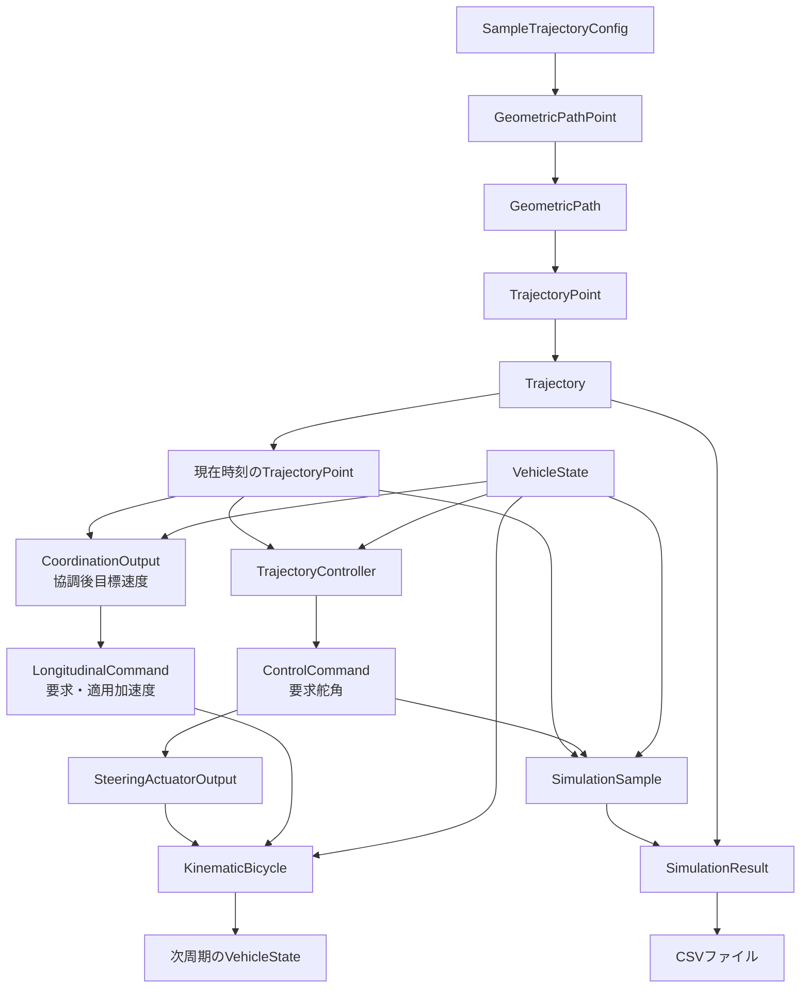
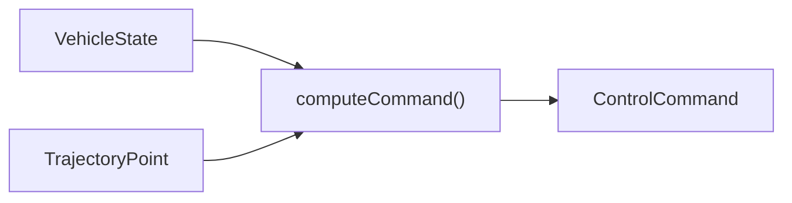

# データフロー

## 1. この文書の目的

モジュール間でどの構造体が生成され、どこへ渡り、最終的に何として保存されるかを説明します。型の定義は主に `include/core` と `include/simulation` にあります。

## 2. データ変換の全体像



## 3. `GeometricPathPoint`：幾何学的な経路点

定義場所は `include/core/types.hpp` です。

| フィールド | 意味 | 単位 |
|---|---|---|
| `s` | 経路始点からの累積距離 | m |
| `x`, `y` | 世界座標上の位置 | m |
| `yaw` | 経路接線の方位角 | rad |
| `curvature` | 符号付き経路曲率 | 1/m |

生成元は `PathGenerator` です。複数点を `std::vector` に格納した型を `GeometricPath` と呼びます。

```text
PathGenerator
    ↓ 直線・円弧を離散化
GeometricPath = vector<GeometricPathPoint>
```

## 4. `TrajectoryPoint`：時刻付きの目標軌道点

`GeometricPathPoint` の情報に、次のフィールドを追加した型です。

| 追加フィールド | 意味 | 単位 |
|---|---|---|
| `time` | 軌道開始からの時刻 | s |
| `velocity` | 符号付き前後方向速度 | m/s |
| `acceleration` | 符号付き前後方向加速度 | m/s² |

`createVelocityProfile()` が `GeometricPath` を受け取り、`Trajectory` を返します。

```text
GeometricPath
    ↓ 速度・加速度・時刻を付与
Trajectory = vector<TrajectoryPoint>
```

`Trajectory` は次の場所で使用されます。

- `TrajectorySampler`：現在時刻の参照点を取得
- `SimulationResult`：入力した参照軌道を保持
- `csv_writer.cpp`：`reference_trajectory.csv` へ保存

## 5. `VehicleState`：現在の車両状態

| フィールド | 意味 | 単位 |
|---|---|---|
| `x`, `y` | 後輪車軸中心の世界座標 | m |
| `yaw` | 車両方位角 | rad |
| `velocity` | 符号付き実車速。前進正、後退負 | m/s |

初期状態は `ParkingSimulationConfig::initial_state` から取得します。未指定なら軌道先頭の位置・方位を使います。

`VehicleState` は次の二つの役割で使用されます。

1. 制御器が現在状態を知るための入力
2. 車両モデルが次周期の状態を計算するための現在値

## 6. `ControlCommand`：制御器の出力

定義場所は `include/core/control_types.hpp` です。

| フィールド | 意味 | 単位 |
|---|---|---|
| `target_velocity` | 目標前後方向速度 | m/s |
| `target_steering` | 目標前輪舵角 | rad |



フィードフォワード制御器は車両状態を補正計算に使いません。方位誤差フィードバック制御器は現在方位と参照方位を使用します。横偏差フィードバック制御器はさらに現在位置と参照位置を使い、符号付き横偏差を計算します。

## 7. 縦制御・協調の入出力

| 型 | 主な入力・出力 | 生成元 |
|---|---|---|
| `CoordinationInput` | 参照速度、曲率、横偏差、方位誤差、操舵制約 | `runParkingScenario()` |
| `CoordinationOutput` | 協調後目標速度と各速度上限 | `LongitudinalLateralCoordinator` |
| `LongitudinalControllerInput` | 目標速度、実車速、残距離、周期 | `runParkingScenario()` |
| `LongitudinalCommand` | 速度誤差、要求・適用加速度、ジャーク、停止判定 | `VelocityStopController` |

これらは`include/core/longitudinal_types.hpp`で定義し、横制御の`ControlCommand`と分離しています。

## 8. `SimulationSample`：1周期分の記録

定義場所は `include/simulation/simulation_result.hpp` です。

| データ | 内容 |
|---|---|
| `time` | 現在時刻 |
| `vehicle_state` | 更新前の現在車両状態 |
| `reference` | 同時刻の参照軌道点 |
| `command` | 同時刻に計算した制御指令 |
| `position_error` | 世界座標上の位置誤差の大きさ |
| `lateral_error` | 参照経路の左側を正とする横偏差 |
| `longitudinal_error` | 参照経路の前方を正とする縦偏差 |
| `yaw_error` | 参照方位－車両方位を正規化した値 |

一つの `SimulationSample` に同時刻の値をまとめることで、CSVの一行が一つの制御周期に対応します。

## 9. `SimulationResult`：1回分の全結果

| フィールド | 内容 |
|---|---|
| `reference_trajectory` | シミュレーションへ入力した目標軌道 |
| `samples` | 全制御周期の `SimulationSample` |
| `final_state` | シミュレーション終了時の車両状態 |

`runParkingSimulation()` の戻り値であり、計算処理と保存処理の境界になります。

```text
runParkingSimulation()
    ↓ SimulationResultを返す
main()
    ↓ 保存関数へ渡す
writeSimulationCsvFiles()
```

## 10. CSV列への対応

### 10.1 `reference_trajectory.csv`

主に `TrajectoryPoint` から出力します。

| CSV列 | 元データ |
|---|---|
| `time`, `s`, `x`, `y`, `yaw` | `TrajectoryPoint` の同名フィールド |
| `curvature`, `velocity`, `acceleration` | `TrajectoryPoint` の同名フィールド |
| `steering` | 曲率とホイールベースから保存時に計算 |

### 10.2 `vehicle_log.csv`

主に `SimulationSample` から出力します。

| CSV列のグループ | 元データ |
|---|---|
| `x`, `y`, `yaw` | `vehicle_state` |
| `velocity`, `steering` | `command` |
| `acceleration`, `curvature` | `reference` |
| `reference_x`, `reference_y`, `reference_yaw` | `reference` |
| 各誤差列 | `SimulationSample` の誤差フィールド |
| `actual_velocity` | `VehicleState::velocity` |
| `target_velocity`, `velocity_error` | `LongitudinalCommand` |
| `requested_acceleration`, `applied_acceleration`, `jerk` | `LongitudinalCommand` |
| `remaining_distance`, `stopping_velocity_limit` | `LongitudinalCommand` |
| 各協調速度上限 | `CoordinationOutput` |

## 11. データを追加するときの変更範囲

例として操舵角速度をログへ追加する場合、データは次の経路を通ります。

```text
計算処理
  ↓
SimulationSampleへフィールド追加
  ↓
parking_simulator.cppで値を設定
  ↓
csv_writer.cppで列名と値を出力
  ↓
plot_result.pyで列を読み描画
```

構造体へ追加するだけではCSVやグラフへ自動反映されないため、生成元から最終利用先まで一方向に追跡して変更します。

## 12. データフローを読む際の注意

- `GeometricPathPoint` と `TrajectoryPoint` を混同しないでください。
- `VehicleState` は実際にシミュレーションされた状態、`TrajectoryPoint` は目標値です。
- `ControlCommand` は制御器の出力であり、車両状態そのものではありません。
- 誤差の符号規約は[座標系と追従誤差](../fundamentals/coordinate_system.md)を参照してください。
