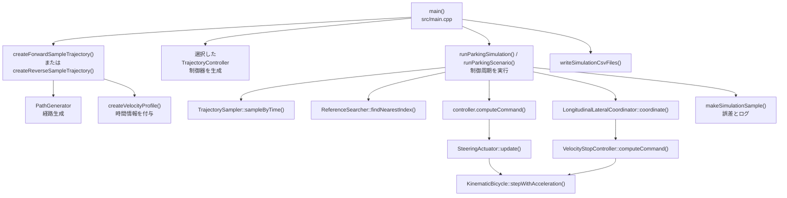
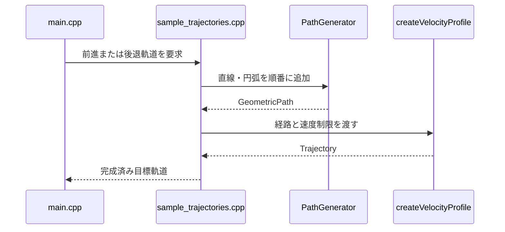
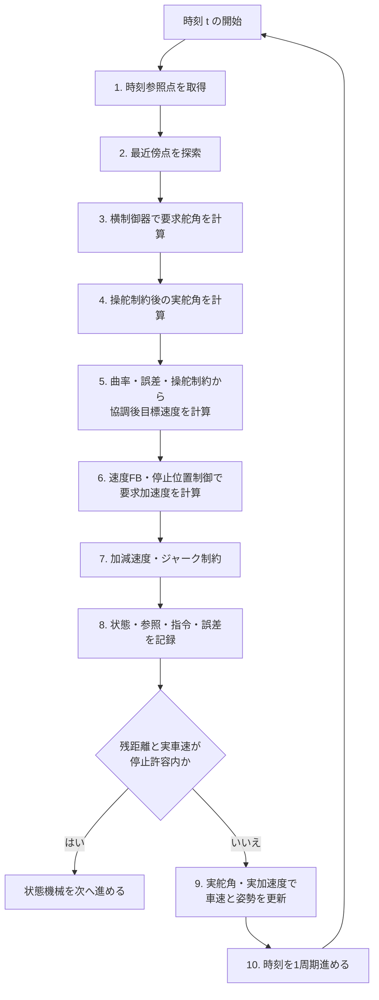
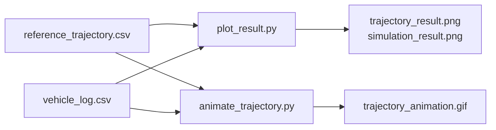

# ソースコードの処理フロー

## 1. この文書の目的

実行ファイルの開始からCSV出力までを、呼び出される関数と対応ファイルに沿って説明します。上から順番にソースを追うための読み方ガイドでもあります。

## 2. 最上位の呼び出し関係



## 3. 起動とシナリオ選択

開始地点は `src/main.cpp` の `main()` です。

1. 引数なしなら前進基準ケースを選びます。
2. `--reverse` なら後退確認ケースを選びます。
3. `--forward-lateral-offset` と `--reverse-lateral-offset` は横偏差実験を選びます。
4. `--forward-pose-offset` と `--reverse-pose-offset` は複合姿勢誤差実験を選びます。
5. 未知のオプションはエラーにします。
6. シナリオに対応する出力先を決めます。

```text
引数なし   → createForwardSampleTrajectory()
           → output/feedforward/forward

--reverse  → createReverseSampleTrajectory()
           → output/feedforward/reverse

--forward-lateral-offset / --reverse-lateral-offset
           → forwardまたはreverseの既存軌道
           → initial state = (0.0, 0.5, 0.0)

--forward-pose-offset / --reverse-pose-offset
           → forwardまたはreverseの既存軌道
           → initial state = (0.3, 0.5, 5 deg)
```

## 4. 目標軌道を準備する処理

対応ファイルは `src/trajectory/sample_trajectories.cpp` です。



処理は次の二段階です。

1. `PathGenerator` が位置、方位、曲率を持つ `GeometricPath` を生成します。
2. `createVelocityProfile()` が時刻、速度、加速度を付けて `Trajectory` を生成します。

この段階で制御器へ渡せる完成済みの軌道になります。

## 5. 制御器とシミュレーション条件の生成

`main()` は `--controller` の値に応じて `FeedforwardController`、`YawFeedbackController`、`LateralFeedbackController`、`PurePursuitController`、`StanleyController` のいずれかを生成します。また、`ParkingSimulationConfig` に次の条件を設定します。

- ホイールベース
- 制御・シミュレーション周期
- 任意の初期車両状態

初期状態が `std::nullopt` の場合、目標軌道の先頭位置・方位を初期車両状態として使用します。

## 6. シミュレーション開始時の準備

`src/simulation/parking_simulator.cpp` の `runParkingSimulation()` は、最初に入力を検証します。

1. 軌道が空でないことを確認します。
2. ホイールベースと周期が正であることを確認します。
3. `TrajectorySampler` を生成します。
4. `ReferenceSearcher` を生成します。
5. 初期状態を決めて `KinematicBicycle` を生成します。
6. 入力軌道を `SimulationResult` へ保存します。

## 7. 1制御周期の詳細

理想速度モードは軌道終端時刻まで、縦制御モードは残距離と実車速が停止条件を満たすまで繰り返します。



### 7.1 参照点を取得する

`TrajectorySampler::sampleByTime(time)` が、現在時刻を挟む二つの軌道点を検索します。位置、方位、速度などを線形補間して `TrajectoryPoint` を返します。

`ReferenceSearcher::findNearestIndex()` は現在位置に最も近い軌道点を探します。前周期の番号より前へ戻らないため、自己交差に近い経路でも参照点が不意に逆戻りしにくい構造です。Pure Pursuitは、その点から指定した注視距離だけ先の点も探索します。

### 7.2 制御指令を計算する

`TrajectoryController::computeCommand()` を呼び出し、実行時に選択した具体クラスへ同じインターフェースで処理を委譲します。

```cpp
const ControlCommand command =
    controller.computeCommand(ControllerInput{
        time, vehicle.state(), reference, trajectory, nearest_index});
```

フィードフォワード系は主に時刻参照点を使います。Pure Pursuitは軌道全体から注視点を選び、Stanleyは最近傍点を使います。LQRは横偏差・方位誤差の線形モデルからゲインを計算します。どの方式も結果を同じ `ControlCommand` へ格納します。

### 7.3 実舵角を計算する

`SteeringActuator::update()`が要求舵角へ最大舵角、最大操舵速度、一次遅れを適用します。理想設定では要求舵角がそのまま実舵角になります。車両モデルには常に実舵角を渡します。

### 7.4 縦横協調と縦制御

`LongitudinalLateralCoordinator::coordinate()`が曲率、横偏差、方位誤差、前周期の操舵制約状態を速度上限へ変換します。その後、`VelocityStopController::computeCommand()`が残距離による停止速度上限、速度P制御、加減速度・ジャーク制約を順番に適用します。

理論は[車速フィードバック](../controllers/longitudinal_velocity_control.md)、[加減速度・ジャーク制約](../controllers/longitudinal_constraints.md)、[停止位置制御](../controllers/stop_position_control.md)、[縦横協調](../controllers/longitudinal_lateral_coordination.md)を参照してください。

### 7.5 誤差とログを記録する

`makeSimulationSample()` が次を一つの `SimulationSample` にまとめます。

- 現在時刻
- 車両状態
- 参照軌道点
- 制御指令
- 位置誤差
- 符号付き横偏差
- 符号付き縦偏差
- 方位誤差

この記録は車両状態を更新する前に行うため、同じ時刻の参照値・指令値・車両状態が対応します。

### 7.6 車両状態を更新する

理想速度モードは`KinematicBicycle::step()`、縦制御モードは`stepWithAcceleration()`を使用します。

```cpp
vehicle.step(
    command.target_velocity,
    actuator_output.applied_steering,
    dt);
```

```cpp
vehicle.stepWithAcceleration(
    longitudinal_output.applied_acceleration,
    actuator_output.applied_steering,
    dt);
```

車両モデルは次周期の位置と方位を内部状態へ保存します。

### 7.7 次周期へ進む

通常は設定周期だけ時刻を進めます。最後の区間だけは終端時刻を越えないように $dt$ を短くします。

## 8. 結果を返す処理

制御ループ終了後、最終車両状態を `SimulationResult::final_state` へ保存し、結果全体を `main()` へ返します。この時点まではファイル出力を行いません。

## 9. CSVを保存する処理

`main()` が `writeSimulationCsvFiles()` を呼び出します。対応ファイルは `src/io/csv_writer.cpp` です。

```text
SimulationResult
├── reference_trajectory → reference_trajectory.csv
└── samples              → vehicle_log.csv
```

保存先ディレクトリが存在しない場合は、`output/<controller>/<scenario>` まで段階的に作成します。

## 10. Pythonによる可視化

C++実行後、PythonスクリプトはCSVを読み込みます。



Pythonは結果を読むだけであり、C++の制御計算や車両状態には影響しません。

## 11. ソースコードを読む推奨順序

1. `src/main.cpp`
2. `src/simulation/parking_simulator.cpp`
3. `include/controllers/trajectory_controller.hpp`
4. `src/controllers/feedforward_controller.cpp`
5. `src/models/kinematic_bicycle.cpp`
6. `src/trajectory/trajectory_sampler.cpp`
7. `src/trajectory/reference_searcher.cpp`
8. `src/controllers/pure_pursuit_controller.cpp` または `stanley_controller.cpp`
9. `src/trajectory/sample_trajectories.cpp`
10. `src/trajectory/path_generator.cpp`
11. `src/trajectory/velocity_profile.cpp`
12. `src/io/csv_writer.cpp`

制御ロジックを先に学びたい場合は1～8を先に読み、入力軌道の作り方は後から9～11で確認できます。
