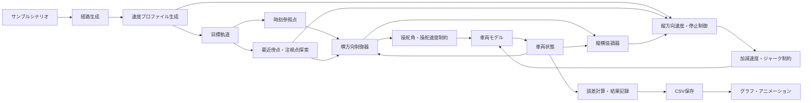

# プロジェクト全体像

## 1. この文書の目的

この文書は、プロジェクトを初めて読む人が「何を学ぶコードなのか」「主要な部品がどう連携するのか」「どこが制御ロジックの中心なのか」を把握するための地図です。個々の数式は `fundamentals`、具体的な実行方法は `guides` を参照してください。

## 2. プロジェクトの目的

このプロジェクトの中心的な学習対象は、完成済みの目標軌道を受け取った後の軌道追従制御です。

```text
目標軌道を受け取る
        ↓
現在時刻の参照点と車両位置の最近傍点を取得する
        ↓
現在状態と参照点から舵角・加速度を計算する
        ↓
制約後の舵角・加速度で車両運動を更新する
        ↓
追従誤差を記録して次の制御周期へ進む
```

目標経路生成と目標軌道生成も含まれますが、これらは制御器へ入力を用意する補助機能として、制御周期から分離されています。

## 3. システムを構成する部品



| 部品 | 主な責務 | 対応フォルダ |
|---|---|---|
| 共通データ型 | モジュール間で受け渡す構造体を定義 | `include/core` |
| 軌道 | 経路生成、速度付与、時刻による参照点取得 | `include/trajectory`, `src/trajectory` |
| 横方向制御器 | 車両状態と参照点から要求舵角を計算 | `include/controllers`, `src/controllers` |
| 縦方向制御器 | 目標速度・実車速・残距離から加速度を計算 | `include/controllers/longitudinal`, `src/controllers/longitudinal` |
| 縦横協調 | 曲率・追従誤差・操舵制約から速度上限を調整 | `include/coordination`, `src/coordination` |
| 車両モデル | 指令値から次の車両状態を計算 | `include/models`, `src/models` |
| シミュレーション | 制御周期、誤差計算、結果収集 | `include/simulation`, `src/simulation` |
| 入出力 | 計算結果をCSVへ保存 | `include/io`, `src/io` |
| 可視化 | CSVからPNGとGIFを生成 | `python` |

## 4. 制御周期の中心

単一軌道の理想速度ケースは`runParkingSimulation()`、前進・停止・後退と縦制御を含む基準ケースは`runParkingScenario()`が担当します。後者の1周期は次の順序です。

```cpp
nearest_index = searcher.findNearestIndex(vehicle.state(), nearest_index);
const ControlCommand lateral_command = controller.computeCommand(input);
const SteeringActuatorOutput steering =
    steering_actuator.update(lateral_command.target_steering, dt);
const CoordinationOutput coordinated = coordinator.coordinate(coordination_input);
const LongitudinalCommand longitudinal =
    longitudinal_controller.computeCommand(longitudinal_input);
vehicle.stepWithAcceleration(
    longitudinal.applied_acceleration, steering.applied_steering, dt);
```

横制御学習では`controller.computeCommand()`、縦制御では`VelocityStopController::computeCommand()`、両者の接続では`LongitudinalLateralCoordinator::coordinate()`が中心です。詳細は[ソースコードの処理フロー](processing_flow.md)を参照してください。

## 5. 経路と軌道の違い

| 用語 | 含む情報 | 主な型 |
|---|---|---|
| 目標経路 | 距離、位置、方位、曲率 | `GeometricPathPoint` |
| 目標軌道 | 経路情報に時刻、速度、加速度を追加 | `TrajectoryPoint` |

`PathGenerator` が目標経路を作り、`createVelocityProfile()` が時間情報を付けて目標軌道へ変換します。この分離により、同じ経路形状へ異なる速度計画を適用できます。

## 6. 現在の実装範囲

- 前進の基準軌道
- 後退専用の確認軌道
- 前進・後退の既存軌道へ横偏差または複合姿勢誤差を与える比較ケース
- 曲率フィードフォワード制御
- 前進・後退対応の方位誤差フィードバック制御
- 方位補正を含む横偏差フィードバック制御
- 注視点を追うPure Pursuit制御
- 最近傍点の方位誤差と横偏差を補正するStanley制御
- 線形誤差モデルに基づくLQR・積分器付きLQR制御
- 最大舵角、最大操舵速度、一次遅れを持つ操舵アクチュエータ
- 非線形キネマティック自転車モデル
- 初期車両状態の指定
- 位置、横、縦、方位誤差の記録
- CSV、グラフ、車両アニメーションの生成
- 前進・停止・後退の状態機械と実駐車形状
- 実車速状態と速度フィードバック
- 加減速度・ジャーク制約
- 残距離と実車速による停止位置制御
- 曲率・横偏差・方位誤差・操舵制約による縦横協調

舵角と加速度を同じ評価関数で解く縦横同時最適化は未実装です。次の拡張は横方向線形MPCです。

## 7. 次に読む文書

1. ファイルを探す場合は[フォルダ・ファイル構成](directory_structure.md)
2. 実行順序を追う場合は[ソースコードの処理フロー](processing_flow.md)
3. 構造体の受け渡しを知る場合は[データフロー](data_flow.md)
4. 数式を理解する場合は `docs/fundamentals`
5. 制御器を追加する場合は[制御器の追加方法](../guides/controller_development.md)
