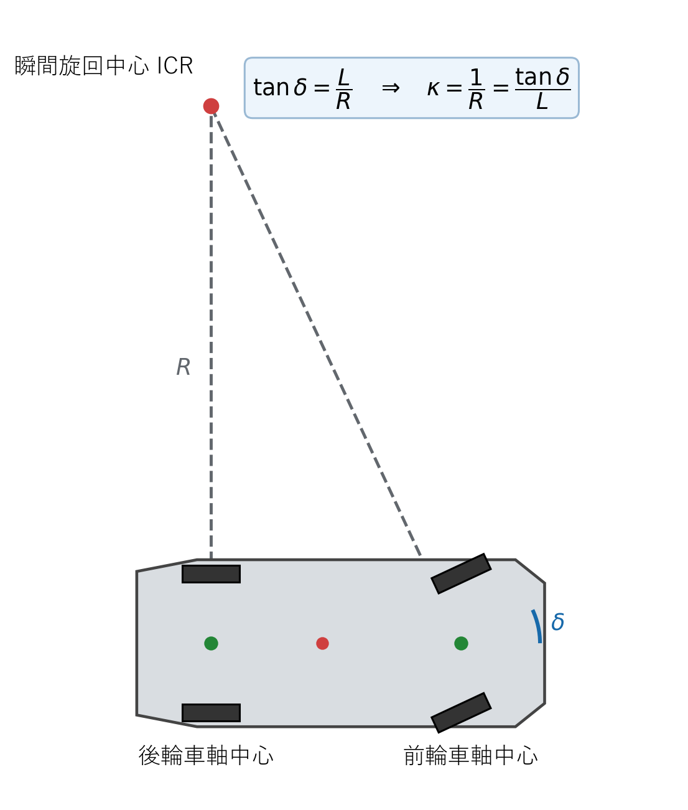

# 曲率フィードフォワード制御

## 1. この章の目的

目標軌道の曲率から前輪舵角を直接求める、現在の基準制御器を説明します。この制御器は追従誤差を見ないため、フィードフォワード制御です。

## 2. 入力と出力

| 種類 | 内容 |
|---|---|
| 入力 | 目標曲率 $\kappa_r$、目標速度 $v_r$、ホイールベース $L$ |
| 出力 | 目標舵角 $\delta_r$、速度指令 $v_{\mathrm{command}}$ |

**図1　フィードフォワード制御が使用する曲率と舵角の関係**

図1の$1/R$が目標曲率$\kappa_r$、前輪の角度が式 (3) の目標舵角$\delta_r$に対応します。

## 3. 目標舵角の導出

キネマティック自転車モデルでは、曲率と舵角の関係は式 (1) です。

**理論ID：`FF-EQ-01`**

**理論ID：`FF-EQ-01`**

**理論ID：`FF-EQ-01`**

**理論ID：`FF-EQ-01`**

$$
\kappa_r=\frac{\tan\delta_r}{L}
\tag{1}
$$

目標舵角を求めたいので、式 (1) の両辺へ $L$ を掛けます。

**理論ID：`FF-EQ-02`**

**理論ID：`FF-EQ-02`**

**理論ID：`FF-EQ-02`**

**理論ID：`FF-EQ-02`**

$$
L\kappa_r=\tan\delta_r
\tag{2}
$$

正接 $\tan$ の逆関数である逆正接 $\arctan$ を式 (2) の両辺へ適用します。これにより式 (3) を得ます。

**理論ID：`FF-EQ-03`**

**理論ID：`FF-EQ-03`**

**理論ID：`FF-EQ-03`**

**理論ID：`FF-EQ-03`**

$$
\delta_r=\arctan(L\kappa_r)
\tag{3}
$$

直線では $\kappa_r=0$ なので、式 (3) から $\delta_r=0$ になります。左曲線では曲率が正なので舵角も正、右曲線では両方とも負になります。

## 4. 速度指令

現行制御器は速度誤差を制御せず、軌道に保存された目標速度をそのまま車両モデルへ渡します。

**理論ID：`FF-EQ-04`**

**理論ID：`FF-EQ-04`**

**理論ID：`FF-EQ-04`**

**理論ID：`FF-EQ-04`**

$$
v_{\mathrm{command}}=v_r
\tag{4}
$$

したがって、現在の主な設計対象は舵角です。速度も能動的に補正するには、将来、縦方向のフィードバック制御を追加します。

## 5. フィードフォワード制御の限界

式 (3) は現在の横偏差や方位誤差を使用しません。理想モデルかつ初期誤差ゼロではよく追従しますが、初期位置ずれ、外乱、モデル誤差があると、それを自動的にゼロへ戻せません。

## 6. 実装との対応

図1と式 (3)、式 (4) は `src/controllers/feedforward_controller.cpp` の `computeCommand()` に対応します。方位誤差と横偏差を加える制御器も、同じインターフェースで実装されています。

## 7. 初心者向け確認ポイント

- 曲率ゼロの区間で舵角がゼロになるか確認します。
- 半径4 mなら曲率の大きさは $1/4=0.25\,\mathrm{m}^{-1}$ です。
- 初期位置を意図的にずらし、フィードフォワードだけでは誤差が残ることを確認します。

実装関数、変数、単体テストとの対応は[全体トレーサビリティ](../traceability.md#71-フィードフォワード方位横偏差)を参照してください。
