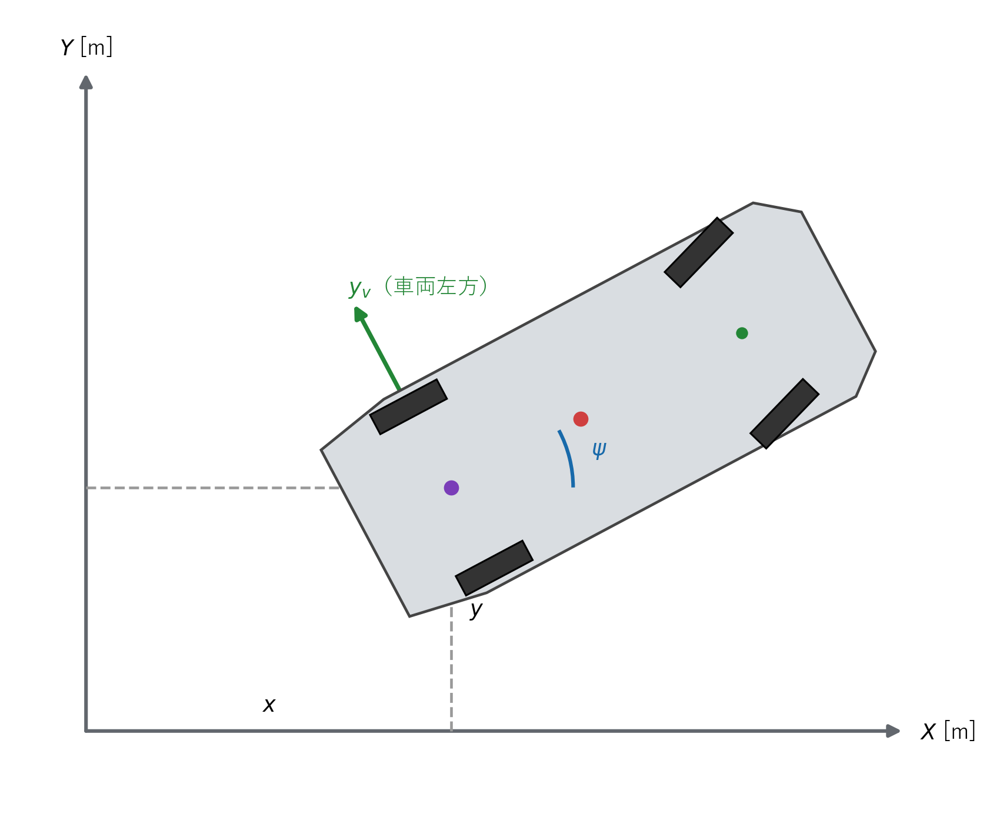

# 横偏差フィードバック制御

## 1. この章の目的

段階3の方位誤差フィードバックへ横偏差の補正を追加し、車両を目標経路へ近づけます。既存の曲率フィードフォワード項と方位誤差項はそのまま活用します。

## 2. 使用する記号

| 記号 | 意味 |
|---|---|
| $e_y$ | 参照経路の左側を正とする横偏差 [m] |
| $e_\psi$ | 参照方位－車両方位 [rad] |
| $K_y$ | 横偏差ゲイン [rad/m] |
| $K_\psi$ | 方位誤差ゲイン |
| $q$ | 前進は$+1$、後退は$-1$ |
| $L$ | ホイールベース [m] |
| $\kappa_r$ | 参照曲率 [1/m] |

本実験では$K_\psi=1.0$、$K_y=0.2\,\mathrm{rad/m}$とします。

**図1　世界座標の位置差を参照経路の横方向へ射影する関係**

図1の参照経路に沿う前方向と左方向を基底として、式 (1)～式 (3) で符号付き横偏差を計算します。

## 3. 横偏差の計算

参照点から車両までの世界座標差を式 (1) で定義します。

**理論ID：`LAT-EQ-01`**

**理論ID：`LAT-EQ-01`**

**理論ID：`LAT-EQ-01`**

**理論ID：`LAT-EQ-01`**

$$
\Delta x=x-x_r,\qquad \Delta y=y-y_r
\tag{1}
$$

参照経路の左向き単位ベクトルは式 (2) です。

**理論ID：`LAT-EQ-02`**

**理論ID：`LAT-EQ-02`**

**理論ID：`LAT-EQ-02`**

**理論ID：`LAT-EQ-02`**

$$
\boldsymbol{n}_r=
\begin{bmatrix}
-\sin\psi_r\\
\cos\psi_r
\end{bmatrix}
\tag{2}
$$

位置差を式 (2)へ射影すると、符号付き横偏差は式 (3) になります。

**理論ID：`LAT-EQ-03`**

**理論ID：`LAT-EQ-03`**

**理論ID：`LAT-EQ-03`**

**理論ID：`LAT-EQ-03`**

$$
e_y
=-\Delta x\sin\psi_r+\Delta y\cos\psi_r
\tag{3}
$$

$e_y>0$なら車両は経路の左側、$e_y<0$なら右側です。

## 4. 横偏差に対する操舵方向

車両が経路の左側にある場合、経路へ戻すには右へ操舵する必要があります。本プロジェクトでは右舵が負なので、比例補正を式 (4) とします。

**理論ID：`LAT-EQ-04`**

**理論ID：`LAT-EQ-04`**

**理論ID：`LAT-EQ-04`**

**理論ID：`LAT-EQ-04`**

$$
\delta_y=-K_y e_y
\tag{4}
$$

式 (4)には進行方向$q$を掛けません。後退時も、左側にある後輪車軸中心を経路へ近づけるには負の舵角が必要だからです。

## 5. 前進・後退で符号が同じになる確認

直線付近で、車両方位と参照方位の差を$\psi-\psi_r=-e_\psi$とすると、横方向速度は式 (5)で近似できます。

**理論ID：`LAT-EQ-05`**

**理論ID：`LAT-EQ-05`**

**理論ID：`LAT-EQ-05`**

**理論ID：`LAT-EQ-05`**

$$
\dot e_y
=v\sin(\psi-\psi_r)
\approx-ve_\psi
\tag{5}
$$

一方、フィードフォワード分を除いた方位誤差の変化は、キネマティックモデルから式 (6)です。

**理論ID：`LAT-EQ-06`**

**理論ID：`LAT-EQ-06`**

**理論ID：`LAT-EQ-06`**

**理論ID：`LAT-EQ-06`**

$$
\dot e_\psi
\approx-\frac{v}{L}\delta_y
\tag{6}
$$

式 (4)を式 (6)へ代入します。

**理論ID：`LAT-EQ-07`**

**理論ID：`LAT-EQ-07`**

**理論ID：`LAT-EQ-07`**

**理論ID：`LAT-EQ-07`**

$$
\dot e_\psi
\approx\frac{vK_y}{L}e_y
\tag{7}
$$

前進では$v>0$なので、正の$e_y$から正の$e_\psi$が作られ、式 (5)により$\dot e_y<0$になります。後退では$v<0$なので$e_\psi$の向きも反転しますが、式 (5)の$v$も反転します。結果として、どちらも横偏差を減らす方向になります。

## 6. 方位誤差補正との組み合わせ

横偏差だけを補正すると、経路へ近づいた後も経路を横切る可能性があります。そこで段階3の方位誤差補正を残します。

**理論ID：`LAT-EQ-08`**

**理論ID：`LAT-EQ-08`**

**理論ID：`LAT-EQ-08`**

**理論ID：`LAT-EQ-08`**

$$
\delta_\psi=qK_\psi e_\psi
\tag{8}
$$

式 (8)は車両方位を参照方向へ揃え、式 (4)は車両位置を経路へ近づけます。

## 7. 最終的な制御則

曲率フィードフォワード、方位誤差、横偏差の3項を足します。

**理論ID：`LAT-EQ-09`**

**理論ID：`LAT-EQ-09`**

**理論ID：`LAT-EQ-09`**

**理論ID：`LAT-EQ-09`**

$$
\delta_{\mathrm{command}}
=\arctan(L\kappa_r)
+qK_\psi e_\psi
-K_y e_y
\tag{9}
$$

速度指令は参照軌道の値をそのまま使います。

**理論ID：`LAT-EQ-10`**

**理論ID：`LAT-EQ-10`**

**理論ID：`LAT-EQ-10`**

**理論ID：`LAT-EQ-10`**

$$
v_{\mathrm{command}}=v_r
\tag{10}
$$

## 8. ゲインの役割

- $K_y$を大きくすると経路へ速く近づきますが、横切りや振動が増える可能性があります。
- $K_\psi$を大きくすると方位を速く揃えますが、横位置の修正が遅くなる場合があります。
- 現段階では操舵角制限がないため、過大なゲインを設定しないよう注意します。

## 9. 実装との対応

| 内容 | 実装 |
|---|---|
| 図1、式 (1)～式 (3) | `include/core/tracking_error.hpp` |
| 式 (4)、式 (8)、式 (9) | `lateral_feedback_controller.cpp` |
| $K_\psi=1.0$、$K_y=0.2$ | `src/main.cpp` |
| 前進・後退の符号テスト | `tests/lateral_feedback_controller_test.cpp` |

## 10. 現段階の限界

- 時刻基準の参照点を使っており、最近傍点探索はまだありません。
- 終端で速度がゼロになると補正運動も停止します。
- 操舵角と操舵速度の制約はまだありません。
- 単純な比例制御なので、速度によって応答が変わります。

これらの性質を扱うPure Pursuit、Stanley、操舵制約も、現在は同じインターフェースで実装されています。

実装関数、変数、単体テストとの対応は[全体トレーサビリティ](../traceability.md#71-フィードフォワード方位横偏差)を参照してください。
