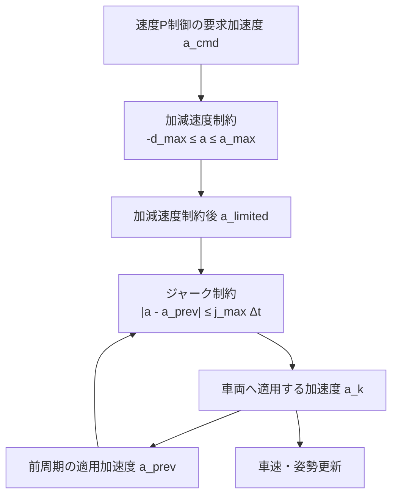

# 加減速度・ジャーク制約

## 1. 目的

速度P制御が要求する加速度を、車両が実現できる範囲と乗り心地を考慮した範囲へ制限します。

**図1　要求加速度へ二段階の物理制約を適用する流れ**

## 2. 加減速度制約

駆動側の最大加速度を$a_{\max}$、制動側の最大減速度を$d_{\max}>0$とします。

**理論ID：`LONLIM-EQ-01`**

**理論ID：`LONLIM-EQ-01`**

**理論ID：`LONLIM-EQ-01`**

$$
a_{\mathrm{limited}}=\operatorname{clamp}(a_{\mathrm{cmd}},-d_{\max},a_{\max})
\tag{1}
$$

## 3. ジャーク制約

ジャークは加速度の時間変化率です。

**理論ID：`LONLIM-EQ-02`**

**理論ID：`LONLIM-EQ-02`**

**理論ID：`LONLIM-EQ-02`**

$$
j_k=\frac{a_k-a_{k-1}}{\Delta t}
\tag{2}
$$

最大ジャーク$j_{\max}$を超えないため、1周期の最大加速度変化は次式になります。

**理論ID：`LONLIM-EQ-03`**

**理論ID：`LONLIM-EQ-03`**

**理論ID：`LONLIM-EQ-03`**

$$
\Delta a_{\max}=j_{\max}\Delta t
\tag{3}
$$

したがって、車両へ適用する加速度は次のように求めます。

**理論ID：`LONLIM-EQ-04`**

**理論ID：`LONLIM-EQ-04`**

**理論ID：`LONLIM-EQ-04`**

$$
a_k=a_{k-1}+\operatorname{clamp}(a_{\mathrm{limited}}-a_{k-1},-\Delta a_{\max},\Delta a_{\max})
\tag{4}
$$

## 4. ソースコードとの対応

式 (1)～式 (4)は`VelocityStopController::computeCommand()`の`acceleration`、`maximum_change`、`previous_acceleration_`に対応します。`testAccelerationAndJerkLimits()`で上下限を検証します。

## 5. 前後の文書

- 制約前の要求値：[車速状態と速度フィードバック制御](longitudinal_velocity_control.md)
- 終端付近の速度目標：[停止位置制御](stop_position_control.md)
- 操舵側の対応する制約：[操舵制約と操舵一次遅れ](../fundamentals/steering_actuator.md)

