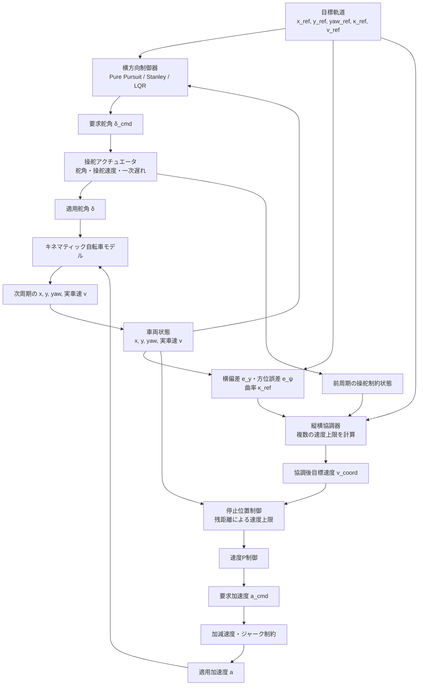
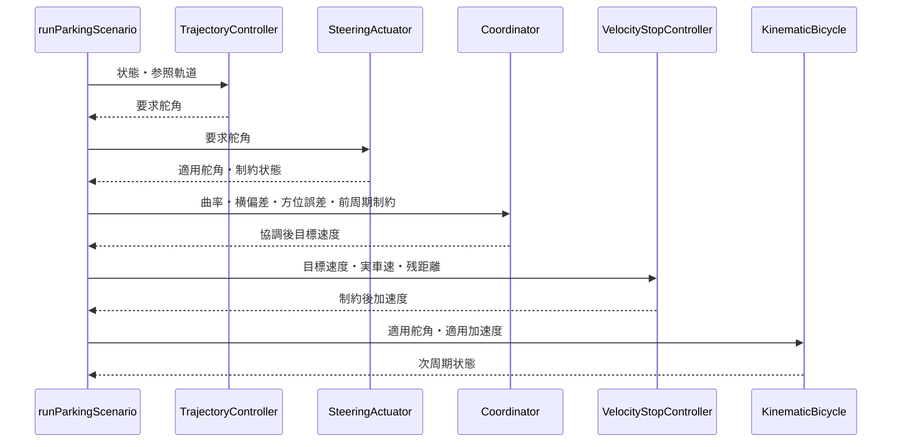

# 縦方向・横方向制御の協調

## 1. 目的

横制御器は舵角、縦制御器は加速度を独立に計算します。協調層は、曲率や追従誤差が大きいときに縦制御の速度目標を下げます。同一評価関数による同時最適化ではありません。

**図1　横方向制御と縦方向制御を速度上限で接続する詳細制御フロー**

図1で、横制御器と縦制御器は独立しています。`LongitudinalLateralCoordinator`は横偏差、方位誤差、曲率、操舵制約を速度上限へ変換するだけであり、舵角と加速度を同じ評価関数で解いてはいません。

## 2. 曲率による速度上限

横加速度$a_y=v^2|\kappa|$を上限$a_{y,\max}$以内にすると、速度上限は次式です。

**理論ID：`COOP-EQ-01`**

**理論ID：`COOP-EQ-01`**

**理論ID：`COOP-EQ-01`**

$$
v_{\kappa,\max}=\sqrt{\frac{a_{y,\max}}{|\kappa|}}
\tag{1}
$$

## 3. 誤差による速度上限

横偏差が大きいほど速度を下げます。

**理論ID：`COOP-EQ-02`**

**理論ID：`COOP-EQ-02`**

**理論ID：`COOP-EQ-02`**

$$
v_{e_y,\max}=\frac{|v_{\mathrm{ref}}|}{1+K_y|e_y|}
\tag{2}
$$

方位誤差についても同じ考え方です。

**理論ID：`COOP-EQ-03`**

**理論ID：`COOP-EQ-03`**

**理論ID：`COOP-EQ-03`**

$$
v_{e_\psi,\max}=\frac{|v_{\mathrm{ref}}|}{1+K_\psi|e_\psi|}
\tag{3}
$$

操舵制約が作動した場合は倍率$r_\delta\le1$を掛けます。

**理論ID：`COOP-EQ-04`**

**理論ID：`COOP-EQ-04`**

**理論ID：`COOP-EQ-04`**

$$
v_{\delta,\max}=r_\delta|v_{\mathrm{ref}}|
\tag{4}
$$

最終速度はすべての上限の最小値へ前後進符号$q$を戻します。

**理論ID：`COOP-EQ-05`**

**理論ID：`COOP-EQ-05`**

**理論ID：`COOP-EQ-05`**

$$
v_{\mathrm{coord}}=q\min(|v_{\mathrm{ref}}|,v_{\kappa,\max},v_{e_y,\max},v_{e_\psi,\max},v_{\delta,\max})
\tag{5}
$$

## 4. ソースコードとの対応

式 (1)～式 (5)は`LongitudinalLateralCoordinator::coordinate()`に一対一で対応します。`testLongitudinalLateralCoordination()`で、誤差・曲率・操舵制約により速度が低下することを検証します。

## 5. 実装上の1周期の順序

**図2　`runParkingScenario()`における呼び出し順序**

## 6. 前後の文書

- 縦制御の入口：[車速状態と速度フィードバック制御](longitudinal_velocity_control.md)
- 終端停止：[停止位置制御](stop_position_control.md)
- プロジェクト内の統合位置：[ソースコードの処理フロー](../architecture/processing_flow.md)
- 将来の同時最適化との差：[学習ロードマップ](../learning_roadmap.md)

