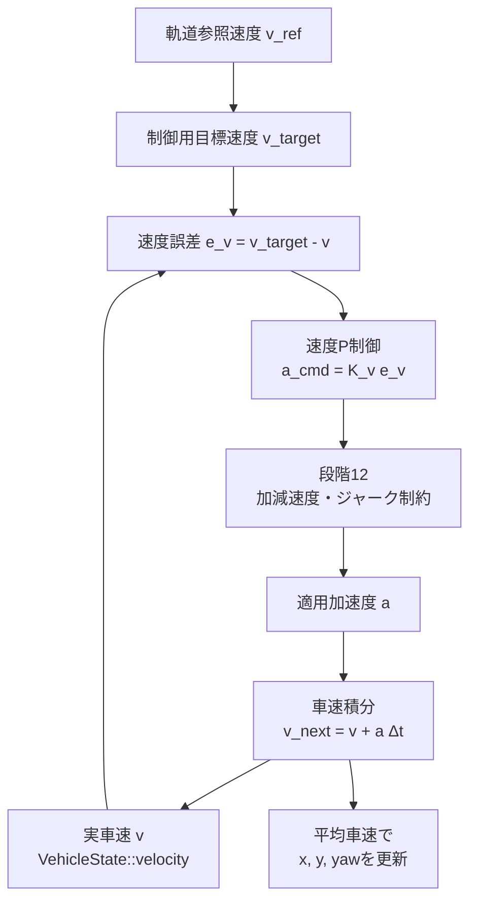

# 車速状態と速度フィードバック制御

## 1. 目的

参照速度を車両へ直接与える理想モデルを卒業し、実車速$v$を状態として持ち、加速度で目標速度へ追従させます。

**図1　速度フィードバックから車速・姿勢更新までの閉ループ**

## 2. 速度誤差から加速度を求める

目標速度を$v_{\mathrm{target}}$、実車速を$v$とすると、速度誤差は「目標－実際」です。

**理論ID：`LON-EQ-01`**

**理論ID：`LON-EQ-01`**

**理論ID：`LON-EQ-01`**

$$
e_v=v_{\mathrm{target}}-v
\tag{1}
$$

正の誤差なら加速、負の誤差なら減速したいため、正のゲイン$K_v$を掛けます。

**理論ID：`LON-EQ-02`**

**理論ID：`LON-EQ-02`**

**理論ID：`LON-EQ-02`**

$$
a_{\mathrm{cmd}}=K_v e_v
\tag{2}
$$

## 3. 加速度から車速を更新する

加速度は速度の時間変化率です。

**理論ID：`LON-EQ-03`**

**理論ID：`LON-EQ-03`**

**理論ID：`LON-EQ-03`**

$$
a=\frac{dv}{dt}
\tag{3}
$$

1周期$\Delta t$で加速度が一定と仮定すると、次周期の車速は次式です。

**理論ID：`LON-EQ-04`**

**理論ID：`LON-EQ-04`**

**理論ID：`LON-EQ-04`**

$$
v_{k+1}=v_k+a_k\Delta t
\tag{4}
$$

周期中の移動には始点速度だけでなく平均速度を使います。

**理論ID：`LON-EQ-05`**

**理論ID：`LON-EQ-05`**

**理論ID：`LON-EQ-05`**

$$
\bar v_k=\frac{v_k+v_{k+1}}{2}
\tag{5}
$$

## 4. ソースコードとの対応

| 理論ID | C++ |
|---|---|
| `LON-EQ-01`, `LON-EQ-02` | `VelocityStopController::computeCommand()` |
| `LON-EQ-04`, `LON-EQ-05` | `KinematicBicycle::stepWithAcceleration()` |

検証は`longitudinal_control_test.cpp`の`testVelocityFeedback()`と`testAccelerationUpdatesVehicleSpeedAndPosition()`です。

## 5. 前後の文書

- 前提となる車両運動：[キネマティック自転車モデル](../fundamentals/kinematic_bicycle_model.md)
- 次に適用する制約：[加減速度・ジャーク制約](longitudinal_constraints.md)
- 全体への組み込み：[ソースコードの処理フロー](../architecture/processing_flow.md)

