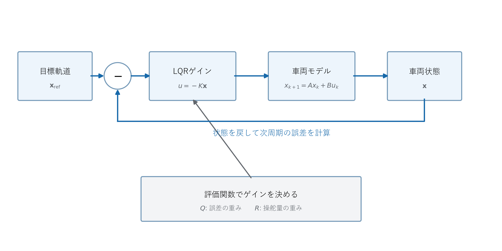
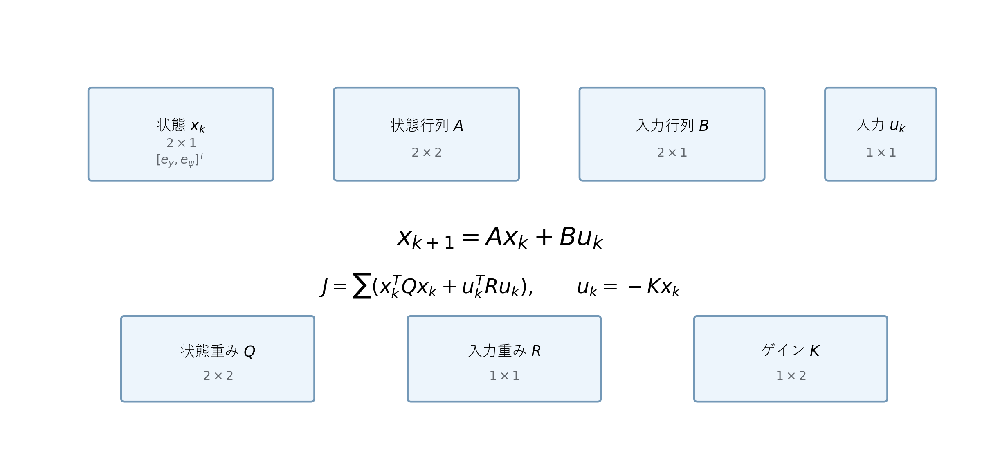

# LQR・積分器付きLQR制御

## 1. LQRの目的

LQRは線形誤差モデルを使い、追従誤差と補正舵角の両方が小さくなるフィードバックゲインを求めます。モデルの導出は[線形軌道誤差モデル](../fundamentals/linear_error_model.md)を参照してください。



**図1　目標軌道、誤差、LQRゲイン、車両モデルの閉ループ構成**

図1の誤差ベクトル$\boldsymbol{x}$が式 (1)、ゲインブロックの$u=-K\boldsymbol{x}$が式 (6) に対応します。$Q$と$R$は式 (2) の評価関数を通してゲイン$K$へ影響します。

## 2. 評価関数



**図2　通常LQRの状態方程式、評価関数、ゲインの行列次元**

図2では、$\boldsymbol{x}_k$、$A$、$B$、$u_k$、$Q$、$R$、$K$の次元を明示します。通常LQRは2状態・1入力であり、$K\boldsymbol{x}_k$が1つの補正舵角になることを確認できます。

横偏差と方位誤差を、

<a id="lqr-eq-01"></a>
**理論ID：`LQR-EQ-01`**

<a id="lqr-eq-01"></a>

**理論ID：`LQR-EQ-01`**

<a id="lqr-eq-01"></a>

**理論ID：`LQR-EQ-01`**

<a id="lqr-eq-01"></a>

**理論ID：`LQR-EQ-01`**

$$
\boldsymbol{x}_k=\begin{bmatrix}e_{y,k}&e_{\psi,k}\end{bmatrix}^{\mathsf T}
\tag{1}
$$

とします。LQRは次の評価値を小さくします。

<a id="lqr-eq-02"></a>
**理論ID：`LQR-EQ-02`**

<a id="lqr-eq-02"></a>

**理論ID：`LQR-EQ-02`**

<a id="lqr-eq-02"></a>

**理論ID：`LQR-EQ-02`**

<a id="lqr-eq-02"></a>

**理論ID：`LQR-EQ-02`**

$$
J=\sum_{k=0}^{\infty}\left(\boldsymbol{x}_k^{\mathsf T}Q\boldsymbol{x}_k+u_k^{\mathsf T}Ru_k\right)
\tag{2}
$$

本実装では、

<a id="lqr-eq-03"></a>
**理論ID：`LQR-EQ-03`**

<a id="lqr-eq-03"></a>

**理論ID：`LQR-EQ-03`**

<a id="lqr-eq-03"></a>

**理論ID：`LQR-EQ-03`**

<a id="lqr-eq-03"></a>

**理論ID：`LQR-EQ-03`**

$$
Q=\begin{bmatrix}4&0\\0&2\end{bmatrix},\qquad R=1
\tag{3}
$$

です。$Q$を大きくすると誤差修正を優先し、$R$を大きくすると補正舵角を抑えます。

## 3. Riccati方程式とゲイン

$P_0=Q$から開始し、

<a id="lqr-eq-04"></a>
**理論ID：`LQR-EQ-04`**

<a id="lqr-eq-04"></a>

**理論ID：`LQR-EQ-04`**

<a id="lqr-eq-04"></a>

**理論ID：`LQR-EQ-04`**

<a id="lqr-eq-04"></a>

**理論ID：`LQR-EQ-04`**

$$
P_{i+1}=A^{\mathsf T}P_iA-A^{\mathsf T}P_iB(R+B^{\mathsf T}P_iB)^{-1}B^{\mathsf T}P_iA+Q
\tag{4}
$$

を収束まで反復します。収束後の$P$から、

<a id="lqr-eq-05"></a>
**理論ID：`LQR-EQ-05`**

<a id="lqr-eq-05"></a>

**理論ID：`LQR-EQ-05`**

<a id="lqr-eq-05"></a>

**理論ID：`LQR-EQ-05`**

<a id="lqr-eq-05"></a>

**理論ID：`LQR-EQ-05`**

$$
K=(R+B^{\mathsf T}PB)^{-1}B^{\mathsf T}PA
\tag{5}
$$

を計算します。補正舵角は、

<a id="lqr-eq-06"></a>
**理論ID：`LQR-EQ-06`**

<a id="lqr-eq-06"></a>

**理論ID：`LQR-EQ-06`**

<a id="lqr-eq-06"></a>

**理論ID：`LQR-EQ-06`**

<a id="lqr-eq-06"></a>

**理論ID：`LQR-EQ-06`**

$$
\Delta\delta_k=-K\boldsymbol{x}_k
\tag{6}
$$

です。最終的な要求舵角は、

<a id="lqr-eq-07"></a>
**理論ID：`LQR-EQ-07`**

<a id="lqr-eq-07"></a>

**理論ID：`LQR-EQ-07`**

<a id="lqr-eq-07"></a>

**理論ID：`LQR-EQ-07`**

<a id="lqr-eq-07"></a>

**理論ID：`LQR-EQ-07`**

$$
\delta_{\mathrm{cmd},k}=\delta_{\mathrm{ff},k}+\Delta\delta_k
\tag{7}
$$

となります。

### 3.1 Eigenによる実装

式 (4)、式 (5)の行列演算にはEigen 3.4.1を使用します。状態数が既知なので、通常LQRは`Matrix2d`・`Vector2d`、積分器付きLQRは`Matrix3d`・`Vector3d`を使います。

```cpp
const double denominator = input_weight +
    (B.transpose() * P * B)(0, 0);

const auto K = B.transpose() * P * A / denominator;

const auto next_P =
    A.transpose() * P * A
    - A.transpose() * P * B * K
    + Q;
```

入力は舵角補正量一つなので、$R+B^{\mathsf T}PB$は1×1です。一般の逆行列を作らず、スカラー除算として計算します。

Riccati反復は`src/control/discrete_lqr.cpp`へ分離しました。`LqrController`は誤差状態の作成、ゲイン更新条件、積分器、アンチワインドアップに集中します。

## 4. 積分器が必要になる理由

通常LQRは、モデルにない一定の操舵角オフセットなどがあると小さな定常偏差を残す場合があります。横偏差を時間方向へ蓄積する状態を追加します。

<a id="lqr-eq-08"></a>
**理論ID：`LQR-EQ-08`**

<a id="lqr-eq-08"></a>

**理論ID：`LQR-EQ-08`**

<a id="lqr-eq-08"></a>

**理論ID：`LQR-EQ-08`**

<a id="lqr-eq-08"></a>

**理論ID：`LQR-EQ-08`**

$$
e_{I,k+1}=e_{I,k}+e_{y,k}\Delta t
\tag{8}
$$

拡張状態は、

<a id="lqr-eq-09"></a>
**理論ID：`LQR-EQ-09`**

<a id="lqr-eq-09"></a>

**理論ID：`LQR-EQ-09`**

<a id="lqr-eq-09"></a>

**理論ID：`LQR-EQ-09`**

<a id="lqr-eq-09"></a>

**理論ID：`LQR-EQ-09`**

$$
\boldsymbol{x}_{\mathrm{aug},k}=\begin{bmatrix}e_{y,k}&e_{\psi,k}&e_{I,k}\end{bmatrix}^{\mathsf T}
\tag{9}
$$

です。線形誤差モデルの$A_d,B_d$を使うと、

<a id="lqr-eq-10"></a>
**理論ID：`LQR-EQ-10`**

<a id="lqr-eq-10"></a>

**理論ID：`LQR-EQ-10`**

<a id="lqr-eq-10"></a>

**理論ID：`LQR-EQ-10`**

<a id="lqr-eq-10"></a>

**理論ID：`LQR-EQ-10`**

$$
A_{\mathrm{aug}}=\begin{bmatrix}A_d&\boldsymbol{0}\\\Delta t&0&1\end{bmatrix}
\tag{10}
$$

<a id="lqr-eq-11"></a>
**理論ID：`LQR-EQ-11`**

<a id="lqr-eq-11"></a>

**理論ID：`LQR-EQ-11`**

<a id="lqr-eq-11"></a>

**理論ID：`LQR-EQ-11`**

<a id="lqr-eq-11"></a>

**理論ID：`LQR-EQ-11`**

$$
B_{\mathrm{aug}}=\begin{bmatrix}B_d\\0\end{bmatrix}
\tag{11}
$$

となります。積分状態の重みは0.005、積分上限は0.3 m·sです。

## 5. アンチワインドアップ

積分器が舵角飽和をさらに悪化させる方向へ増え続けると、制約解除後に大きなオーバーシュートが発生します。候補積分値を、

<a id="lqr-eq-12"></a>
**理論ID：`LQR-EQ-12`**

<a id="lqr-eq-12"></a>

**理論ID：`LQR-EQ-12`**

<a id="lqr-eq-12"></a>

**理論ID：`LQR-EQ-12`**

<a id="lqr-eq-12"></a>

**理論ID：`LQR-EQ-12`**

$$
e_{I,k}^{\mathrm{candidate}}=\operatorname{clamp}(e_{I,k-1}+e_{y,k}\Delta t,-e_{I,\max},e_{I,\max})
\tag{12}
$$

で求めます。候補値によって要求舵角が制限値を超え、かつ飽和をさらに悪化させる場合は積分値を更新しません。

## 6. 制御器の選択

```powershell
.\build\parking_trajectory_sim.exe --controller lqr --forward-pose-offset --steering-model actuator
.\build\parking_trajectory_sim.exe --controller lqr-integral --forward-pose-offset --steering-model actuator
```

一定の操舵角オフセットを加える例です。

```powershell
.\build\parking_trajectory_sim.exe --controller lqr --forward-pose-offset --steering-model actuator --steering-bias-deg 1
.\build\parking_trajectory_sim.exe --controller lqr-integral --forward-pose-offset --steering-model actuator --steering-bias-deg 1
```

## 7. 現段階の限界

- 操舵一次遅れはLQRの予測状態に含めず、制御器の外側に置いています。
- 線形モデルは軌道付近の小さな誤差を仮定します。
- 積分器は横偏差だけを積分します。
- LQRは制約を最適化内部で扱わず、後段の操舵アクチュエータが制限します。
- 次の線形MPCでは、有限時間予測と入力制約を最適化問題へ組み込みます。

## 8. ソースコードとの対応

| 図・数式 | 実装 |
|---|---|
| 式 (1)～式 (3)、式 (6)、式 (7) | `src/controllers/lqr_controller.cpp` |
| 式 (4)、式 (5) | `src/control/discrete_lqr.cpp` |
| 式 (8)～式 (12) | `src/controllers/lqr_controller.cpp`の積分器・アンチワインドアップ処理 |
| 図1 | `src/simulation/parking_simulator.cpp`の閉ループと`src/controllers/lqr_controller.cpp` |
| 図2、式 (1)、式 (2)、式 (6) | 状態・入力・重み・ゲインの次元 | `src/control/discrete_lqr.cpp` |

関数・変数・単体テストまで含む対応は[全体トレーサビリティ](../traceability.md#74-線形誤差モデルlqr)を参照してください。
