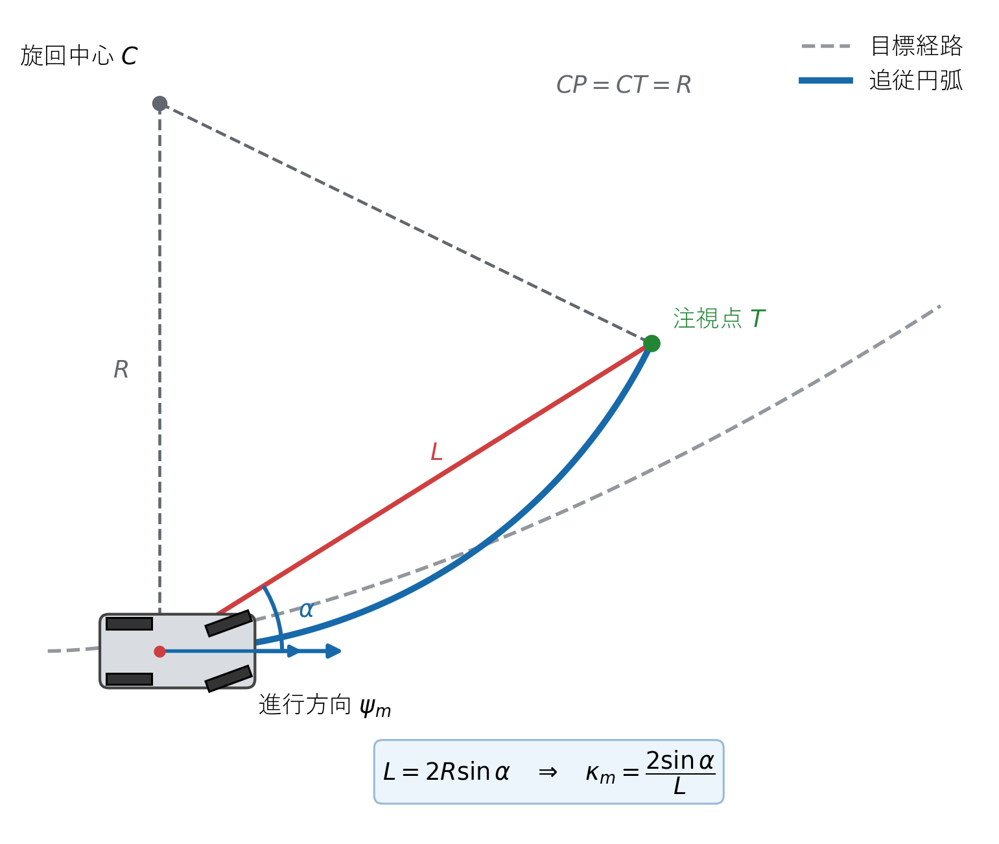
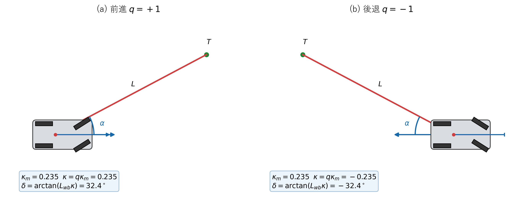

# Pure Pursuit制御

## 1. この章の目的

Pure Pursuitが「車両から注視点へ到達する円」をどのように作り、その円の曲率から舵角を求めるかを幾何学的に導出します。本実装に合わせ、前進と後退の符号も区別します。

この章では、曲率を先に暗記するのではなく、図1の三角形から式 (8) を導きます。

## 2. 使用する記号

| 記号 | 意味 |
|---|---|
| $P=(x,y)$ | 現在の車両位置 |
| $T=(x_t,y_t)$ | 経路上の注視点 |
| $C$ | $P$と$T$を通る追従円の中心 |
| $L_d$ | 経路上で注視点を選ぶ注視距離 [m] |
| $L$ | 車両から注視点までの直線距離 $|PT|$ [m] |
| $R$ | 追従円の半径 [m] |
| $L_{\mathrm{wb}}$ | 車両のホイールベース [m] |
| $\psi_m$ | 車両の進行方向方位 [rad] |
| $\alpha$ | 進行方向と注視点方向の角度差 [rad] |
| $q$ | 進行方向。前進は$+1$、後退は$-1$ |

**図1　Pure Pursuitの追従円と注視点の幾何学的関係**

図1の赤線$PT$が式 (4) の距離$L$、角度$\alpha$が式 (6)、青い円弧の曲率が式 (8) に対応します。

## 3. 最近傍点と注視点

最初に、車両位置$(x,y)$と各軌道点$(x_i,y_i)$の二乗距離を計算します。

**理論ID：`PP-EQ-01`**

**理論ID：`PP-EQ-01`**

**理論ID：`PP-EQ-01`**

**理論ID：`PP-EQ-01`**

$$
d_i^2=(x_i-x)^2+(y_i-y)^2
\tag{1}
$$

式 (1) が最小の点を最近傍点とします。平方根を取らなくても距離の大小関係は変わらないため、実装では二乗距離を比較します。

最近傍点から軌道の累積距離$s$を進み、次の条件を初めて満たす点を注視点$T$にします。

**理論ID：`PP-EQ-02`**

**理論ID：`PP-EQ-02`**

**理論ID：`PP-EQ-02`**

**理論ID：`PP-EQ-02`**

$$
s_{\mathrm{target}}-s_{\mathrm{nearest}}\ge L_d
\tag{2}
$$

本実験では$L_d=1.5\,\mathrm{m}$です。軌道終端までに式 (2) を満たさない場合は終端点を使います。

## 4. 車両から注視点までの関係

車両位置$P$から注視点$T$へ向かうベクトルを成分で表します。

**理論ID：`PP-EQ-03`**

**理論ID：`PP-EQ-03`**

**理論ID：`PP-EQ-03`**

**理論ID：`PP-EQ-03`**

$$
\Delta x=x_t-x,\qquad \Delta y=y_t-y
\tag{3}
$$

式 (3) に三平方の定理を適用すると、図1の線分$PT$の長さは次式です。

**理論ID：`PP-EQ-04`**

**理論ID：`PP-EQ-04`**

**理論ID：`PP-EQ-04`**

**理論ID：`PP-EQ-04`**

$$
L=\sqrt{\Delta x^2+\Delta y^2}
\tag{4}
$$

前進では車両前方、後退では車両後方が実際の進行方向です。そこで進行方向方位を次のように定義します。

**理論ID：`PP-EQ-05`**

**理論ID：`PP-EQ-05`**

**理論ID：`PP-EQ-05`**

**理論ID：`PP-EQ-05`**

$$
\psi_m=\begin{cases}
\psi & (q=+1)\\
\psi+\pi & (q=-1)
\end{cases}
\tag{5}
$$

図1の角度$\alpha$は、注視点の方向から進行方向方位を引き、$[-\pi,\pi]$へ正規化した値です。

**理論ID：`PP-EQ-06`**

**理論ID：`PP-EQ-06`**

**理論ID：`PP-EQ-06`**

**理論ID：`PP-EQ-06`**

$$
\alpha=\operatorname{wrap}
\left(\operatorname{atan2}(\Delta y,\Delta x)-\psi_m\right)
\tag{6}
$$

$\alpha>0$なら注視点は進行方向の左側、$\alpha<0$なら右側です。この符号が、後で求める曲率の左右を決めます。

## 5. 追従円の曲率を幾何学から導出する

### 5.1 二等辺三角形を作る

図1では$P$と$T$が同じ円上にあるため、中心$C$から両点までの距離はどちらも半径$R$です。

**理論ID：`PP-EQ-07`**

**理論ID：`PP-EQ-07`**

**理論ID：`PP-EQ-07`**

**理論ID：`PP-EQ-07`**

$$
CP=CT=R
\tag{7}
$$

したがって三角形$CPT$は二等辺三角形です。また、半径$CP$は点$P$での円の接線、すなわち車両の進行方向と直交します。

進行方向と弦$PT$の角度が$\alpha$なので、三角形$CPT$の点$P$側の内角は$\pi/2-\alpha$です。二等辺三角形の両底角は等しいため、中心角$\angle PCT$は$2\alpha$になります。

### 5.2 弦の長さを求める

二等辺三角形$CPT$を中心角の二等分線で半分にすると、斜辺$R$、中心角側の角度$\alpha$、向かい側の辺$L/2$の直角三角形ができます。正弦の定義より、

**理論ID：`PP-EQ-08`**

**理論ID：`PP-EQ-08`**

**理論ID：`PP-EQ-08`**

**理論ID：`PP-EQ-08`**

$$
\sin\alpha=\frac{L/2}{R}
\tag{8}
$$

です。式 (8) を$R$について解きます。

**理論ID：`PP-EQ-09`**

**理論ID：`PP-EQ-09`**

**理論ID：`PP-EQ-09`**

**理論ID：`PP-EQ-09`**

$$
R=\frac{L}{2\sin\alpha}
\tag{9}
$$

曲率は半径の逆数なので、進行方向を基準にした曲率は次式になります。

**理論ID：`PP-EQ-10`**

**理論ID：`PP-EQ-10`**

**理論ID：`PP-EQ-10`**

**理論ID：`PP-EQ-10`**

$$
\kappa_m=\frac{1}{R}=\frac{2\sin\alpha}{L}
\tag{10}
$$

式 (10) では$\sin\alpha$が符号を持つため、左旋回は正、右旋回は負になります。

## 6. 後退時の符号と舵角

**図2　同じ注視角に対する前進・後退の曲率符号と舵角符号**

図2は進行方向$q$、注視角$\alpha$、注視点$T$、距離$L$、進行方向基準曲率$\kappa_m$、車両前方基準曲率$\kappa$、舵角$\delta$を前進・後退で並べています。式 (11)、式 (12) の符号変換を確認できます。

式 (10) の$\kappa_m$は「実際の進行方向」を基準にした曲率です。一方、キネマティック自転車モデルは車両前方を基準に舵角と曲率を定義します。そのため、進行方向$q$を掛けてモデルへ渡す曲率へ変換します。

**理論ID：`PP-EQ-11`**

**理論ID：`PP-EQ-11`**

**理論ID：`PP-EQ-11`**

**理論ID：`PP-EQ-11`**

$$
\kappa=q\kappa_m
=q\frac{2\sin\alpha}{L}
\tag{11}
$$

キネマティック自転車モデルの関係$\kappa=\tan\delta/L_{\mathrm{wb}}$を$\delta$について解くと、要求舵角は次式です。

**理論ID：`PP-EQ-12`**

**理論ID：`PP-EQ-12`**

**理論ID：`PP-EQ-12`**

**理論ID：`PP-EQ-12`**

$$
\delta=\arctan\left(L_{\mathrm{wb}}\kappa\right)
\tag{12}
$$

式 (4) の$L$は注視点までの距離、式 (12) の$L_{\mathrm{wb}}$はホイールベースです。混同しないよう記号を分けています。

## 7. 数値例

$L=2.0\,\mathrm{m}$、$\alpha=20^\circ$、前進$q=1$、$L_{\mathrm{wb}}=2.7\,\mathrm{m}$とします。式 (11) より、

**理論ID：`PP-EQ-13`**

**理論ID：`PP-EQ-13`**

**理論ID：`PP-EQ-13`**

**理論ID：`PP-EQ-13`**

$$
\kappa=\frac{2\sin20^\circ}{2.0}\approx0.342\,\mathrm{m}^{-1}
\tag{13}
$$

です。式 (12) へ代入すると、

**理論ID：`PP-EQ-14`**

**理論ID：`PP-EQ-14`**

**理論ID：`PP-EQ-14`**

**理論ID：`PP-EQ-14`**

$$
\delta=\arctan(2.7\times0.342)
\approx0.746\,\mathrm{rad}\approx42.7^\circ
\tag{14}
$$

となります。この例では舵角が大きいため、実際には操舵角制約が作動します。注視距離を長くすると一般に$|\alpha|/L$が小さくなり、要求曲率も小さくなります。

## 8. 注視距離の影響

- 短い注視距離は経路へ素早く近づきますが、舵角が大きく振動しやすくなります。
- 長い注視距離は滑らかですが、曲線をショートカットしやすくなります。
- 現在は幾何関係の学習を単純にするため、固定値$1.5\,\mathrm{m}$です。

## 9. 数式・図・ソースコードの対応

| 図・数式 | 内容 | 実装 |
|---|---|---|
| 式 (1)、式 (2) | 最近傍点と注視点の探索 | `src/trajectory/reference_searcher.cpp` |
| 図1、式 (3)～式 (10) | 注視点と追従円の幾何関係 | `src/controllers/pure_pursuit_controller.cpp` |
| 図2、式 (11)、式 (12) | 前進・後退の曲率・舵角符号 | `src/controllers/pure_pursuit_controller.cpp` |
| 式 (11) | 前進・後退の曲率符号 | `src/controllers/pure_pursuit_controller.cpp` |
| 式 (12) | 曲率から舵角への変換 | `src/controllers/pure_pursuit_controller.cpp` |
| $L_d=1.5\,\mathrm{m}$ | 注視距離 | `src/main.cpp` |

## 10. この章の確認ポイント

- 式 (10) は暗記式ではなく、図1の二等辺三角形と正弦から導出できます。
- 注視点が遠いほど常に良いわけではなく、応答性とのトレードオフがあります。
- 後退時は進行方向基準の曲率を車両前方基準へ戻す必要があります。

## 11. 現段階の限界

- 注視距離は速度や曲率に応じて変化しません。
- 軌道終端で位置を厳密に合わせる縦方向制御はありません。
- Pure Pursuit単体では操舵角・操舵速度制約を最適化内部で考慮しません。

実装関数、変数、単体テストとの対応は[全体トレーサビリティ](../traceability.md#72-pure-pursuit)を参照してください。
