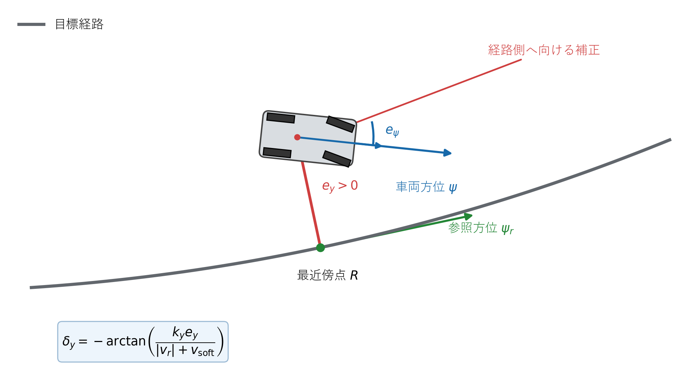
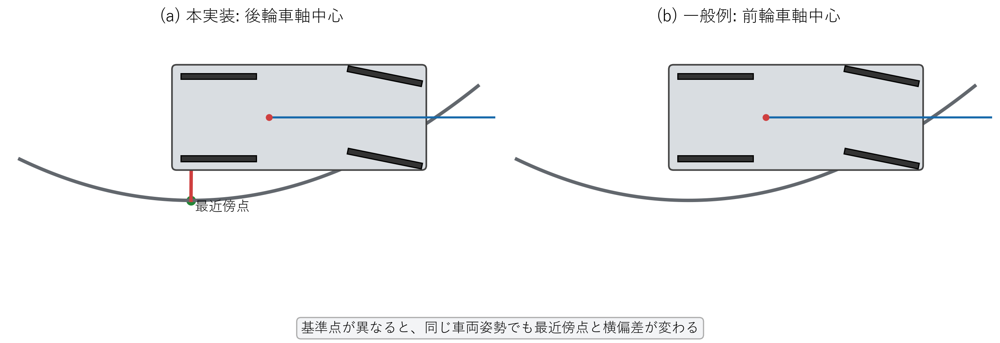

# Stanley制御

## 1. この章の目的

Stanley制御が、最近傍点の曲率、経路と車両の向き、経路からの横ずれをどのように一つの舵角へまとめるかを説明します。

Pure Pursuitが「注視点を通る円」を幾何学から作るのに対し、Stanley法は方位誤差を揃える項と、横偏差を経路側へ戻す項を組み合わせる制御則です。したがって、Stanleyの式全体が一つの円の幾何だけから一意に決まるわけではありません。この違いを区別して学びます。

## 2. 使用する記号

| 記号 | 意味 |
|---|---|
| $P$ | 現在の車両位置 |
| $R$ | 目標軌道上の最近傍点 |
| $e_y$ | 経路の左側を正とする符号付き横偏差 [m] |
| $e_\psi$ | 参照方位－車両方位の方位誤差 [rad] |
| $q$ | 進行方向。前進は$+1$、後退は$-1$ |
| $k_y$ | 横偏差ゲイン [1/s] |
| $v_{\mathrm{soft}}$ | 停止付近の過大操舵を防ぐ緩和速度 [m/s] |
| $L_{\mathrm{wb}}$ | ホイールベース [m] |

**図1　Stanley制御で使用する最近傍点、横偏差、方位誤差**

図1の赤い線が式 (2) の横偏差$e_y$、二つの矢印の角度差が式 (3) の方位誤差$e_\psi$です。

## 3. 最近傍点と横偏差

車両位置と各軌道点の二乗距離を比較し、最小となる点を最近傍点$R$とします。

**理論ID：`STANLEY-EQ-01`**

**理論ID：`STANLEY-EQ-01`**

**理論ID：`STANLEY-EQ-01`**

**理論ID：`STANLEY-EQ-01`**

$$
i_{\mathrm{nearest}}
=\underset{i}{\operatorname{argmin}}
\left((x_i-x)^2+(y_i-y)^2\right)
\tag{1}
$$

前周期の最近傍点より後ろへ戻らない範囲で探索し、軌道上の参照点が逆戻りするのを防ぎます。

最近傍点から車両へ向かう差ベクトルを、参照経路の左向き単位ベクトルへ射影すると横偏差になります。

**理論ID：`STANLEY-EQ-02`**

**理論ID：`STANLEY-EQ-02`**

**理論ID：`STANLEY-EQ-02`**

**理論ID：`STANLEY-EQ-02`**

$$
e_y=-(x-x_r)\sin\psi_r+(y-y_r)\cos\psi_r
\tag{2}
$$

式 (2) が正なら、図1のように車両は経路の左側にあります。

## 4. 方位誤差項

経路と車両の向きの差を、最短回転となるよう$[-\pi,\pi]$へ正規化します。

**理論ID：`STANLEY-EQ-03`**

**理論ID：`STANLEY-EQ-03`**

**理論ID：`STANLEY-EQ-03`**

**理論ID：`STANLEY-EQ-03`**

$$
e_\psi=\operatorname{wrap}(\psi_r-\psi)
\tag{3}
$$

前進では$e_\psi$をそのまま補正へ使います。後退では同じ舵角でもヨーレートの符号が反転するため、進行方向$q$を掛けます。

**理論ID：`STANLEY-EQ-04`**

**理論ID：`STANLEY-EQ-04`**

**理論ID：`STANLEY-EQ-04`**

**理論ID：`STANLEY-EQ-04`**

$$
\delta_\psi=q e_\psi
\tag{4}
$$

式 (4) は図1の車両方位$\psi$を参照方位$\psi_r$へ揃える役割を持ちます。

## 5. 横偏差項を幾何学的に解釈する

### 5.1 経路へ戻るための向き

車両が経路の左側、すなわち$e_y>0$にある場合、経路へ戻るには進行方向を右側へ傾ける必要があります。そのため横偏差補正角$\theta_y$には負号が付きます。

横偏差$|e_y|$を、仮想的な前方距離$\ell$の間に解消する直角三角形を考えると、正接の定義から、

**理論ID：`STANLEY-EQ-05`**

**理論ID：`STANLEY-EQ-05`**

**理論ID：`STANLEY-EQ-05`**

**理論ID：`STANLEY-EQ-05`**

$$
\tan|\theta_y|=\frac{|e_y|}{\ell}
\tag{5}
$$

となります。

### 5.2 速度を仮想前方距離へ変換する

Stanley法では、速度が高いほど急な横補正を避けるため、仮想前方距離を次のように置いたと解釈できます。

**理論ID：`STANLEY-EQ-06`**

**理論ID：`STANLEY-EQ-06`**

**理論ID：`STANLEY-EQ-06`**

**理論ID：`STANLEY-EQ-06`**

$$
\ell=\frac{|v_r|+v_{\mathrm{soft}}}{k_y}
\tag{6}
$$

$k_y$の単位を$1/\mathrm{s}$とすれば、式 (6) の単位はメートルになります。式 (6) を式 (5) へ代入し、左右の符号を戻すと、

**理論ID：`STANLEY-EQ-07`**

**理論ID：`STANLEY-EQ-07`**

**理論ID：`STANLEY-EQ-07`**

**理論ID：`STANLEY-EQ-07`**

$$
\tan\theta_y
=-\frac{k_y e_y}{|v_r|+v_{\mathrm{soft}}}
\tag{7}
$$

です。両辺へ逆正接を適用して横偏差補正項を得ます。

**理論ID：`STANLEY-EQ-08`**

**理論ID：`STANLEY-EQ-08`**

**理論ID：`STANLEY-EQ-08`**

**理論ID：`STANLEY-EQ-08`**

$$
\delta_y=\theta_y
=-\arctan\left(
\frac{k_y e_y}{|v_r|+v_{\mathrm{soft}}}
\right)
\tag{8}
$$

式 (8) から、横偏差が大きいほど補正が強く、速度が高いほど同じ横偏差に対する補正が穏やかになることが分かります。$v_{\mathrm{soft}}$は停止付近で分母がゼロになることを防ぎます。

この直角三角形は式の意味を理解するための幾何学的解釈です。Pure Pursuitのように、実際の追従円を一意に構成して導いた式ではありません。

## 6. 曲率フィードフォワード項

最近傍点の参照曲率$\kappa_r$から、経路そのものを走るために必要な基準舵角を求めます。

**理論ID：`STANLEY-EQ-09`**

**理論ID：`STANLEY-EQ-09`**

**理論ID：`STANLEY-EQ-09`**

**理論ID：`STANLEY-EQ-09`**

$$
\delta_{\mathrm{ff}}
=\arctan\left(L_{\mathrm{wb}}\kappa_r\right)
\tag{9}
$$

式 (9) は[キネマティック自転車モデル](../fundamentals/kinematic_bicycle_model.md)の曲率と舵角の関係から得られます。

## 7. 最終的な制御則

式 (4) の方位誤差項、式 (8) の横偏差項、式 (9) のフィードフォワード項を加えます。

**理論ID：`STANLEY-EQ-10`**

**理論ID：`STANLEY-EQ-10`**

**理論ID：`STANLEY-EQ-10`**

**理論ID：`STANLEY-EQ-10`**

$$
\delta_{\mathrm{command}}
=\arctan\left(L_{\mathrm{wb}}\kappa_r\right)
+q e_\psi
-\arctan\left(
\frac{k_y e_y}{|v_r|+v_{\mathrm{soft}}}
\right)
\tag{10}
$$

各項の役割は次のとおりです。

| 項 | 役割 |
|---|---|
| $\delta_{\mathrm{ff}}$ | 目標経路の曲率を走る |
| $q e_\psi$ | 車両の向きを経路の向きへ揃える |
| $\delta_y$ | 車両位置を経路へ戻す |

## 8. 数値例

$e_y=0.5\,\mathrm{m}$、$|v_r|=1.0\,\mathrm{m/s}$、$k_y=0.5\,\mathrm{s}^{-1}$、$v_{\mathrm{soft}}=1.0\,\mathrm{m/s}$とします。式 (8) より、

**理論ID：`STANLEY-EQ-11`**

**理論ID：`STANLEY-EQ-11`**

**理論ID：`STANLEY-EQ-11`**

**理論ID：`STANLEY-EQ-11`**

$$
\delta_y=-\arctan\left(\frac{0.5\times0.5}{1.0+1.0}\right)
\approx-0.124\,\mathrm{rad}\approx-7.1^\circ
\tag{11}
$$

です。横偏差が正、すなわち経路の左側にいるため、負の舵角で右側へ戻そうとします。

## 9. 数式・図・ソースコードの対応

**図2　本実装の後輪車軸中心基準と一般的な前輪車軸中心基準の比較**

図2では、同じ車両姿勢でも制御基準点を変えると最近傍点と横偏差$e_y$が変わることを示します。本実装は図2(a)の後輪車軸中心を使用します。

| 図・数式 | 内容 | 実装 |
|---|---|---|
| 式 (1) | 最近傍点探索 | `src/trajectory/reference_searcher.cpp` |
| 図1、式 (2)、式 (3) | 横偏差と方位誤差 | `include/core/tracking_error.hpp` |
| 図2 | 後輪基準と一般的な前輪基準の差 | `src/controllers/stanley_controller.cpp` |
| 式 (4)、式 (8) | Stanleyのフィードバック項 | `src/controllers/stanley_controller.cpp` |
| 式 (9) | 曲率フィードフォワード項 | `src/controllers/stanley_controller.cpp` |
| 式 (10) | 最終要求舵角 | `src/controllers/stanley_controller.cpp` |
| $k_y$、$v_{\mathrm{soft}}$ | 制御パラメーター | `src/main.cpp` |

## 10. この章の確認ポイント

- Pure Pursuitは注視点を通る円を作りますが、Stanleyは三つの補正項を加えます。
- $e_y>0$では経路へ戻るため横偏差項が負になります。
- 速度項は高速時の過大な方向変更を抑え、$v_{\mathrm{soft}}$は停止付近を扱います。

## 11. 現段階の限界

- 一般的なStanley法は前輪位置を基準にしますが、本学習実装は後輪車軸中心を使います。
- ゲインと緩和速度は現在の極低速軌道向けの基準値です。
- Stanley単体では操舵角・操舵速度制約を最適化内部で考慮しません。

実装関数、変数、単体テストとの対応は[全体トレーサビリティ](../traceability.md#73-stanley)を参照してください。
