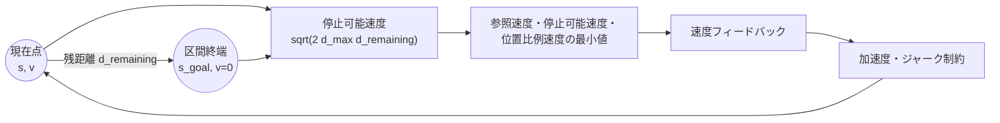
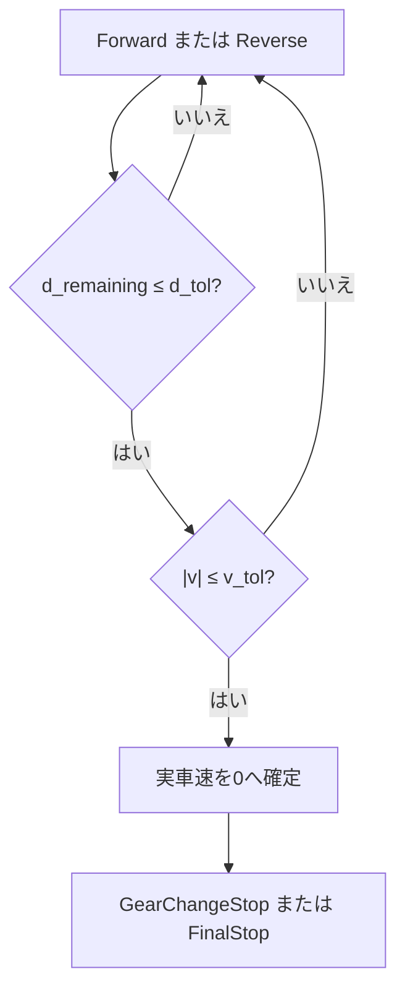

# 停止位置制御

## 1. 目的

目標速度が0になる時刻だけでなく、区間終端までの残距離と実車速を使って切り返し位置・最終位置へ停止します。

**図1　現在点から区間終端までの残距離を使う停止閉ループ**

## 2. 残距離

現在の経路長を$s$、区間終端を$s_{\mathrm{goal}}$とします。

**理論ID：`STOP-EQ-01`**

**理論ID：`STOP-EQ-01`**

**理論ID：`STOP-EQ-01`**

$$
d_{\mathrm{remaining}}=s_{\mathrm{goal}}-s
\tag{1}
$$

## 3. 停止可能速度

速度と距離の関係$v_1^2=v_0^2+2a\Delta s$で、終端速度を0、減速度の大きさを$d_{\max}$とすると、残距離内で停止できる速度上限は次式です。

**理論ID：`STOP-EQ-02`**

**理論ID：`STOP-EQ-02`**

**理論ID：`STOP-EQ-02`**

$$
v_{\mathrm{stop,max}}=\sqrt{2d_{\max}d_{\mathrm{remaining}}}
\tag{2}
$$

終端へ近づくほど速度を比例的に下げる上限も用意します。

**理論ID：`STOP-EQ-03`**

**理論ID：`STOP-EQ-03`**

**理論ID：`STOP-EQ-03`**

$$
v_{\mathrm{position}}=K_s d_{\mathrm{remaining}}
\tag{3}
$$

三つの候補の最小値を制御用速度とします。

**理論ID：`STOP-EQ-04`**

**理論ID：`STOP-EQ-04`**

**理論ID：`STOP-EQ-04`**

$$
|v_{\mathrm{target}}|=\min(|v_{\mathrm{ref}}|,v_{\mathrm{stop,max}},v_{\mathrm{position}})
\tag{4}
$$

## 4. 停止完了判定

位置だけでなく実車速も小さいことを要求します。

**理論ID：`STOP-EQ-05`**

**理論ID：`STOP-EQ-05`**

**理論ID：`STOP-EQ-05`**

$$
d_{\mathrm{remaining}}\le d_{\mathrm{tol}}
\tag{5}
$$

**理論ID：`STOP-EQ-06`**

**理論ID：`STOP-EQ-06`**

**理論ID：`STOP-EQ-06`**

$$
|v|\le v_{\mathrm{tol}}
\tag{6}
$$

式 (5)と式 (6)を同時に満たしたときだけ状態機械を次へ進めます。

## 5. ソースコードとの対応

式 (1)は`runParkingScenario()`、式 (2)～式 (6)は`VelocityStopController::computeCommand()`に対応します。`testStopPositionControl()`と駐車統合テストで検証します。

## 6. 状態管理との接続

**図2　位置と実車速を両方使う区間完了判定**

## 7. 前後の文書

- 制約付き加速度：[加減速度・ジャーク制約](longitudinal_constraints.md)
- 停止後の状態遷移：[前進・停止・後退の状態管理](../fundamentals/parking_state_management.md)
- 横追従状態も使う速度調整：[縦方向・横方向制御の協調](longitudinal_lateral_coordination.md)

