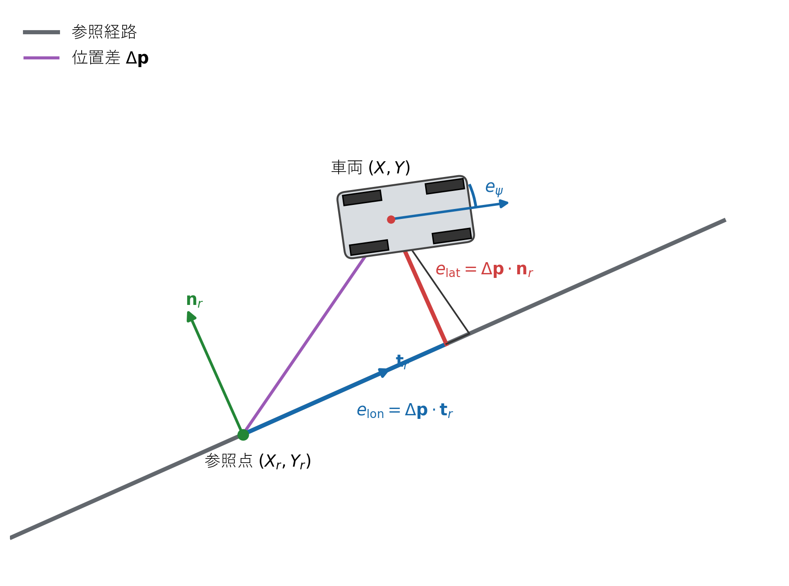

# 座標系と追従誤差

## 1. この章の目的

車両が目標軌道から「どの方向へ、どれだけずれているか」を表す方法を説明します。ここで決める符号は、後から追加するフィードバック制御器でも共通して使います。

**図1　世界座標系、車両座標系、車両方位角の定義**

図1の世界座標上の位置差を式 (1) で求め、参照方位に沿う方向と左方向へ射影した値が式 (4)、式 (5) です。

図1では世界座標$(X,Y)$、車両座標$(x_v,y_v)$、状態位置$(x,y)$、車両方位$\psi$、後輪車軸中心、COGを同時に示します。状態位置はCOGではなく後輪車軸中心です。

## 2. 使用する記号

| 記号 | 意味 |
|---|---|
| $(X,Y)$ | 車両位置の世界座標 [m] |
| $(X_r,Y_r)$ | 参照点の世界座標 [m] |
| $\psi$ | 車両方位角 [rad] |
| $\psi_r$ | 参照点の方位角 [rad] |
| $e_{\mathrm{lon}}$ | 符号付き縦偏差 [m] |
| $e_{\mathrm{lat}}$ | 符号付き横偏差 [m] |
| $e_\psi$ | 方位誤差 [rad] |

## 3. 世界座標上の位置差

**図2　位置差ベクトルを縦偏差・横偏差へ射影する幾何学的関係**

図2には位置差$\Delta\boldsymbol{p}$、接線$\boldsymbol{t}_r$、法線$\boldsymbol{n}_r$、縦偏差$e_{\mathrm{lon}}$、横偏差$e_{\mathrm{lat}}$、方位誤差$e_\psi$を表示しています。式 (1)～式 (7) の幾何変数を図上で対応付けられます。

最初に、参照点から車両へ向かう差ベクトルを考えます。各座標を引けば、その $X$ 成分と $Y$ 成分は式 (1) になります。

**理論ID：`COORD-EQ-01`**

**理論ID：`COORD-EQ-01`**

**理論ID：`COORD-EQ-01`**

**理論ID：`COORD-EQ-01`**

$$
\Delta X=X-X_r,\qquad \Delta Y=Y-Y_r
\tag{1}
$$

式 (1) はまだ世界座標での差なので、このままでは経路に対して前後・左右のどちらへずれたのか分かりません。そこで参照点の向きを基準に座標を回転します。

## 4. 参照点に沿った単位ベクトル

長さ1で角度 $\psi_r$ のベクトルは、三角比から式 (2) です。これは参照経路の前方向を表します。

**理論ID：`COORD-EQ-02`**

**理論ID：`COORD-EQ-02`**

**理論ID：`COORD-EQ-02`**

**理論ID：`COORD-EQ-02`**

$$
\boldsymbol{t}_r=
\begin{bmatrix}
\cos\psi_r\\
\sin\psi_r
\end{bmatrix}
\tag{2}
$$

式 (2) を反時計回りに90度回すと、参照経路の左方向を向く式 (3) になります。

**理論ID：`COORD-EQ-03`**

**理論ID：`COORD-EQ-03`**

**理論ID：`COORD-EQ-03`**

**理論ID：`COORD-EQ-03`**

$$
\boldsymbol{n}_r=
\begin{bmatrix}
-\sin\psi_r\\
\cos\psi_r
\end{bmatrix}
\tag{3}
$$

## 5. 縦偏差の導出

差ベクトル $(\Delta X,\Delta Y)$ が前方向へどれだけ含まれるかは、差ベクトルと式 (2) の内積で求められます。成分ごとに掛けて足すと式 (4) です。

**理論ID：`COORD-EQ-04`**

**理論ID：`COORD-EQ-04`**

**理論ID：`COORD-EQ-04`**

**理論ID：`COORD-EQ-04`**

$$
e_{\mathrm{lon}}
=\begin{bmatrix}\Delta X&\Delta Y\end{bmatrix}\boldsymbol{t}_r
=\Delta X\cos\psi_r+\Delta Y\sin\psi_r
\tag{4}
$$

式 (4) が正なら参照点より前、負なら後ろに車両があります。

## 6. 横偏差の導出

同様に、差ベクトルと式 (3) の内積を取ります。これにより式 (5) を得ます。

**理論ID：`COORD-EQ-05`**

**理論ID：`COORD-EQ-05`**

**理論ID：`COORD-EQ-05`**

**理論ID：`COORD-EQ-05`**

$$
e_{\mathrm{lat}}
=\begin{bmatrix}\Delta X&\Delta Y\end{bmatrix}\boldsymbol{n}_r
=-\Delta X\sin\psi_r+\Delta Y\cos\psi_r
\tag{5}
$$

本実装では、式 (5) が正なら参照経路の左側、負なら右側に車両があると定義します。

## 7. 方位誤差の導出

車両が参照方位へ一致するために必要な回転量は「目標－現在」なので、まず式 (6) の差を取ります。

**理論ID：`COORD-EQ-06`**

**理論ID：`COORD-EQ-06`**

**理論ID：`COORD-EQ-06`**

**理論ID：`COORD-EQ-06`**

$$
\Delta\psi=\psi_r-\psi
\tag{6}
$$

角度は $2\pi$ ごとに同じ向きを表します。例えば $179^\circ$ と $-179^\circ$ の単純な差は $358^\circ$ ですが、実際の最短回転は $-2^\circ$ です。そのため式 (6) を $[-\pi,\pi]$ へ正規化し、式 (7) を方位誤差とします。

**理論ID：`COORD-EQ-07`**

**理論ID：`COORD-EQ-07`**

**理論ID：`COORD-EQ-07`**

**理論ID：`COORD-EQ-07`**

$$
e_\psi=\operatorname{wrap}(\Delta\psi)
=\operatorname{atan2}(\sin\Delta\psi,\cos\Delta\psi)
\tag{7}
$$

## 8. 実装との対応

図1、図2と式 (1)、式 (4)、式 (5)、式 (7) の符号規約は `include/core/tracking_error.hpp` に実装され、`src/simulation/parking_simulator.cpp`から使用されます。CSVではそれぞれ `longitudinal_error`、`lateral_error`、`yaw_error` として確認できます。

## 9. 初心者向け確認ポイント

- 参照方位が $0$ のとき、式 (4) は $e_{\mathrm{lon}}=\Delta X$ になります。
- 参照方位が $0$ のとき、式 (5) は $e_{\mathrm{lat}}=\Delta Y$ になります。
- 参照方位が変わっても、偏差は参照経路から見た前後・左右として解釈できます。

実装関数、変数、単体テストとの対応は[全体トレーサビリティ](../traceability.md#3-座標系と追従誤差)を参照してください。
