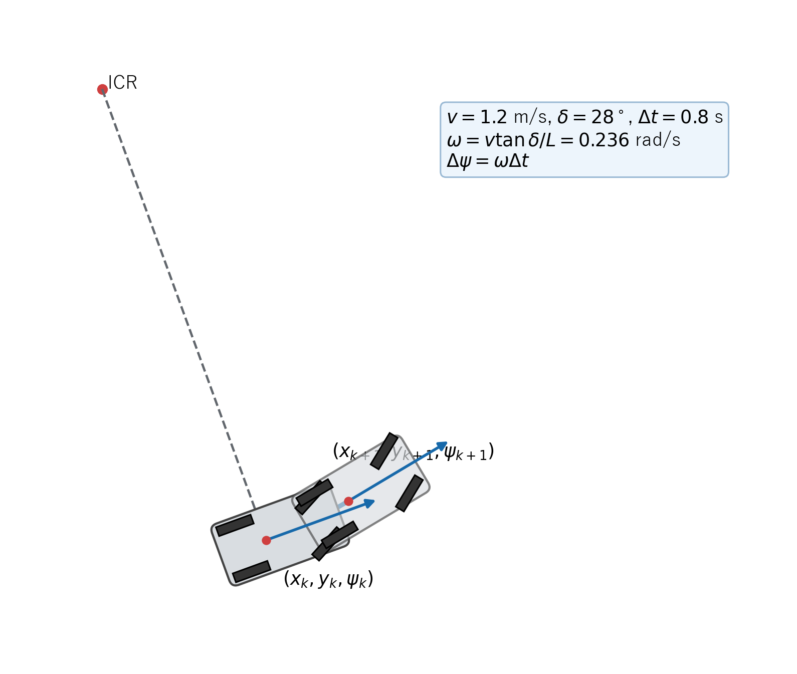

# キネマティック自転車モデル

## 1. この章の目的

速度と前輪舵角から車両位置・方位を更新する式を導出します。極低速ではタイヤ横滑りや慣性の影響が比較的小さいため、左右輪を一本ずつにまとめたキネマティック自転車モデルを使います。

## 2. モデルの前提

- タイヤは横滑りしない。
- 車体は変形しない。
- 左右の前輪を一本、左右の後輪を一本として扱う。
- 状態位置 $(x,y)$ は後輪車軸中心とする。
- 1回の更新中は速度と舵角が一定とする。

三角関数を含むため、このモデルは非線形モデルです。

## 3. 使用する記号

| 記号 | 意味 |
|---|---|
| $(x,y)$ | 後輪車軸中心の世界座標 [m] |
| $\psi$ | 車両方位角 [rad] |
| $v$ | 符号付き前後方向速度 [m/s] |
| $\delta$ | 前輪舵角 [rad] |
| $L$ | ホイールベース [m] |
| $R$ | 後輪車軸中心の旋回半径 [m] |
| $\omega$ | ヨーレート [rad/s] |

**図1　舵角、ホイールベース、旋回半径の幾何学的関係**

図1の直角三角形が式 (1)～式 (3) に対応します。後輪車軸中心から瞬間旋回中心までが旋回半径$R$、前後車軸間がホイールベース$L$です。

図1の車体寸法、前後車軸、トレッド、COG位置、最大舵角は`include/core/vehicle_parameters.hpp`の共通諸元から生成しています。

## 4. 舵角と旋回半径

旋回中、前輪は円の接線方向を向きます。後輪車軸中心、前輪車軸中心、瞬間旋回中心でできる直角三角形では、舵角 $\delta$ に対する「向かい側の辺」が $L$、「隣の辺」が $R$ です。正接の定義から式 (1) が成り立ちます。

**理論ID：`BICYCLE-EQ-01`**

**理論ID：`BICYCLE-EQ-01`**

**理論ID：`BICYCLE-EQ-01`**

**理論ID：`BICYCLE-EQ-01`**

$$
\tan\delta=\frac{L}{R}
\tag{1}
$$

式 (1) の両辺を $L$ で割ると式 (2) です。

**理論ID：`BICYCLE-EQ-02`**

**理論ID：`BICYCLE-EQ-02`**

**理論ID：`BICYCLE-EQ-02`**

**理論ID：`BICYCLE-EQ-02`**

$$
\frac{1}{R}=\frac{\tan\delta}{L}
\tag{2}
$$

曲率は旋回半径の逆数 $\kappa=1/R$ なので、式 (2) は式 (3) と書けます。

**理論ID：`BICYCLE-EQ-03`**

**理論ID：`BICYCLE-EQ-03`**

**理論ID：`BICYCLE-EQ-03`**

**理論ID：`BICYCLE-EQ-03`**

$$
\kappa=\frac{\tan\delta}{L}
\tag{3}
$$

## 5. ヨーレートの導出

半径 $R$ の円で、微小角度 $d\psi$ に対応する弧長は $ds=R\,d\psi$ です。時間 $dt$ で割ると式 (4) になります。

**理論ID：`BICYCLE-EQ-04`**

**理論ID：`BICYCLE-EQ-04`**

**理論ID：`BICYCLE-EQ-04`**

**理論ID：`BICYCLE-EQ-04`**

$$
\frac{ds}{dt}=R\frac{d\psi}{dt}
\tag{4}
$$

$ds/dt=v$、$d\psi/dt=\dot\psi$ を式 (4) へ代入し、$\dot\psi$ について解きます。

**理論ID：`BICYCLE-EQ-05`**

**理論ID：`BICYCLE-EQ-05`**

**理論ID：`BICYCLE-EQ-05`**

**理論ID：`BICYCLE-EQ-05`**

$$
\dot\psi=\frac{v}{R}=v\kappa
\tag{5}
$$

式 (5) へ式 (3) を代入すると、舵角からヨーレートを求める式 (6) を得ます。

**理論ID：`BICYCLE-EQ-06`**

**理論ID：`BICYCLE-EQ-06`**

**理論ID：`BICYCLE-EQ-06`**

**理論ID：`BICYCLE-EQ-06`**

$$
\omega=\dot\psi=\frac{v\tan\delta}{L}
\tag{6}
$$

## 6. 世界座標上の速度

車両は方位角 $\psi$ の方向へ速さ $v$ で進みます。速度ベクトルを直角三角形の成分へ分けると式 (7)、式 (8) です。

**理論ID：`BICYCLE-EQ-07`**

**理論ID：`BICYCLE-EQ-07`**

**理論ID：`BICYCLE-EQ-07`**

**理論ID：`BICYCLE-EQ-07`**

$$
\dot x=v\cos\psi
\tag{7}
$$

**理論ID：`BICYCLE-EQ-08`**

**理論ID：`BICYCLE-EQ-08`**

**理論ID：`BICYCLE-EQ-08`**

**理論ID：`BICYCLE-EQ-08`**

$$
\dot y=v\sin\psi
\tag{8}
$$

式 (6)～式 (8) をまとめたものが連続時間の車両モデルです。

## 7. 1周期後の方位角

**図2　速度・舵角から1周期後の位置と方位を求める円運動**

図2には$(x_k,y_k,\psi_k)$、$(x_{k+1},y_{k+1},\psi_{k+1})$、$v$、$\delta$、$\Delta t$、$\omega$、$\Delta\psi$、ICRを表示しています。式 (6)、式 (9)～式 (12) の変数を一つの円運動として確認できます。

1周期 $\Delta t$ の間で $v$ と $\delta$ が一定なら、式 (6) の $\omega$ も一定です。$\dot\psi=\omega$ を時間積分すると式 (9) になります。

**理論ID：`BICYCLE-EQ-09`**

**理論ID：`BICYCLE-EQ-09`**

**理論ID：`BICYCLE-EQ-09`**

**理論ID：`BICYCLE-EQ-09`**

$$
\psi_{k+1}=\psi_k+\omega\Delta t
\tag{9}
$$

## 8. 旋回時の位置更新

$\omega\ne0$ では、式 (9) から $d\psi=\omega\,dt$、したがって $dt=d\psi/\omega$ と書けます。これを式 (7) へ代入します。

**理論ID：`BICYCLE-EQ-10`**

**理論ID：`BICYCLE-EQ-10`**

**理論ID：`BICYCLE-EQ-10`**

**理論ID：`BICYCLE-EQ-10`**

$$
dx=v\cos\psi\frac{d\psi}{\omega}
\tag{10}
$$

式 (10) を現在方位から次の方位まで積分すると式 (11) です。

**理論ID：`BICYCLE-EQ-11`**

**理論ID：`BICYCLE-EQ-11`**

**理論ID：`BICYCLE-EQ-11`**

**理論ID：`BICYCLE-EQ-11`**

$$
x_{k+1}=x_k+\frac{v}{\omega}
(\sin\psi_{k+1}-\sin\psi_k)
\tag{11}
$$

同じように式 (8) を積分します。$\sin\psi$ の積分は $-\cos\psi$ なので式 (12) です。

**理論ID：`BICYCLE-EQ-12`**

**理論ID：`BICYCLE-EQ-12`**

**理論ID：`BICYCLE-EQ-12`**

**理論ID：`BICYCLE-EQ-12`**

$$
y_{k+1}=y_k-\frac{v}{\omega}
(\cos\psi_{k+1}-\cos\psi_k)
\tag{12}
$$

## 9. 直進に近い場合

$\omega$ がゼロに非常に近いと、式 (11)、式 (12) の $v/\omega$ が数値的に不安定になります。この場合、1周期では方位がほぼ一定とみなし、式 (13) を使います。

**理論ID：`BICYCLE-EQ-13`**

**理論ID：`BICYCLE-EQ-13`**

**理論ID：`BICYCLE-EQ-13`**

**理論ID：`BICYCLE-EQ-13`**

$$
x_{k+1}=x_k+v\cos\psi_k\Delta t,\qquad
y_{k+1}=y_k+v\sin\psi_k\Delta t
\tag{13}
$$

位置に式 (13) を使う場合でも、方位角は式 (9) で更新します。これにより極小旋回の方位変化を失いません。

## 10. 実装との対応

図1と式 (1)～式 (3)、式 (6)、式 (9)、式 (11)～式 (13) は `src/models/kinematic_bicycle.cpp` に対応します。前進・後退の符号は `tests/kinematic_bicycle_test.cpp` で検証します。

## 11. 初心者向け確認ポイント

- $\delta=0$ なら $\tan\delta=0$ なので $\omega=0$、車両は直進します。
- 同じ舵角でも、後退して $v<0$ になるとヨーレートの符号が反転します。
- ホイールベース $L$ が長いほど、同じ舵角での旋回は緩やかになります。

実装関数、変数、単体テストとの対応は[全体トレーサビリティ](../traceability.md#5-キネマティック自転車モデル)を参照してください。
