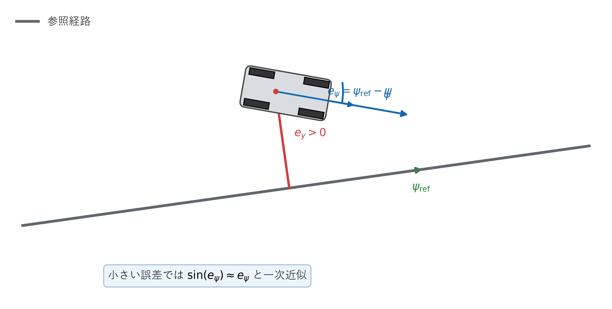
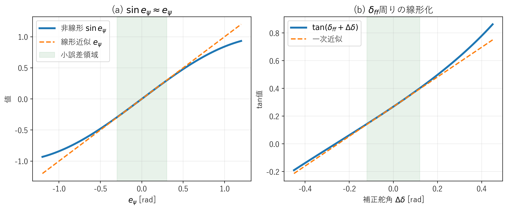

# 線形軌道誤差モデル

## 1. この文書の目的

非線形キネマティック自転車モデルから、LQRが使用する横偏差・方位誤差の線形モデルを導出します。本プロジェクト固有の誤差符号を途中で省略せず説明します。

## 2. 誤差の定義

車両が参照経路の左側にあるとき、横偏差$e_y$を正とします。方位誤差は、

**理論ID：`LINERR-EQ-01`**

**理論ID：`LINERR-EQ-01`**

**理論ID：`LINERR-EQ-01`**

**理論ID：`LINERR-EQ-01`**

$$
e_\psi=\psi_{\mathrm{ref}}-\psi
\tag{1}
$$

です。一般的な資料には逆符号の定義もあるため、式だけをコピーせず式 (1) と一致させる必要があります。

状態と制御入力を、

**理論ID：`LINERR-EQ-02`**

**理論ID：`LINERR-EQ-02`**

**理論ID：`LINERR-EQ-02`**

**理論ID：`LINERR-EQ-02`**

$$
\boldsymbol{x}=\begin{bmatrix}e_y&e_\psi\end{bmatrix}^{\mathsf T}
\tag{2}
$$

**理論ID：`LINERR-EQ-03`**

**理論ID：`LINERR-EQ-03`**

**理論ID：`LINERR-EQ-03`**

**理論ID：`LINERR-EQ-03`**

$$
u=\Delta\delta
\tag{3}
$$

とします。$\Delta\delta$は参照曲率から求めた舵角に追加する補正量です。

**図1　線形誤差モデルで使用する横偏差と方位誤差**

図1の$e_y$が式 (2) の第1状態、$e_\psi$が第2状態です。図の符号関係から、車両が参照方位より左を向くと$e_\psi<0$になることを確認できます。

## 3. 横偏差の変化

**図2　$\sin e_\psi$と$\tan(\delta_{\mathrm{ff}}+\Delta\delta)$の一次近似範囲**

図2(a)は式 (4)から式 (5)への近似、図2(b)は式 (10)から式 (11)への近似を示します。緑色の範囲では非線形式と一次近似が近く、誤差や補正舵角が大きくなると差が増えます。

車両方位は式 (1)から$\psi=\psi_{\mathrm{ref}}-e_\psi$です。参照経路に対する横方向速度は、

**理論ID：`LINERR-EQ-04`**

**理論ID：`LINERR-EQ-04`**

**理論ID：`LINERR-EQ-04`**

**理論ID：`LINERR-EQ-04`**

$$
\dot e_y=v\sin(\psi-\psi_{\mathrm{ref}})=v\sin(-e_\psi)
\tag{4}
$$

となります。誤差が小さい範囲では$\sin e_\psi\approx e_\psi$なので、

**理論ID：`LINERR-EQ-05`**

**理論ID：`LINERR-EQ-05`**

**理論ID：`LINERR-EQ-05`**

**理論ID：`LINERR-EQ-05`**

$$
\dot e_y\approx-ve_\psi
\tag{5}
$$

です。負号は式 (1)の方位誤差定義から生じます。

## 4. 方位誤差の変化

方位誤差の時間変化は、参照方位と車両方位の変化率の差です。

**理論ID：`LINERR-EQ-06`**

**理論ID：`LINERR-EQ-06`**

**理論ID：`LINERR-EQ-06`**

**理論ID：`LINERR-EQ-06`**

$$
\dot e_\psi=\dot\psi_{\mathrm{ref}}-\dot\psi
\tag{6}
$$

参照経路と車両のヨーレートは、

**理論ID：`LINERR-EQ-07`**

**理論ID：`LINERR-EQ-07`**

**理論ID：`LINERR-EQ-07`**

**理論ID：`LINERR-EQ-07`**

$$
\dot\psi_{\mathrm{ref}}=v\kappa_{\mathrm{ref}}
\tag{7}
$$

**理論ID：`LINERR-EQ-08`**

**理論ID：`LINERR-EQ-08`**

**理論ID：`LINERR-EQ-08`**

**理論ID：`LINERR-EQ-08`**

$$
\dot\psi=\frac{v}{L}\tan\delta
\tag{8}
$$

です。参照曲率に対応するフィードフォワード舵角を、

**理論ID：`LINERR-EQ-09`**

**理論ID：`LINERR-EQ-09`**

**理論ID：`LINERR-EQ-09`**

**理論ID：`LINERR-EQ-09`**

$$
\delta_{\mathrm{ff}}=\tan^{-1}(L\kappa_{\mathrm{ref}})
\tag{9}
$$

とし、実舵角を、

**理論ID：`LINERR-EQ-10`**

**理論ID：`LINERR-EQ-10`**

**理論ID：`LINERR-EQ-10`**

**理論ID：`LINERR-EQ-10`**

$$
\delta=\delta_{\mathrm{ff}}+\Delta\delta
\tag{10}
$$

と分解します。$\tan\delta$を$\delta_{\mathrm{ff}}$周りで一次近似すると、

**理論ID：`LINERR-EQ-11`**

**理論ID：`LINERR-EQ-11`**

**理論ID：`LINERR-EQ-11`**

**理論ID：`LINERR-EQ-11`**

$$
\tan(\delta_{\mathrm{ff}}+\Delta\delta)\approx\tan\delta_{\mathrm{ff}}+\frac{1}{\cos^2\delta_{\mathrm{ff}}}\Delta\delta
\tag{11}
$$

です。式 (9)から$\tan\delta_{\mathrm{ff}}=L\kappa_{\mathrm{ref}}$なので、式 (6)～式 (11)を整理すると参照曲率の項が相殺され、

**理論ID：`LINERR-EQ-12`**

**理論ID：`LINERR-EQ-12`**

**理論ID：`LINERR-EQ-12`**

**理論ID：`LINERR-EQ-12`**

$$
\dot e_\psi\approx-\frac{v}{L\cos^2\delta_{\mathrm{ff}}}\Delta\delta
\tag{12}
$$

となります。

## 5. 連続時間状態方程式

式 (5)と式 (12)をまとめると、

**理論ID：`LINERR-EQ-13`**

**理論ID：`LINERR-EQ-13`**

**理論ID：`LINERR-EQ-13`**

**理論ID：`LINERR-EQ-13`**

$$
\dot{\boldsymbol{x}}=A_c\boldsymbol{x}+B_cu
\tag{13}
$$

**理論ID：`LINERR-EQ-14`**

**理論ID：`LINERR-EQ-14`**

**理論ID：`LINERR-EQ-14`**

**理論ID：`LINERR-EQ-14`**

$$
A_c=\begin{bmatrix}0&-v\\0&0\end{bmatrix}
\tag{14}
$$

**理論ID：`LINERR-EQ-15`**

**理論ID：`LINERR-EQ-15`**

**理論ID：`LINERR-EQ-15`**

**理論ID：`LINERR-EQ-15`**

$$
B_c=\begin{bmatrix}0\\-\dfrac{v}{L\cos^2\delta_{\mathrm{ff}}}\end{bmatrix}
\tag{15}
$$

です。符号付き速度$v$を使うため、同じ式で前進と後退を表せます。

## 6. 離散化

周期$\Delta t$の前進オイラー近似は、

**理論ID：`LINERR-EQ-16`**

**理論ID：`LINERR-EQ-16`**

**理論ID：`LINERR-EQ-16`**

**理論ID：`LINERR-EQ-16`**

$$
\boldsymbol{x}_{k+1}\approx\boldsymbol{x}_k+\Delta t(A_c\boldsymbol{x}_k+B_cu_k)
\tag{16}
$$

です。これを、

**理論ID：`LINERR-EQ-17`**

**理論ID：`LINERR-EQ-17`**

**理論ID：`LINERR-EQ-17`**

**理論ID：`LINERR-EQ-17`**

$$
\boldsymbol{x}_{k+1}=A_d\boldsymbol{x}_k+B_du_k
\tag{17}
$$

と書くと、

**理論ID：`LINERR-EQ-18`**

**理論ID：`LINERR-EQ-18`**

**理論ID：`LINERR-EQ-18`**

**理論ID：`LINERR-EQ-18`**

$$
A_d=\begin{bmatrix}1&-v\Delta t\\0&1\end{bmatrix}
\tag{18}
$$

**理論ID：`LINERR-EQ-19`**

**理論ID：`LINERR-EQ-19`**

**理論ID：`LINERR-EQ-19`**

**理論ID：`LINERR-EQ-19`**

$$
B_d=\begin{bmatrix}0\\-\dfrac{v\Delta t}{L\cos^2\delta_{\mathrm{ff}}}\end{bmatrix}
\tag{19}
$$

となります。

## 7. 停止付近とゲイン更新

$v=0$では式 (19)がゼロとなり、舵角だけでは位置・方位を変えられません。実装では軌道から進行方向を取得し、LQR計算だけに最小線形化速度0.5 m/sを使用します。車両モデルへ渡す速度は変更しません。

$A_d$と$B_d$は速度と参照舵角で変わります。両者が一定量変化したときにRiccati方程式を解き直し、それ以外の周期では直前のゲインを再利用します。

## 8. ソースコードとの対応

| 数式 | 実装 |
|---|---|
| 図1、式 (1)、式 (2) | `include/core/tracking_error.hpp`、`src/controllers/lqr_controller.cpp` |
| 図2、式 (4)、式 (5)、式 (10)、式 (11) | 非線形式と一次近似 | `src/models/linear_error_model.cpp` |
| 式 (9)～式 (12) | `src/controllers/lqr_controller.cpp`、`src/models/linear_error_model.cpp` |
| 式 (13)～式 (19) | `src/models/linear_error_model.cpp` |

`LinearErrorModelMatrices`はEigenの固定サイズ型`Matrix2d`と`Vector2d`を使用します。式 (18)、式 (19)の行と列がコード上でも明示されるため、手書きの二重添字配列より数式との対応を追いやすくなっています。

関数・変数・単体テストまで含む対応は[全体トレーサビリティ](../traceability.md#74-線形誤差モデルlqr)を参照してください。
