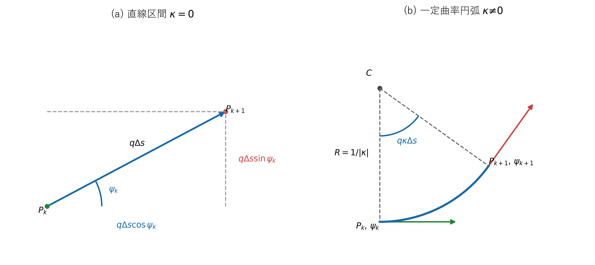
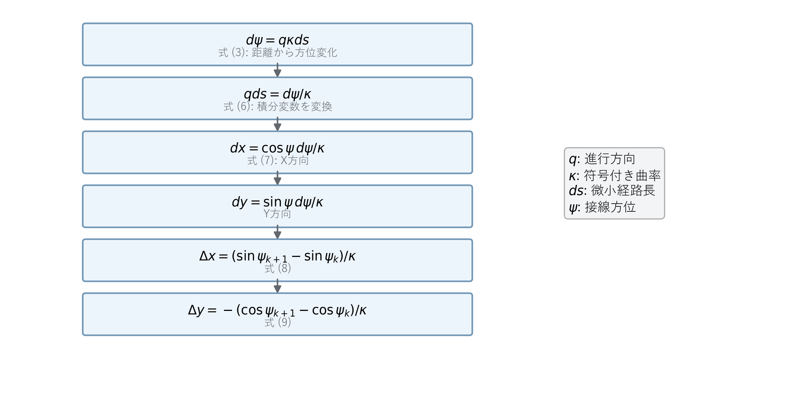

# 目標経路生成

## 1. この章の目的

目標経路は「車両がどこを、どの向きで通るか」を表します。時刻、速度、加速度はまだ含みません。この章では直線と一定曲率円弧を離散的な経路点へ変換する過程を説明します。

**図1　直線と円弧を接続して生成するサンプル経路**

図1は、直線区間の$P_k$、$P_{k+1}$、$q\Delta s$、$\psi_k$と、円弧区間の中心$C$、半径$R$、曲率$\kappa$、方位変化$q\kappa\Delta s$を分けて示します。

## 2. 使用する記号と符号

| 記号 | 意味 |
|---|---|
| $s$ | 経路始点からの累積距離 [m] |
| $(x,y)$ | 経路点の世界座標 [m] |
| $\psi$ | 経路接線の方位角 [rad] |
| $\kappa$ | 符号付き曲率 [1/m] |
| $q$ | 進行方向。前進は $+1$、後退は $-1$ |
| $\Delta s$ | 経路点間の距離 [m] |

左旋回の曲率を正、右旋回の曲率を負とします。

## 3. 微小な位置変化

方位角 $\psi$ の方向へ微小距離 $ds$ 進む状況を考えます。進行距離を斜辺とする直角三角形を考えると、$x$ 方向成分は $\cos\psi$、$y$ 方向成分は $\sin\psi$ です。進行方向の符号 $q$ を加えると式 (1) になります。

**理論ID：`PATH-EQ-01`**

**理論ID：`PATH-EQ-01`**

**理論ID：`PATH-EQ-01`**

**理論ID：`PATH-EQ-01`**

$$
dx=q\cos\psi\,ds,\qquad dy=q\sin\psi\,ds
\tag{1}
$$

前進では $q=+1$ なので方位角方向へ進み、後退では $q=-1$ なので同じ車両方位のまま反対方向へ進みます。

## 4. 曲率と方位角の関係

曲率は、単位距離を進んだときに方位角がどれだけ変化するかを表します。進行方向を含めると定義は式 (2) です。

**理論ID：`PATH-EQ-02`**

**理論ID：`PATH-EQ-02`**

**理論ID：`PATH-EQ-02`**

**理論ID：`PATH-EQ-02`**

$$
\kappa=\frac{d\psi}{q\,ds}
\tag{2}
$$

式 (2) の両辺へ $q\,ds$ を掛けると、微小な方位変化は式 (3) になります。

**理論ID：`PATH-EQ-03`**

**理論ID：`PATH-EQ-03`**

**理論ID：`PATH-EQ-03`**

**理論ID：`PATH-EQ-03`**

$$
d\psi=q\kappa\,ds
\tag{3}
$$

区間内で $q$ と $\kappa$ が一定なら、式 (3) を距離 $\Delta s$ について積分できます。その結果、次の経路点の方位角は式 (4) です。

**理論ID：`PATH-EQ-04`**

**理論ID：`PATH-EQ-04`**

**理論ID：`PATH-EQ-04`**

**理論ID：`PATH-EQ-04`**

$$
\psi_{k+1}=\psi_k+q\kappa\Delta s
\tag{4}
$$

## 5. 直線区間の導出

直線では曲率がゼロなので、式 (4) から方位角は変わりません。短い区間内では方位角一定として式 (1) を積分すると、式 (5) を得ます。

**理論ID：`PATH-EQ-05`**

**理論ID：`PATH-EQ-05`**

**理論ID：`PATH-EQ-05`**

**理論ID：`PATH-EQ-05`**

$$
x_{k+1}=x_k+q\Delta s\cos\psi_k,\qquad
y_{k+1}=y_k+q\Delta s\sin\psi_k
\tag{5}
$$

## 6. 円弧区間の位置導出

**図2　微小方位変化から円弧位置更新式までの変形順序**

図2は式 (3)、式 (6)～式 (9) の変形を上から順に示します。右側の記号表には$q$、$\kappa$、$ds$、$\psi$の意味を併記しています。

円弧では方位角が区間内でも変わるため、式 (5) の直線近似を使わず解析的に積分します。まず式 (3) を $q\,ds$ について解きます。

**理論ID：`PATH-EQ-06`**

**理論ID：`PATH-EQ-06`**

**理論ID：`PATH-EQ-06`**

**理論ID：`PATH-EQ-06`**

$$
q\,ds=\frac{d\psi}{\kappa}
\tag{6}
$$

式 (6) を式 (1) の $x$ 成分へ代入すると、式 (7) になります。

**理論ID：`PATH-EQ-07`**

**理論ID：`PATH-EQ-07`**

**理論ID：`PATH-EQ-07`**

**理論ID：`PATH-EQ-07`**

$$
dx=\cos\psi\frac{d\psi}{\kappa}
\tag{7}
$$

式 (7) を $\psi_k$ から $\psi_{k+1}$ まで積分します。$\cos\psi$ の積分が $\sin\psi$ であることから式 (8) を得ます。

**理論ID：`PATH-EQ-08`**

**理論ID：`PATH-EQ-08`**

**理論ID：`PATH-EQ-08`**

**理論ID：`PATH-EQ-08`**

$$
x_{k+1}-x_k
=\frac{1}{\kappa}\int_{\psi_k}^{\psi_{k+1}}\cos\psi\,d\psi
=\frac{\sin\psi_{k+1}-\sin\psi_k}{\kappa}
\tag{8}
$$

同じ手順を $y$ 成分へ適用します。$\sin\psi$ の積分は $-\cos\psi$ なので式 (9) です。

**理論ID：`PATH-EQ-09`**

**理論ID：`PATH-EQ-09`**

**理論ID：`PATH-EQ-09`**

**理論ID：`PATH-EQ-09`**

$$
y_{k+1}-y_k
=\frac{1}{\kappa}\int_{\psi_k}^{\psi_{k+1}}\sin\psi\,d\psi
=-\frac{\cos\psi_{k+1}-\cos\psi_k}{\kappa}
\tag{9}
$$

式 (8)、式 (9) の左辺を整理すると、実装で使用する更新式 (10)、式 (11) になります。

**理論ID：`PATH-EQ-10`**

**理論ID：`PATH-EQ-10`**

**理論ID：`PATH-EQ-10`**

**理論ID：`PATH-EQ-10`**

$$
x_{k+1}=x_k+\frac{\sin\psi_{k+1}-\sin\psi_k}{\kappa}
\tag{10}
$$

**理論ID：`PATH-EQ-11`**

**理論ID：`PATH-EQ-11`**

**理論ID：`PATH-EQ-11`**

**理論ID：`PATH-EQ-11`**

$$
y_{k+1}=y_k-\frac{\cos\psi_{k+1}-\cos\psi_k}{\kappa}
\tag{11}
$$

## 7. 半径から曲率を求める

半径 $R$ の円では、1 radだけ向きが変わる間に弧長 $R$ を進みます。したがって曲率の大きさは $1/R$ です。旋回方向の符号を加えると式 (12) になります。

**理論ID：`PATH-EQ-12`**

**理論ID：`PATH-EQ-12`**

**理論ID：`PATH-EQ-12`**

**理論ID：`PATH-EQ-12`**

$$
\kappa=\frac{\operatorname{sign}(\mathrm{turn})}{R}
\tag{12}
$$

## 8. 実装との対応

式 (4)、式 (5)、式 (10)、式 (11) は `src/trajectory/path_generator.cpp` に対応します。`PathGenerator` は曲率が十分小さい場合に式 (5)、それ以外では円弧の式を使います。

## 9. 初心者向け確認ポイント

- $\kappa=0$ なら方位角は変化せず、直線になります。
- 半径 $R$ が小さいほど $|\kappa|$ は大きくなり、急旋回になります。
- 後退時は $q=-1$ なので、同じ曲率でも方位角変化の向きが前進時と反対になります。

実装関数、変数、検証先との対応は[全体トレーサビリティ](../traceability.md#4-経路軌道生成)を参照してください。
