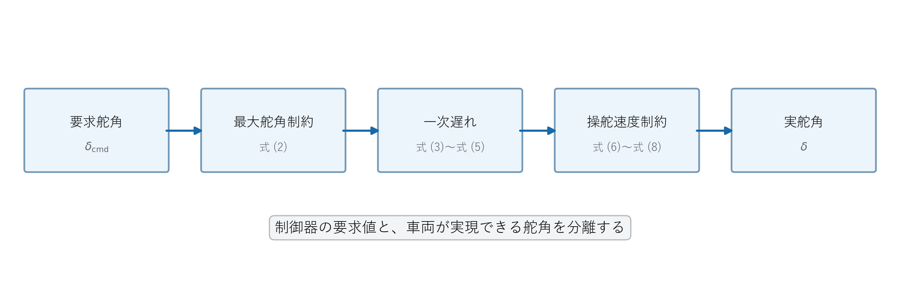
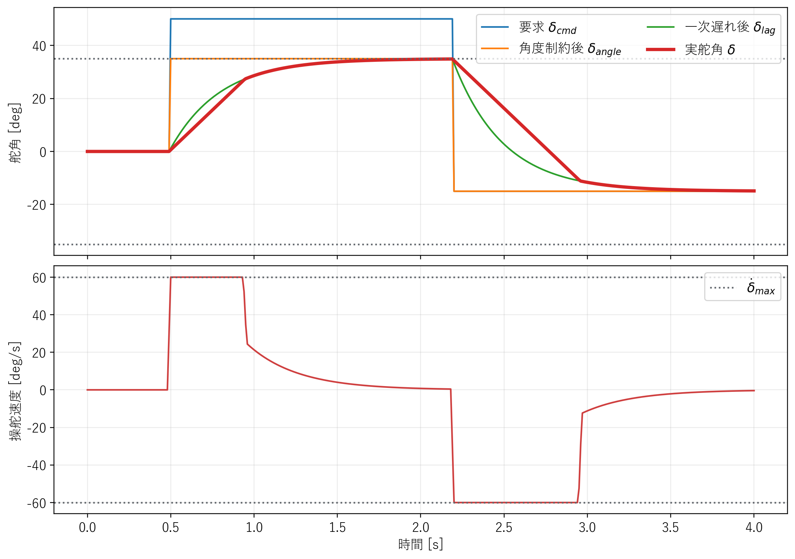

# 操舵制約と操舵一次遅れ

## 1. この文書の目的

制御器が計算する要求舵角と、車両が実際に実現する舵角の違いを説明します。本実装は最大舵角、最大操舵速度、一次遅れを一つの`SteeringActuator`で扱います。

## 2. 要求舵角と実舵角

制御器が出す値を要求舵角$\delta_{\mathrm{cmd},k}$、車両モデルへ渡す値を実舵角$\delta_k$とします。理想操舵では、

<a id="act-eq-01"></a>
**理論ID：`ACT-EQ-01`**

<a id="act-eq-01"></a>

**理論ID：`ACT-EQ-01`**

<a id="act-eq-01"></a>

**理論ID：`ACT-EQ-01`**

<a id="act-eq-01"></a>

**理論ID：`ACT-EQ-01`**

$$
\delta_k=\delta_{\mathrm{cmd},k}
\tag{1}
$$

です。しかし、実際の操舵機構には動作範囲と応答速度の限界があります。



**図1　操舵アクチュエータの処理順序と対応する数式**

図1は、要求舵角が式 (2) の角度制約、式 (3)～式 (5) の一次遅れ、式 (6)～式 (8) の操舵速度制約を順に通り、実舵角になる流れを示します。

## 3. 最大舵角

左右の最大舵角を$\delta_{\max}$とすると、実現可能範囲へ収めた目標値は、

<a id="act-eq-02"></a>
**理論ID：`ACT-EQ-02`**

<a id="act-eq-02"></a>

**理論ID：`ACT-EQ-02`**

<a id="act-eq-02"></a>

**理論ID：`ACT-EQ-02`**

<a id="act-eq-02"></a>

**理論ID：`ACT-EQ-02`**

$$
\delta_{\mathrm{angle},k}=\operatorname{clamp}\left(\delta_{\mathrm{cmd},k},-\delta_{\max},\delta_{\max}\right)
\tag{2}
$$

です。本実験では$\delta_{\max}=35\ \mathrm{deg}$とします。

## 4. 一次遅れの導出

実舵角は、現在値と目標値の差が大きいほど速く変化し、目標へ近づくほど変化が小さくなると仮定します。

<a id="act-eq-03"></a>
**理論ID：`ACT-EQ-03`**

<a id="act-eq-03"></a>

**理論ID：`ACT-EQ-03`**

<a id="act-eq-03"></a>

**理論ID：`ACT-EQ-03`**

<a id="act-eq-03"></a>

**理論ID：`ACT-EQ-03`**

$$
\frac{d\delta(t)}{dt}=\frac{\delta_{\mathrm{angle}}(t)-\delta(t)}{\tau_\delta}
\tag{3}
$$

$\tau_\delta$は時定数で、大きいほど応答が遅くなります。式 (3) の両辺へ$\tau_\delta$を掛けると、

<a id="act-eq-04"></a>
**理論ID：`ACT-EQ-04`**

<a id="act-eq-04"></a>

**理論ID：`ACT-EQ-04`**

<a id="act-eq-04"></a>

**理論ID：`ACT-EQ-04`**

<a id="act-eq-04"></a>

**理論ID：`ACT-EQ-04`**

$$
\tau_\delta\frac{d\delta(t)}{dt}+\delta(t)=\delta_{\mathrm{angle}}(t)
\tag{4}
$$

になります。1周期中の目標値が一定とみなし式 (4) を解くと、次周期の候補舵角は、

<a id="act-eq-05"></a>
**理論ID：`ACT-EQ-05`**

<a id="act-eq-05"></a>

**理論ID：`ACT-EQ-05`**

<a id="act-eq-05"></a>

**理論ID：`ACT-EQ-05`**

<a id="act-eq-05"></a>

**理論ID：`ACT-EQ-05`**

$$
\delta_{\mathrm{lag},k}=\delta_{k-1}+\left(1-e^{-\Delta t/\tau_\delta}\right)\left(\delta_{\mathrm{angle},k}-\delta_{k-1}\right)
\tag{5}
$$

となります。本実装では$\tau_\delta=0.3\ \mathrm{s}$です。厳密離散化を使うため、制御周期が大きくても目標値を数値的に飛び越えにくくなります。

## 5. 最大操舵速度

最大操舵速度を$\dot{\delta}_{\max}$、周期を$\Delta t$とすると、1周期で許される最大変化量は、

<a id="act-eq-06"></a>
**理論ID：`ACT-EQ-06`**

<a id="act-eq-06"></a>

**理論ID：`ACT-EQ-06`**

<a id="act-eq-06"></a>

**理論ID：`ACT-EQ-06`**

<a id="act-eq-06"></a>

**理論ID：`ACT-EQ-06`**

$$
\Delta\delta_{\max}=\dot{\delta}_{\max}\Delta t
\tag{6}
$$

です。一次遅れ後の要求変化量を、

<a id="act-eq-07"></a>
**理論ID：`ACT-EQ-07`**

<a id="act-eq-07"></a>

**理論ID：`ACT-EQ-07`**

<a id="act-eq-07"></a>

**理論ID：`ACT-EQ-07`**

<a id="act-eq-07"></a>

**理論ID：`ACT-EQ-07`**

$$
\Delta\delta_k=\delta_{\mathrm{lag},k}-\delta_{k-1}
\tag{7}
$$

と置き、式 (6) の範囲へ制限します。

<a id="act-eq-08"></a>
**理論ID：`ACT-EQ-08`**

<a id="act-eq-08"></a>

**理論ID：`ACT-EQ-08`**

<a id="act-eq-08"></a>

**理論ID：`ACT-EQ-08`**

<a id="act-eq-08"></a>

**理論ID：`ACT-EQ-08`**

$$
\delta_k=\delta_{k-1}+\operatorname{clamp}\left(\Delta\delta_k,-\Delta\delta_{\max},\Delta\delta_{\max}\right)
\tag{8}
$$

本実験では$\dot{\delta}_{\max}=60\ \mathrm{deg/s}$です。

## 6. 実装の処理順序

```text
要求舵角 → 最大舵角制約 → 一次遅れ → 最大操舵速度制約 → 実舵角
```

一次遅れを無効にした場合は$\delta_{\mathrm{lag},k}=\delta_{\mathrm{angle},k}$として扱います。各制約は設定で独立に無効化できます。



**図2　要求舵角から実舵角までの時系列変化と操舵速度**

図2上段は$\delta_{\mathrm{cmd}}$、$\delta_{\mathrm{angle}}$、$\delta_{\mathrm{lag}}$、実舵角$\delta$を比較します。下段は$\dot\delta$と$\dot\delta_{\max}$を示し、どの期間に操舵速度制約が働くかを確認できます。

## 7. 数式とソースコードの対応

| 図・数式 | `src/actuators/steering_actuator.cpp`の処理 |
|---|---|
| 式 (1) | `ideal`設定 |
| 式 (2) | 最大舵角制約 |
| 式 (3)～式 (5) | 一次遅れ |
| 式 (6)～式 (8) | 最大操舵速度制約 |
| 図1 | 上記3処理の適用順序 |
| 図2 | 各段階の舵角と操舵速度の時系列応答 |

## 8. ログの読み方

- `requested_steering`：制御器が要求した舵角
- `applied_steering`：車両モデルへ入力した実舵角
- `steering_rate`：実舵角の変化速度
- `angle_limit_active`：最大舵角制約が働いた周期
- `rate_limit_active`：最大操舵速度制約が働いた周期

要求値と実現値を分けることで、追従誤差の原因が制御則か操舵機構かを調べられます。

実装関数、変数、単体テストとの対応は[全体トレーサビリティ](../traceability.md#6-操舵アクチュエータ)を参照してください。
