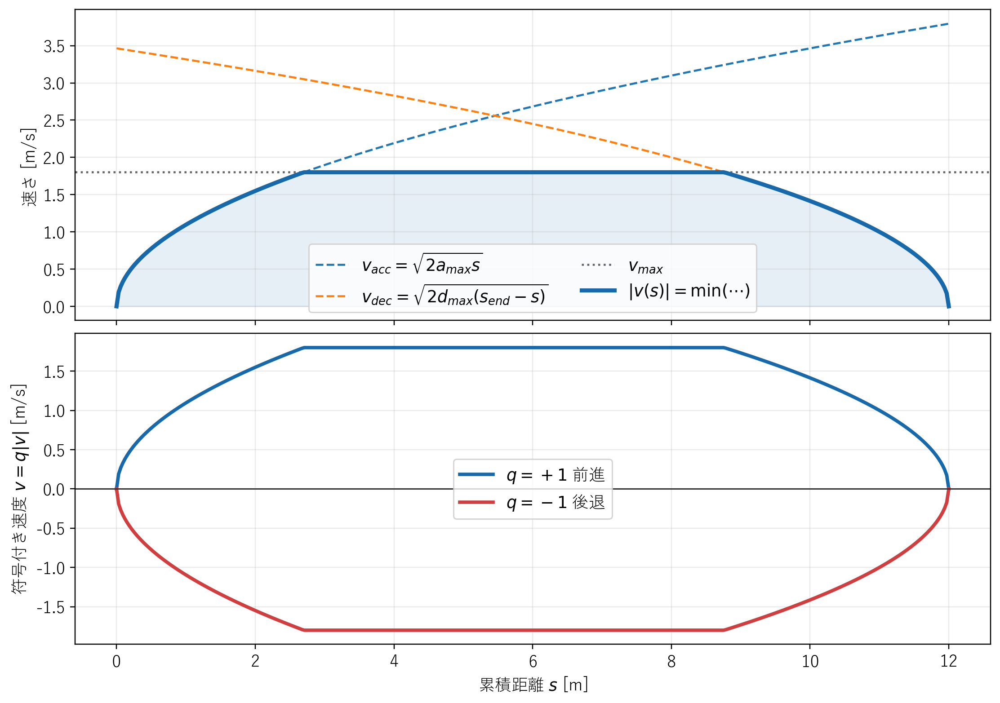
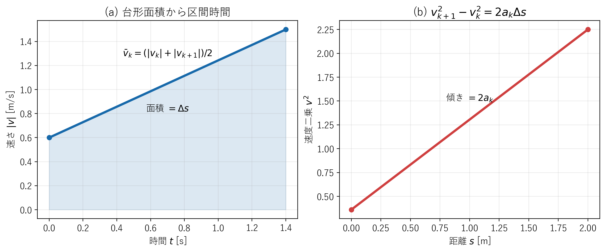

# 目標軌道生成

## 1. この章の目的

目標経路へ時刻、速度、加速度を加え、制御器が時刻ごとに参照できる目標軌道へ変換します。ここでは、始点と終点で停止し、加減速度と最高速度を守る速度プロファイルを導出します。

**図1　経路距離に対する加速・定速・減速の速度プロファイル**

図1上段には$v_{\mathrm{acc}}$、$v_{\mathrm{dec}}$、$v_{\max}$と、その最小値で決まる$|v(s)|$を表示します。下段は$q$を掛けた前進・後退の符号付き速度$v=q|v|$です。

## 2. 使用する記号

| 記号 | 意味 |
|---|---|
| $s$ | 経路始点からの距離 [m] |
| $v$ | 符号付き速度 [m/s] |
| $a$ | 符号付き加速度 [m/s²] |
| $v_{\max}$ | 最高速度の大きさ [m/s] |
| $a_{\max}$ | 加速度上限の大きさ [m/s²] |
| $d_{\max}$ | 減速度上限の大きさ [m/s²] |
| $q$ | 前進は $+1$、後退は $-1$ |

## 3. 時間を消去して速度と距離を結ぶ

加速度は速度の時間変化なので式 (1)、速度は距離の時間変化なので式 (2) で定義されます。

**理論ID：`TRAJ-EQ-01`**

**理論ID：`TRAJ-EQ-01`**

**理論ID：`TRAJ-EQ-01`**

**理論ID：`TRAJ-EQ-01`**

$$
a=\frac{dv}{dt}
\tag{1}
$$

**理論ID：`TRAJ-EQ-02`**

**理論ID：`TRAJ-EQ-02`**

**理論ID：`TRAJ-EQ-02`**

**理論ID：`TRAJ-EQ-02`**

$$
v=\frac{ds}{dt}
\tag{2}
$$

速度を距離 $s$ の関数と考えると、連鎖律により $dv/dt$ を二つの微分へ分けられます。式 (2) も代入すると式 (3) です。

**理論ID：`TRAJ-EQ-03`**

**理論ID：`TRAJ-EQ-03`**

**理論ID：`TRAJ-EQ-03`**

**理論ID：`TRAJ-EQ-03`**

$$
a=\frac{dv}{dt}
=\frac{dv}{ds}\frac{ds}{dt}
=v\frac{dv}{ds}
\tag{3}
$$

式 (3) の両辺へ $ds$ を掛け、変数を左右へ分けます。

**理論ID：`TRAJ-EQ-04`**

**理論ID：`TRAJ-EQ-04`**

**理論ID：`TRAJ-EQ-04`**

**理論ID：`TRAJ-EQ-04`**

$$
a\,ds=v\,dv
\tag{4}
$$

区間内で加速度 $a$ が一定と仮定し、左辺を $s_k$ から $s_{k+1}$、右辺を $v_k$ から $v_{k+1}$ まで積分します。

**理論ID：`TRAJ-EQ-05`**

**理論ID：`TRAJ-EQ-05`**

**理論ID：`TRAJ-EQ-05`**

**理論ID：`TRAJ-EQ-05`**

$$
\int_{s_k}^{s_{k+1}}a\,ds
=\int_{v_k}^{v_{k+1}}v\,dv
\tag{5}
$$

式 (5) の積分を計算します。$\Delta s=s_{k+1}-s_k$ とすると式 (6) です。

**理論ID：`TRAJ-EQ-06`**

**理論ID：`TRAJ-EQ-06`**

**理論ID：`TRAJ-EQ-06`**

**理論ID：`TRAJ-EQ-06`**

$$
a\Delta s=\frac{v_{k+1}^2-v_k^2}{2}
\tag{6}
$$

式 (6) の両辺を2倍して整理すると、速度・加速度・距離の基本関係である式 (7) を得ます。

**理論ID：`TRAJ-EQ-07`**

**理論ID：`TRAJ-EQ-07`**

**理論ID：`TRAJ-EQ-07`**

**理論ID：`TRAJ-EQ-07`**

$$
v_{k+1}^{2}=v_k^{2}+2a\Delta s
\tag{7}
$$

## 4. 始点側の加速制限

始点速度をゼロ、始点から現在点までの距離を $s$、加速度を $a_{\max}$ として式 (7) へ代入します。

**理論ID：`TRAJ-EQ-08`**

**理論ID：`TRAJ-EQ-08`**

**理論ID：`TRAJ-EQ-08`**

**理論ID：`TRAJ-EQ-08`**

$$
v_{mathrm{acc}}^2=0^2+2a_{\max}s
\tag{8}
$$

速度の大きさは負にならないため、式 (8) の正の平方根を取り、式 (9) を得ます。

**理論ID：`TRAJ-EQ-09`**

**理論ID：`TRAJ-EQ-09`**

**理論ID：`TRAJ-EQ-09`**

**理論ID：`TRAJ-EQ-09`**

$$
v_{\mathrm{acc}}(s)=\sqrt{2a_{\max}s}
\tag{9}
$$

式 (9) より、始点近くでは速度を低くしないと加速度上限を超えることが分かります。

## 5. 終点側の減速制限

現在速度から終点速度ゼロまで、残距離 $s_{\mathrm{end}}-s$ で減速する状況を考えます。進行方向に対する加速度は $-d_{\max}$ なので、式 (7) は式 (10) になります。

**理論ID：`TRAJ-EQ-10`**

**理論ID：`TRAJ-EQ-10`**

**理論ID：`TRAJ-EQ-10`**

**理論ID：`TRAJ-EQ-10`**

$$
0^2=v_{mathrm{dec}}^2-2d_{\max}(s_{\mathrm{end}}-s)
\tag{10}
$$

式 (10) を $v_{\mathrm{dec}}$ について解くと式 (11) です。

**理論ID：`TRAJ-EQ-11`**

**理論ID：`TRAJ-EQ-11`**

**理論ID：`TRAJ-EQ-11`**

**理論ID：`TRAJ-EQ-11`**

$$
v_{\mathrm{dec}}(s)
=\sqrt{2d_{\max}(s_{\mathrm{end}}-s)}
\tag{11}
$$

## 6. 各地点の速度を決める

各地点では、最高速度、始点から加速可能な速度、終点までに停止可能な速度の三条件を同時に守る必要があります。最も厳しい上限を選ぶため、速度の大きさを式 (12) で決めます。

**理論ID：`TRAJ-EQ-12`**

**理論ID：`TRAJ-EQ-12`**

**理論ID：`TRAJ-EQ-12`**

**理論ID：`TRAJ-EQ-12`**

$$
|v(s)|=\min\left(
v_{\max},
v_{\mathrm{acc}}(s),
v_{\mathrm{dec}}(s)
\right)
\tag{12}
$$

前進と後退の符号を付けると、最終的な速度は式 (13) です。

**理論ID：`TRAJ-EQ-13`**

**理論ID：`TRAJ-EQ-13`**

**理論ID：`TRAJ-EQ-13`**

**理論ID：`TRAJ-EQ-13`**

$$
v(s)=q|v(s)|
\tag{13}
$$

## 7. 経路点へ時刻を割り当てる

**図2　区間平均速度と速度二乗・距離関係の幾何学的解釈**

図2(a)の速度–時間線図の台形面積が$\Delta s$です。図2(b)では$v^2$–$s$線図の傾きが$2a_k$となり、式 (16) の意味を視覚化しています。

隣り合う点の間では速度が直線的に変化すると仮定します。このとき区間平均速度の大きさは式 (14) です。

**理論ID：`TRAJ-EQ-14`**

**理論ID：`TRAJ-EQ-14`**

**理論ID：`TRAJ-EQ-14`**

**理論ID：`TRAJ-EQ-14`**

$$
\bar v_k=\frac{|v_k|+|v_{k+1}|}{2}
\tag{14}
$$

距離は「速さ×時間」なので、時間は「距離÷速さ」です。式 (14) を使うと式 (15) を得ます。

**理論ID：`TRAJ-EQ-15`**

**理論ID：`TRAJ-EQ-15`**

**理論ID：`TRAJ-EQ-15`**

**理論ID：`TRAJ-EQ-15`**

$$
\Delta t_k
=\frac{\Delta s}{\bar v_k}
=\frac{2\Delta s}{|v_k|+|v_{k+1}|}
\tag{15}
$$

各区間の時間を順番に足せば、各経路点の時刻になります。

## 8. ログへ保存する加速度

式 (7) を加速度について解きます。まず両辺から $v_k^2$ を引き、次に $2\Delta s$ で割ると式 (16) です。

**理論ID：`TRAJ-EQ-16`**

**理論ID：`TRAJ-EQ-16`**

**理論ID：`TRAJ-EQ-16`**

**理論ID：`TRAJ-EQ-16`**

$$
a_k=\frac{v_{k+1}^{2}-v_k^{2}}{2\Delta s}
\tag{16}
$$

本実装では前進・後退方向の符号を明示するため、式 (16) へ $q$ を掛けた式 (17) を保存します。

**理論ID：`TRAJ-EQ-17`**

**理論ID：`TRAJ-EQ-17`**

**理論ID：`TRAJ-EQ-17`**

**理論ID：`TRAJ-EQ-17`**

$$
a_k=q\frac{v_{k+1}^{2}-v_k^{2}}{2\Delta s}
\tag{17}
$$

## 9. 実装との対応

式 (9)、式 (11) から候補速度を求め、式 (12)、式 (13) で速度を決定する処理は `src/trajectory/velocity_profile.cpp` にあります。同じファイルで式 (15) による時刻と式 (17) による加速度も計算します。

## 10. 初心者向け確認ポイント

- 短い経路では最高速度へ到達せず、三角形の速度波形になります。
- 長い経路では最高速度を保つ区間ができ、台形の速度波形になります。
- 後退では速度が負になりますが、所要時間の計算には速さ $|v|$ を使います。

実装関数、変数、検証先との対応は[全体トレーサビリティ](../traceability.md#4-経路軌道生成)を参照してください。
