# 非線形車両モデルに基づく軌道追従最適制御

## LTV-LQRとiLQRの理論・図解・MATLAB実装

**対象：方式① 目標軌道周り1回のLTV-LQR／方式② 予測基準軌道周り1回のLTV-LQR／方式③ 予測基準軌道周りiLQR**  
**最終更新：2026年10月18日｜日本語技術解説・教材／MATLAB R2019a**

> 利用上の注意：本書の図は概念図。実装は数値検証用であり、実車制御の安全性や制約順守を保証しません。

**目次**：第1章 目的と全体像／第2章 モデルと線形化／第3章 共通リカッチ再帰／第4章 方式①／第5章 方式②／第6章 方式③／第7章 比較／第8章 実装／付録A

---
# 第1章　目的・問題設定・3方式の全体像

## 1.1 本書の目的

本書は、非線形車両モデルを用いた有限ホライズンの軌道追従制御について、次の3方式を**同一の数式・重み・検証モデル**で理解し、MATLAB R2019aからC++へ実装する準備を整えるための技術ノートである。

1. **方式①：目標軌道周りで一度線形化し、LTV-LQRを1回解く**
2. **方式②：予測基準軌道周りで一度線形化し、LTV-LQRを1回解く**
3. **方式③：予測基準軌道を反復更新し、iLQRで非線形問題を改善する**

本書の「1回」は、**1つの固定した線形二次問題に対する後退計算1回**を意味する。MPCを毎制御周期で再実行することとは異なる。また、①②の解が厳密なのは**線形化して固定したLTV問題について**であり、元の非線形問題についてではない。

## 1.2 図で捉える3つの軌道

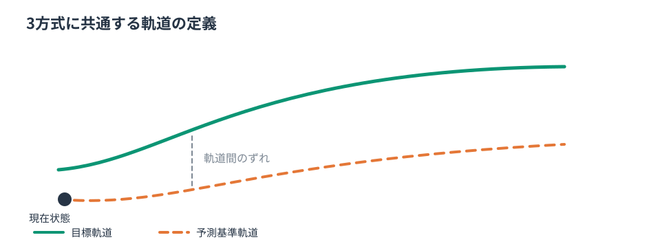

- **目標軌道** $X^{\mathrm{ref}}$：上位計画器等から与えられる、追従したい状態系列。
- **予測基準軌道** $\bar X$：仮入力 $\bar U$ を非線形モデルに与え、現在状態から生成した状態系列。**線形化の計算基準**。
- **最適化後の予測軌道** $X^*$：最適入力候補をモデルへ入力して得る予測系列。線形モデルの予測と非線形モデルによる再予測は区別する。

軌道上の点に対して線形化するとき、実際に評価するのは状態だけでなく、同時刻の**入力** $u_k$ も必要である。位置だけの経路曲線は、状態・入力系列がそろった「モデル整合的な軌道」と必ずしも同じではない。


## 1.3 制御周期と予測インデックスの区別

- $t$：実際のMPC制御周期。計測・目標系列の受信・再最適化が発生する。
- $k=0,1,\ldots,N$：周期 $t$ におけるホライズン内部の予測インデックス。
- $T_s$：予測モデルの離散化周期。制御周期と異なる場合は、前周期解のシフトに補間や時間合わせが必要。

厳密には $x_{k|t}$ と表せるが、以後、**1制御周期の説明中は $|t$ を省略**する。毎周期、$X^{\mathrm{ref}}$, $U^{\mathrm{ref}}$, $x_0$, および必要に応じて $A_k,B_k$ を更新する。

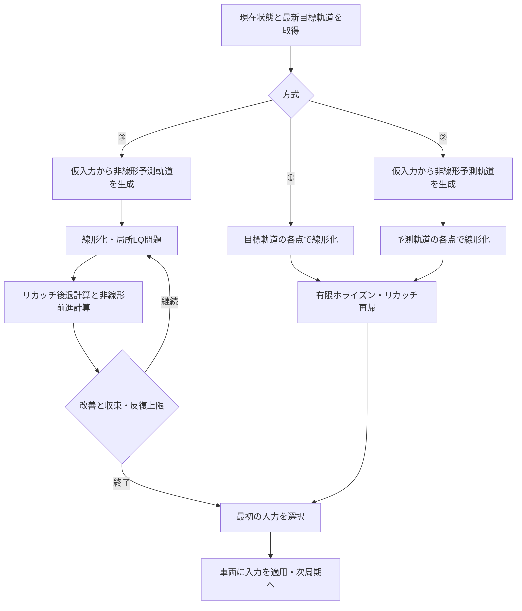

## 1.4 3方式の関係：2つの設計軸

| 設計軸 | ① | ② | ③ |
|---|---|---|---|
| 線形化基準 | 目標状態・目標入力 | 仮入力の非線形ロールアウト | 更新中の非線形ロールアウト |
| 局所LQ問題の求解回数 | 1 | 1 | 反復ごとに1 |
| モデル整合的な基準軌道の準備 | 目標生成方法による | 通常あり | 通常あり |
| 目標追従の目的関数 | 共通 | 共通 | 共通 |
| 元の非線形問題の局所最適性 | 保証なし | 保証なし | 条件・収束状況に依存 |

**線形化する軌道は計算のため、目標軌道は追従のため**、という役割を変えないことが本書全体の原則である。

## 1.5 想定範囲と、扱わない保証

離散時間モデル、状態 $x\in\mathbb R^{n_x}$、入力 $u\in\mathbb R^{n_u}$、有限ホライズン $N$、二次コストを想定する。①②は不等式制約なしの凸LQ問題、③は元の非線形問題への局所的な反復最適化を対象とする。

- 実車の舵角・舵角速度・加速度の限界は物理的に存在する。**ソルバが「制約なし」であることは、制御対象に制約が存在しないことを意味しない**。
- 局所LQ問題の一意解、非線形最適制御の収束、閉ループ安定性・追従精度、実時間実行保証は、それぞれ別の検証事項。
- 図は特記がなければ**概念図**。制御性能に関する優劣を図形の見た目だけから結論づけない。

### 第1章の確認事項

- [ ] 目標軌道・線形化基準軌道・最適化後の予測軌道を区別できる。
- [ ] 1周期1回のリカッチ再帰と、iLQRの同一周期内の反復を区別できる。
- [ ] ①②③は同じ元の非線形最適制御問題に対する異なる解法戦略だと説明できる。


---

# 第2章　非線形モデル・線形化・モデル整合性

## 2.1 統一する状態方程式と評価関数

非線形離散時間状態方程式を

$$
\boxed{x_{k+1}=f_k(x_k,u_k)}\tag{2.1}
$$

と置く。$f_k$ の時変性には車速の既知予測系列、路面パラメータ、モデル係数などを含めてもよい。$k$ の依存を落とした $f_d$ という表記も同義とする。

全方式で同じ追従コストを最小化する：

$$
\boxed{\begin{aligned}
J=&\sum_{k=0}^{N-1}\left[\tfrac12(x_k-x_k^{\rm ref})^TQ_k(x_k-x_k^{\rm ref})
+\tfrac12(u_k-u_k^{\rm ref})^TR_k(u_k-u_k^{\rm ref})\right]\\
&+\tfrac12(x_N-x_N^{\rm ref})^TQ_f(x_N-x_N^{\rm ref}).
\end{aligned}}\tag{2.2}
$$

ここでは $Q_k,Q_f\succeq0$, $R_k\succ0$ とする。**$\tfrac12$ をすべての二次項に付ける**記法で統一する（リカッチ再帰の係数2の取り違えを防ぐ）。

## 2.2 目標軌道の「モデル整合性」は何を意味するか

指定された**目標状態・目標入力の組**が、状態方程式を満たす条件は

$$
\boxed{x_{k+1}^{\rm ref}=f_k(x_k^{\rm ref},u_k^{\rm ref})}\tag{2.3}
$$

である。1ステップ残差を

$$
\boxed{d_k^{\rm target}=f_k(x_k^{\rm ref},u_k^{\rm ref})-x_{k+1}^{\rm ref}}\tag{2.4}
$$

と定義すれば、**使用した同じ離散モデルと同じ外部パラメータに対して** $d_k^{\rm target}=0$ が整合条件である。

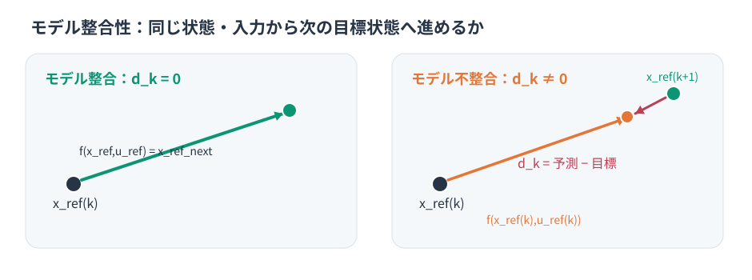

実務の診断では、状態の単位差を補正した $\|D^{-1}d_k^{\rm target}\|$ や、状態ごとの閾値で判定する。$\psi$ のような角度状態はラップ処理に注意する。連続時間モデルに整合していても、使用した離散化が異なれば $d_k$ が残ることがある。

> **目標入力が存在しない場合**：$x_k^{\rm ref}$ だけから (2.3) を直接検査することはできない。逆モデルで実現可能な $u_k^{\rm ref}$ を探すか、$\min_u\|f_k(x_k^{\rm ref},u)-x_{k+1}^{\rm ref}\|$ の最小残差を調べる。ただし物理入力制約を無視してよいわけではない。

## 2.3 一般の線形化点とアフィン近似

線形化に使う基準状態・基準入力を $(\bar x_k,\bar u_k)$ とする。一次テイラー展開により

$$
\begin{aligned}
A_k&=\left.\frac{\partial f_k}{\partial x}\right|_{\bar x_k,\bar u_k},\qquad
B_k=\left.\frac{\partial f_k}{\partial u}\right|_{\bar x_k,\bar u_k},\\
x_{k+1}&\approx f_k(\bar x_k,\bar u_k)+A_k(x_k-\bar x_k)+B_k(u_k-\bar u_k).
\end{aligned}\tag{2.5}
$$

絶対座標なら $x_{k+1}\approx A_kx_k+B_ku_k+c_k$、ただし

$$
\boxed{c_k=f_k(\bar x_k,\bar u_k)-A_k\bar x_k-B_k\bar u_k.}\tag{2.6}
$$

**非線形モデルの線形化によって得るのは一般には「アフィン」モデル**である。$c_k$ を不注意に省略してはならない。

## 2.4 偏差座標を2つに分ける

### A. 線形化基準に対する偏差

$z_k=x_k-\bar x_k$, $v_k=u_k-\bar u_k$ と置くと、

$$
\boxed{z_{k+1}=A_kz_k+B_kv_k+\bar d_k,\quad
\bar d_k=f_k(\bar x_k,\bar u_k)-\bar x_{k+1}.}\tag{2.7}
$$

現在状態から同じ非線形モデルで $\bar x_{k+1}=f_k(\bar x_k,\bar u_k)$ と**厳密にロールアウトした基準軌道**なら $\bar d_k=0$。これは**その基準点でのオフセット**が消えたというだけで、非線形化誤差全体が消えたわけではない。

### B. 目標軌道に対する偏差

$e_k=x_k-x_k^{\rm ref}$, $w_k=u_k-u_k^{\rm ref}$ と置けば、**任意の線形化点**について

$$
\boxed{e_{k+1}=A_ke_k+B_kw_k+d_k^{\rm ref|nom},}\tag{2.8}
$$

$$
\boxed{\begin{aligned}
d_k^{\rm ref|nom}={}&f_k(\bar x_k,\bar u_k)
+A_k(x_k^{\rm ref}-\bar x_k)\\
&+B_k(u_k^{\rm ref}-\bar u_k)-x_{k+1}^{\rm ref}.
\end{aligned}}\tag{2.9}
$$

**線形化点＝目標点**とすれば (2.9) は (2.4) と一致する。**線形化点≠目標点**のときは、単純な $f_k(x_k^{\rm ref},u_k^{\rm ref})-x_{k+1}^{\rm ref}$ を線形化モデルのアフィン項にそのまま使わないこと。

## 2.5 $d_k$ と非線形化剰余の違い

実際の非線形モデルを目標偏差で正確に書けば

$$
e_{k+1}=A_ke_k+B_kw_k+d_k^{\rm ref|nom}+\mathcal R_k,
$$

$\mathcal R_k$ はヤコビアンの一次近似で落とした2次以上の項である。$f_k$ の二階微分が局所有界なら、概ね

$$
\|\mathcal R_k\|\le C_k\bigl\|[x_k-\bar x_k;\ u_k-\bar u_k]\bigr\|^2
$$

という評価が成り立つ（ノルムと領域の選択に依存）。

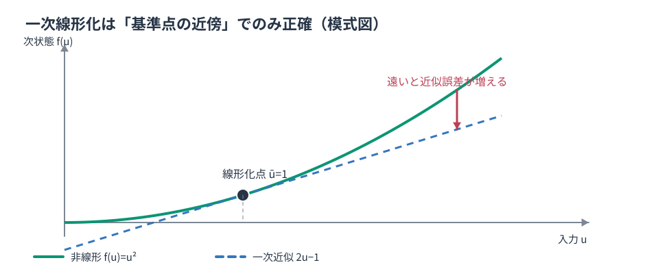

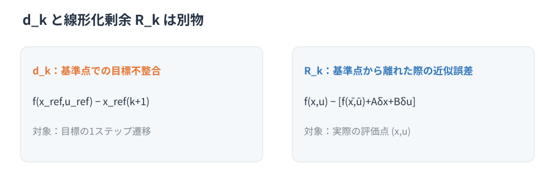

**$d_k$ の計算はモデル不整合に対する処置であって、線形化点から遠く離れた際の非線形近似精度を保証しない。**

## 2.6 線形化基準と追従目標が異なるときのコスト一次項

目標状態誤差は

$$x_k-x_k^{\rm ref}=z_k+(\bar x_k-x_k^{\rm ref}).$$

この式を (2.2) へ代入すると、$z_k$ の一次項が生じる：

$$
\tfrac12\|z_k+a_k\|_{Q_k}^2
=\tfrac12 z_k^TQ_kz_k+(Q_ka_k)^Tz_k+\mathrm{const},
\quad a_k=\bar x_k-x_k^{\rm ref}.\tag{2.10}
$$

入力も $u_k-u_k^{\rm ref}=v_k+(\bar u_k-u_k^{\rm ref})$ なので、入力の一次項が生じる。終端も同様。

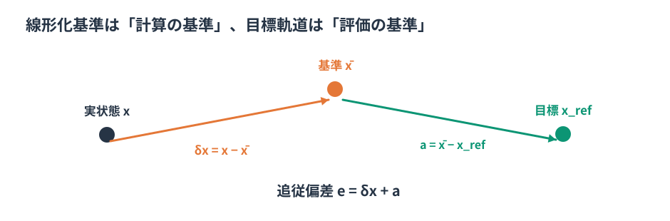

代わりに (2.8) の目標偏差 $e_k,w_k$ を用いれば、(2.2) のコスト一次項は消えるが、状態方程式にアフィン項 (2.9) が残る。**どちらの偏差座標も数学的に同等**である。後の章では各方式の説明が明瞭になる方を選ぶ。

## 2.7 離散化と線形化の順番

- 連続時間 $\dot x=f_c(x,u)$ を直接離散化して得た $f_k$ を微分すれば、**離散時間モデルの厳密な（その数値積分器に対する）ヤコビアン**を得られる。
- 先に $A_c,B_c$ を求めてから適切に離散化する方法もある。前進Eulerなら $A_d\approx I+T_sA_c$, $B_d\approx T_sB_c$ だが、一般の高次積分器やZOHの線形化と完全には一致しない。
- 車速を外生入力とする場合、各 $k$ の車速予測値を**非線形ロールアウトとヤコビアンで統一**する。

### 第2章の確認事項

- [ ] $d_k^{\rm target}$ と $d_k^{\rm ref|nom}$ の定義と違いが説明できる。
- [ ] 基準軌道のオフセット $\bar d_k=0$ と非線形剰余 $\mathcal R_k=0$ を混同しない。
- [ ] 基準座標ではコスト一次項、目標座標ではアフィン項が現れる理由が説明できる。


---

# 第3章　共通ソルバ：有限ホライズン・アフィンLTV-LQR

## 3.1 3方式から独立した共通問題

本章では**線形化点の選び方とは独立に使える**ソルバを導出する。未知の偏差状態を $z_k\in\mathbb R^{n_x}$、未知の入力補正を $v_k\in\mathbb R^{n_u}$ とする。

$$
\boxed{z_{k+1}=A_kz_k+B_kv_k+d_k,\qquad z_0\ \text{既知}}\tag{3.1}
$$

一般の二次ステージコスト（交差項も許す）を

$$
\boxed{\begin{aligned}
\ell_k(z,v)={}&\tfrac12z^TQ_kz+z^TC_kv+\tfrac12v^TR_kv\\
&+q_k^Tz+r_k^Tv+c_k,\\
\ell_N(z_N)={}&\tfrac12z_N^TQ_fz_N+q_f^Tz_N+c_f.
\end{aligned}}\tag{3.2}
$$

とする。3方式で主に使う追従コストでは通常 $C_k=0$、$Q_k,Q_f\succeq0$, $R_k\succ0$。一般に交差項 $C_k\ne0$ を入れる場合には**ステージHessian**

$$\begin{bmatrix}Q_k&C_k\\C_k^T&R_k\end{bmatrix}\succeq0$$

など、全体の凸性を保証する条件を確認する。行列 $W_k$ の正定値もチェックする。

## 3.2 なぜこの一般形を選ぶのか

| 方式 | 偏差変数 $z,v$ | $d_k$ | $q_k,r_k$ |
|---|---|---|---|
| ① 目標軌道周り | $z=x-x^{ref},\ v=u-u^{ref}$ | 目標モデル不整合 $(2.4)$ | 0 |
| ② 予測基準軌道周り | $z=x-\bar x,\ v=u-\bar u$ | 0（モデル整合ロールアウト） | $Q(\bar x-x^{ref}),\ R(\bar u-u^{ref})$ |
| ③ iLQRの各反復 | ②と同じ（その反復の基準） | 0 | 同じ定義を反復更新 |

つまり、**同じリカッチソルバへ与える $A,B,d,Q,R,q,r,q_f,z_0$ を変えればよい**。座標を揃えれば①②の理論的な目的関数は同じである。

## 3.3 Bellmanの最適性原理と価値関数

時刻 $k$ の状態 $z_k=z$ から終端までの最小コストを $V_k(z)$ とすると、

$$
V_k(z)=\min_v\{\ell_k(z,v)+V_{k+1}(A_kz+B_kv+d_k)\}.\tag{3.3}
$$

将来のコストを二次関数として

$$
\boxed{V_k(z)=\tfrac12z^TP_kz+p_k^Tz+s_k}\tag{3.4}
$$

と仮定する。終端条件は

$$
\boxed{P_N=Q_f,\quad p_N=q_f,\quad s_N=c_f.}\tag{3.5}
$$

$P_k$ は将来コストの二次項、$p_k$ は一次項、$s_k$ は定数項を表す。**最適入力を求めるだけなら $s_k$ は不要**。

## 3.4 1ステップの最小化を展開する

(3.3) に (3.2) と (3.4) を代入し、$v$ に依存する項だけをまとめる。$P_{k+1}$ と $p_{k+1}$ を既知とすると、

$$
\begin{aligned}
W_k&=R_k+B_k^TP_{k+1}B_k,\\
F_k&=C_k^T+B_k^TP_{k+1}A_k,\\
g_k&=r_k+B_k^T(P_{k+1}d_k+p_{k+1}).
\end{aligned}\tag{3.6}
$$

すると $v$ に関する目的関数は

$$\tfrac12v^TW_kv+v^T(F_kz+g_k)+\mathrm{const}$$

となる。$W_k\succ0$ のもとで入力勾配をゼロとすれば、

$$
\boxed{W_kv_k^*+F_kz_k+g_k=0}\tag{3.7}
$$

である。したがって、

$$
\boxed{v_k^*=-K_kz_k-\ell_k^{ff},\quad
K_k=W_k^{-1}F_k,\quad \ell_k^{ff}=W_k^{-1}g_k.}\tag{3.8}
$$

この章の $\ell_k^{ff}$ は**入力のフィードフォワード補正ベクトル**であり、ステージコスト $\ell_k(z,v)$ とは文脈で区別する。実装コードでは `ell` を使用する。

> 数式中の $W^{-1}$ は関係を示す記法。MATLAB/C++では $W_kK_k=F_k$, $W_k\ell_k^{ff}=g_k$ を**Cholesky分解などの連立一次方程式ソルバ**で解く。逆行列を明示的に作らない。

## 3.5 アフィン・リカッチ再帰（完全形）

(3.8) を価値関数へ代入すると、

$$
\boxed{\begin{aligned}
P_k={}&Q_k+A_k^TP_{k+1}A_k-F_k^TK_k,\\
p_k={}&q_k+A_k^T(P_{k+1}d_k+p_{k+1})-F_k^T\ell_k^{ff}.
\end{aligned}}\tag{3.9}
$$

となる。交差項 $C_k=0$、線形項 $q_k=r_k=0$、アフィン項 $d_k=0$ のとき、通常の有限ホライズン・リカッチ差分方程式へ戻る。

**後退計算（Backward Pass）**：$P_N,p_N$ から始め、$k=N-1,N-2,\ldots,0$ の順に (3.6) → (3.8) → (3.9) を計算。

**前進計算（Forward Pass）**：与えられた $z_0$ から、

$$
\boxed{v_k^*=-K_kz_k-\ell_k^{ff},\qquad
z_{k+1}=A_kz_k+B_kv_k^*+d_k}\tag{3.10}
$$

の順で入力・状態を計算する。

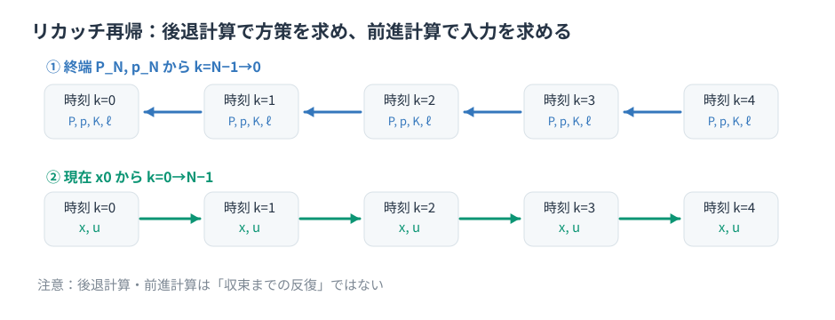

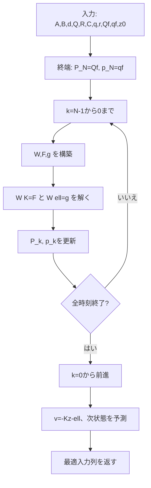

## 3.6 数値例：連立一次方程式法と同じ解

$N=2$, $x_{k+1}=x_k+u_k$, $x_0=1$ とし、

$$J=\tfrac12(x_1^2+x_2^2+u_0^2+u_1^2)$$

を最小化する。$Q=R=Q_f=1$ として $\tfrac12x_0^2$ を追加しても入力の最適解は変わらない。

終端 $P_2=1$ から、

$$W_1=2,\ K_1=\tfrac12,\ P_1=1.5;\qquad
W_0=2.5,\ K_0=0.6.$$

前進すると $u_0=-0.6$, $x_1=0.4$, $u_1=-0.2$, $x_2=0.2$。一方、Condensed QPでは

$$
\begin{bmatrix}3&1\\1&2\end{bmatrix}\begin{bmatrix}u_0\\u_1\end{bmatrix}
=\begin{bmatrix}-2\\-1\end{bmatrix},
$$

となり、同一の $U^*=[-0.6,-0.2]^T$ が得られる。

## 3.7 正定値性・最適解の一意性

交差項のない追従型LQでは、入力系列だけにまとめたHessianが

$$\boxed{H=G^T\bar QG+\bar R.}\tag{3.11}$$

$\bar Q\succeq0$, $\bar R\succ0$ なら $H\succ0$、すなわち**固定されたLTV近似問題の入力系列の最適解は一意**。$d_k$ や目標の変化は線形項や定数項を変えるが、この条件下で正定値性を失わせない。

一般交差項を含む場合は、単に $R\succ0$ だけで十分とは限らないため、全体の凸性と $W_k\succ0$ を別途確認する。

## 3.8 ほかの数値解法とリカッチ再帰

| 方法 | 数学的操作 | 実装上の特徴 |
|---|---|---|
| Condensed QP＋Cholesky | $HU=b$ を $H=LL^T$ として解く | 小規模な問題の検証基準に適する。密な $H$ は $Nn_u$ 次元 |
| 最小二乗＋QR | $\min\|MU-y\|^2$ をQRで解く | 正規方程式より悪条件に強い傾向 |
| Sparse KKT＋LDLᵀ | 状態・入力と等式条件を残して解く | 疎構造利用、汎用拡張性がある |
| リカッチ再帰 | 時間構造を使った後退・前進計算 | 状態・入力次元固定時、演算量は $N$ にほぼ線形 |
| 反復線形ソルバ | CG等で連立一次方程式を解く | 精度・反復回数と計算時間の関係に注意 |

密なCondensed HessianをCholesky分解する演算量は典型的に $O((Nn_u)^3)$。リカッチ再帰は**状態・入力次元を固定すれば** $O(N)$。ただし小さい $N$ では実測比較が必要。リカッチ再帰の内部でも $W_k$ のCholesky分解を使用できるため、両者は排他的ではない。

## 3.9 DAREと有限ホライズン終端重み

無限ホライズンLTI-LQRの定常価値関数 $P_\infty$ は、離散時間代数リカッチ方程式（DARE）の安定化解である。有限ホライズンで

$$\boxed{P_N=Q_f=P_\infty}\tag{3.12}$$

と選ぶと、**LTI・同じ $Q,R$・ゼロ基準の制約なし問題**では、すべての $P_k=P_\infty$ となる。一方、LTVでは通常、終端以降を一定の $(A_f,B_f)$ で近似するなどの仮定が必要であり、追従の一次項まで無限ホライズンと一致するとは限らない。


## 3.10 解の求解と閉ループの安定性は別

固定した凸LQ問題は後退計算1回で解ける。しかし次の3つは別問題である。

1. **ソルバの最適性**：同じLTV問題のCondensed QP解と一致するか。
2. **非線形モデルとの近似誤差**：$X^{\rm LTV}$ と $X^{\rm NL}$ は一致するか。
3. **閉ループ性能・安定性**：MPCを繰り返したとき、実際の追従偏差や入力が適切か。

$W_k$ が正定値でも、実装の浮動小数点誤差・悪条件に対する検査は必要。さらに物理制約の無視、アクチュエータ遅れ、モデル誤差に対する保証は別途評価する。

### 第3章の確認事項

- [ ] (3.1)〜(3.10) の記号・行列次元が一致している。
- [ ] 各方式の $d,q,r,q_f,z_0$ を本章の共通ソルバに渡せる。
- [ ] DAREは無限ホライズンの価値関数であり、有限ホライズンでは終端重みとして**利用**することを区別できる。


---

# 第4章　方式①：目標軌道周り・1回のLTV-LQR

## 4.1 方式①の考え方

線形化基準を**目標状態・目標入力そのもの**に固定してLTVモデルを作る。各予測ステップで別々のヤコビアンを使うが、局所LQ最適化は1回だけ解く。

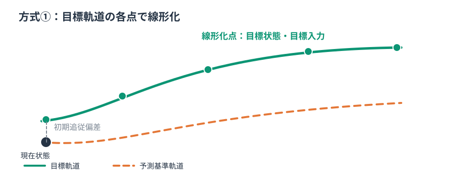

この方法が「最適化後の実際の予測軌道と目標軌道がほぼ一致する」と期待できる状況では、局所近似も良好になりやすい。ただし**目標軌道が動的に実現可能であることは、線形化そのものの必須条件ではない**。

## 4.2 入力と前提

1制御周期で受け取るもの：現在状態 $x_0=x_{\rm meas}$、目標状態 $X^{ref}$（$N+1$ 点）、目標入力 $U^{ref}$（$N$ 点）、各ステップの外生予測（車速等）、$Q_k,R_k,Q_f$。もし目標入力がないなら、逆モデルやFF設計によって別途用意する。適当に0と置けば目的関数・整合性残差の意味も変わる。

## 4.3 線形化とアフィン項の計算

$(\bar x_k,\bar u_k)=(x_k^{ref},u_k^{ref})$ と置き、

$$
\begin{aligned}
A_k&=\left.\partial f_k/\partial x\right|_{x_k^{ref},u_k^{ref}},\\
B_k&=\left.\partial f_k/\partial u\right|_{x_k^{ref},u_k^{ref}},\\
d_k&=f_k(x_k^{ref},u_k^{ref})-x_{k+1}^{ref}.
\end{aligned}\tag{4.1}
$$

重要なのは、**各軌道点で別の $A_k,B_k,d_k$ を計算するが、各点を独立に最適化するわけではない**という点である。すべての行列系列を1つの有限ホライズン問題に渡す。

## 4.4 偏差モデル・評価関数

$$e_k=x_k-x_k^{ref},\qquad w_k=u_k-u_k^{ref}.$$

$$
\boxed{e_{k+1}=A_ke_k+B_kw_k+d_k.}\tag{4.2}
$$

コストは

$$
J=\sum_{k=0}^{N-1}\left(\tfrac12e_k^TQ_ke_k+\tfrac12w_k^TR_kw_k\right)+\tfrac12e_N^TQ_fe_N.\tag{4.3}
$$

第3章の共通ソルバに与える係数は：

| パラメータ | 方式① |
|---|---|
| $z_0$ | $x_{\rm meas}-x_0^{ref}$ |
| $A_k,B_k$ | 目標軌道上のヤコビアン |
| $d_k$ | (4.1) |
| $q_k,r_k,q_f,C_k$ | すべて0 |
| $Q_k,R_k,Q_f$ | 共通の追従コスト重み |

したがって、後退計算から $K_k,\ell_k^{ff}$ を求め、

$$
\boxed{u_k^*=u_k^{ref}-K_ke_k-\ell_k^{ff}.}\tag{4.4}
$$

$\ell_k^{ff}$ は $d_k$ の将来影響から計算される。**$d_k=0$ が全時刻で成り立ち、コストに線形項がなければ $\ell_k^{ff}=0$** であり、$u_k^{ref}$ 自身が名目FF入力となる。

## 4.5 1制御周期の演算フロー

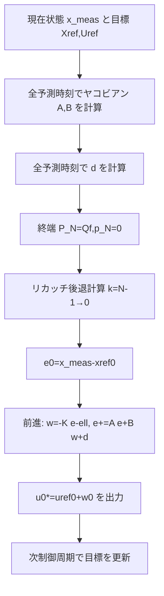

最初の入力のみ必要なら $u_0^*$ は後退計算と $e_0$ から直ちに求まる。全予測入力は前進計算で求められる。非線形モデルでの再予測は、**局所LTV最適化の内部反復ではなく、検証・次周期の初期化**として区別する。

## 4.6 モデル整合性が良い／悪い場合


- $d_k=0$：目標状態・入力が使用したモデルで実現できる。**ただし現在状態が目標から遠い場合の線形化誤差は別**。
- $d_k\ne0$：目標入力で次の目標状態へは厳密に遷移できない。$d_k$ を含むアフィンLTV-LQRとして数学的に整合して解ける。
- $d_k$ を入れても、基準点から離れたときのモデル剰余 $\mathcal R_k$ は補償されない。
- 目標状態・入力の組が大きく不整合なら、$u_k^*$ が $u_k^{ref}$ から離れ、線形化精度がさらに悪くなる可能性がある。

## 4.7 メリット・デメリット

**メリット**：仮入力の非線形ロールアウトが不要、線形化点と追従目標が直感的に対応する、モデル整合時は式が簡単、性能評価の基準方式として適する。

**デメリット**：初期追従偏差が大きいと線形化点が最適化後の予測軌道から遠い場合がある。目標入力の品質に依存し、$d_k$ を入れても局所線形化誤差を抑えられるわけではない。

## 4.8 MATLAB実装に対応する処理

コード：[`matlab/method1_target_ltv.m`](matlab/method1_target_ltv.m)。特に次の定義を確認する。

```matlab
[A(:,:,k), B(:,:,k)] = linearize_fd( ...
    Xref(:,k), Uref(:,k), speed(k), Ts, L);
d(:,k) = vehicle_fd(Xref(:,k), Uref(:,k), speed(k), Ts, L) ...
         - Xref(:,k+1);

% 共通ソルバへ z0=xMeas-Xref(:,1), q=r=qf=0 を渡す
% 出力 Uopt=Uref+V
```

検証項目：$\max_k\|d_k\|$、線形化モデルと非線形ロールアウトの差、非線形追従コスト、最大舵角、最悪実行時間。

### 第4章の確認事項

- [ ] $d_k\ne0$ でも1回のアフィンLTV-LQRが成立することを説明できる。
- [ ] $\ell_k^{ff}$ が $d_k$ から生じる理由が説明できる。
- [ ] 目標上の線形化は「現実の車両が必ず目標近傍にいる」という仮定を**数学的に要求しない**が、その近さが近似精度に関わると説明できる。


---

# 第5章　方式②：予測基準軌道周り・1回のLTV-LQR

## 5.1 方式②の考え方

目標軌道ではなく、**現在状態から仮入力を非線形モデルへ与えて生成した軌道**を線形化基準とする。この基準軌道は、元モデルに対してステップごとに整合している。ただし**追従対象はあくまで目標軌道**である。

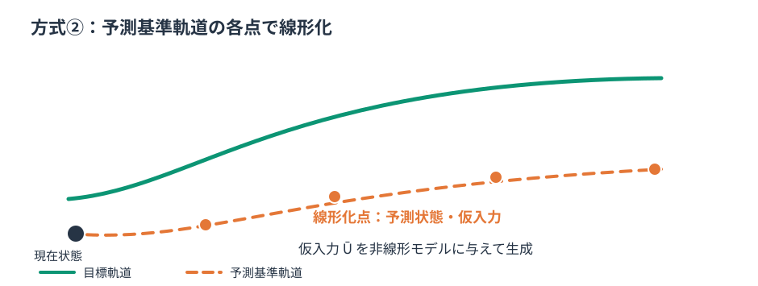

## 5.2 仮入力系列とウォームスタート

仮入力列 $\bar U=[\bar u_0,\dots,\bar u_{N-1}]$ を作る代表例：

| 初期化方式 | 考え方 | 主な注意点 |
|---|---|---|
| 前周期最適解のシフト | $[u_1^{*(t-1)},\ldots,u_{N-1}^{*(t-1)},u_{N-1}^{*(t-1)}]$ | 目標急変・初回には適さないことがある |
| 目標入力列 | $\bar U=U^{ref}$ | FF入力の精度・モデル整合性に依存 |
| 既存FB/FFの予測 | 既存ステア制御器を仮実行 | 実装・予測の追加負担 |
| 現入力維持・ゼロ入力 | シンプルな初期列 | 急旋回では不適切になり得る |

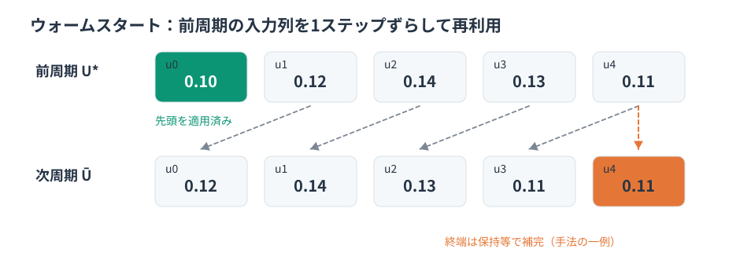

ウォームスタートは**リカッチ再帰に初期解を与える処理ではなく、線形化基準を初期化する処理**である。リカッチ再帰そのものは固定LTV問題の直接的な後退計算であり、初期値を反復的に改善する方式ではない。

制御周期と予測周期が異なる場合は時間に基づき入力系列を補間する。前周期の解を次周期で流用できるかは、目標・車速・状態推定・入力制約との整合を確認する。

## 5.3 非線形モデルによるForward Rollout

$$
\boxed{\bar x_0=x_{\rm meas},\qquad
\bar x_{k+1}=f_k(\bar x_k,\bar u_k).}\tag{5.1}
$$

この式を $k=0,\ldots,N-1$ で実行する。

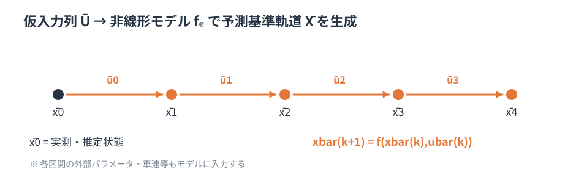

したがって、**基準軌道偏差 $z_k=x_k-\bar x_k$ について**

$$z_{k+1}=A_kz_k+B_kv_k,\qquad v_k=u_k-\bar u_k,\tag{5.2}$$

であり、モデル整合的ロールアウトによって $\bar d_k=0$ になる。ただし $z_0=x_{\rm meas}-\bar x_0=0$ となるのは、ここで $\bar x_0=x_{\rm meas}$ を使った場合に限る。

## 5.4 各予測点で線形化

$$
\boxed{A_k=\left.\frac{\partial f_k}{\partial x}\right|_{\bar x_k,\bar u_k},\quad
B_k=\left.\frac{\partial f_k}{\partial u}\right|_{\bar x_k,\bar u_k}.}\tag{5.3}
$$

$k$ の外部予測条件もロールアウトと統一する。**「ロールアウトしてモデル整合したから、最適化後の入力でも非線形化誤差はゼロ」という推論は誤り**である。最適化後の $U^*$ は $\bar U$ と異なるためである。

## 5.5 目標とのずれは評価関数の一次項に入る

$z=x-\bar x$, $v=u-\bar u$ に置き換えると、ステージコストは

$$\begin{aligned}
\ell_k(z,v)=&\ \tfrac12 z^TQ_kz+q_k^Tz
+\tfrac12 v^TR_kv+r_k^Tv+\mathrm{const},\\
q_k=&\ Q_k(\bar x_k-x_k^{ref}),\\
r_k=&\ R_k(\bar u_k-u_k^{ref}),\\
q_f=&\ Q_f(\bar x_N-x_N^{ref}).
\end{aligned}\tag{5.4}$$


**一次項 $q,r$ を落とすと**基準軌道への偏差だけを小さくする別問題になり、元の目標追従コストとは一致しない。

## 5.6 共通リカッチソルバによる1回の求解

第3章のソルバへ

$$
\boxed{d_k=0,\quad z_0=0,\quad
q_k=Q_k(\bar x_k-x_k^{ref}),\quad r_k=R_k(\bar u_k-u_k^{ref})}\tag{5.5}
$$

と (5.4) の終端 $q_f$ を渡す。$A,B,Q,R,Q_f$ は方式①と同じ形式で扱う。

後退計算で得た $K_k,\ell_k^{ff}$ を用いて、

$$
\boxed{u_k^*=\bar u_k-K_kz_k-\ell_k^{ff},\qquad
z_{k+1}=A_kz_k+B_k(u_k^*-\bar u_k).}\tag{5.6}
$$

を前進計算する。**この1回の結果は、基準軌道の線形化に基づくLQ問題の厳密解**である。

元の非線形モデルで同じ $U^*$ をロールアウトして $X^{NL}$ を求め、$X^{LTV}=\bar X+Z$ と比較する。非線形再予測は採用判断の診断であり、方式②では**同じ制御周期内の再線形化はしない**。

## 5.7 1制御周期のフロー

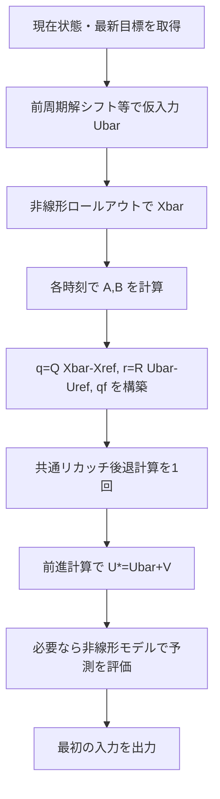

※ フローチャート内の `q=Q Xbar-Xref` 等は省略表記。厳密には (5.4) の行列積 $Q_k(\bar x_k-x_k^{ref})$ に従う。

## 5.8 メリット・デメリットと注意点

**メリット**：現在状態と仮入力から将来挙動を予測して線形化でき、目標から大きく外れた状況でモデル近似が改善する可能性がある。前周期解を使いやすく、方式③の初期反復にも接続しやすい。

**デメリット**：仮入力系列生成・非線形ロールアウトが増える。仮入力が悪いと不適切な場所で線形化し得る。予測基準が目標から離れるとコスト一次項を正確に扱う必要がある。さらに、**局所LQの最適入力で再ロールアウトすると基準軌道から遠ざかることもある**。

制御性能について、**方式②が方式①より常に優れるという定理はない**。どちらも最終的に求めたい非線形最適入力の近傍で精度良く近似できた場合に有効である。

## 5.9 MATLAB実装に対応する処理

コード：[`matlab/method2_nominal_ltv.m`](matlab/method2_nominal_ltv.m)。重要な部分は

```matlab
Xbar = rollout_fd(xMeas, Ubar, speed, Ts, L);
% 各kで (Xbar(:,k),Ubar(:,k)) のヤコビアンを計算
q(:,k) = Q*(Xbar(:,k)-Xref(:,k));
r(:,k) = R*(Ubar(:,k)-Uref(:,k));
qf = Qf*(Xbar(:,N+1)-Xref(:,N+1));
% d = 0; z0 = 0;
% 共通ソルバで V を解く -> Uopt = Ubar + V
```

### 第5章の確認事項

- [ ] ウォームスタートは基準系列の初期化であり、リカッチ再帰の反復ではない。
- [ ] $\bar d=0$ と $q,r,q_f\ne0$ が矛盾しないことを説明できる。
- [ ] 最適化後の $U^*$ を元の非線形モデルで検証する必要性を説明できる。


---

# 第6章　方式③：予測基準軌道周り・iLQR

## 6.1 方式②から③への拡張

方式②で求めた入力は、**1つの基準軌道周りの局所LQ問題の厳密解**にすぎない。得た最適入力が基準入力と大きく異なると、一次線形化の精度が下がる。そこで、

1. 新たな入力で**非線形**状態方程式を再計算
2. 更新されたモデル整合的な軌道で再線形化
3. リカッチ型後退計算で次の入力修正則を求める

という改善を繰り返すのがiLQR（iterative LQR）である。

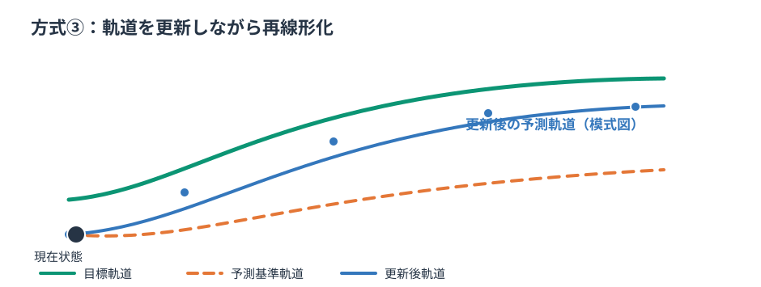

目標軌道は**コストの目標として固定**できる。一方、線形化基準軌道は反復 $i$ ごとに $\bar X^{(i)}$ と変化する。

## 6.2 iLQRが解こうとする元の問題

$$
\boxed{\min_{U}J(U),\qquad x_{k+1}=f_k(x_k,u_k),\quad x_0=x_{\rm meas}}\tag{6.1}
$$

コスト $J$ は第2章の (2.2) と**同じ非線形ロールアウトによる追従コスト**。線形モデルで評価したコストではない点が重要。

非線形問題全体は一般に非凸で、iLQRの反復が到達するのは通常**局所的な停留点・局所最適解の候補**である。非線形システムでは大域最適性・収束成功を無条件に保証できない。

## 6.3 基準軌道の初期化

前周期の最適入力をシフトする、目標入力を初期値にする、既存FF/FB入力を予測するなどして $\bar U^{(0)}$ を作り、

$$\bar x_0^{(0)}=x_{\rm meas},\quad
\bar x_{k+1}^{(0)}=f_k(\bar x_k^{(0)},\bar u_k^{(0)})$$

で初期基準軌道を生成する。ウォームスタートの利点は、前周期と同様の条件で**良好な初期軌道を期待できること**であり、良い局所解への収束を保証することではない。

## 6.4 Gauss-Newton型の局所LQ近似

反復 $i$ の基準軌道に沿って $A_k^{(i)},B_k^{(i)}$ を求める。基準軌道は非線形モデルでロールアウトしたので、

$$\delta x_{k+1}=A_k^{(i)}\delta x_k+B_k^{(i)}\delta u_k$$

であり、基準軌道に対するアフィン項はゼロ（ただし**一次線形化近似**）。

コストを $(\bar x,\bar u)$ 周りで二次展開し、第5章と同じ $q_k,r_k,q_f$ を構築する。通常のiLQRはモデルの2階微分を無視するGauss-Newton型近似で、フルDDPはモデルの2階微分に由来する項まで扱う。iLQR・Gauss-Newton LQRの具体的な命名や正則化方法は実装・文献によって異なる。

## 6.5 Backward Pass：局所フィードバック修正則

共通リカッチ再帰を使い、

$$
\boxed{\delta u_k=-K_k\delta x_k-\ell_k^{ff}}\tag{6.2}
$$

を求める。通常の軌道最適化実装では $-\ell_k^{ff}$ を**フィードフォワード探索方向**、$-K_k$ を**フィードバック補正**として利用する。

注意：ここで得られるのは更新された非線形最適解そのものではなく、局所LQ近似に基づく改善候補である。

## 6.6 Forward Pass：非線形モデルで試行軌道を生成

ステップ幅 $\alpha\in(0,1]$ に対し、現在状態から非線形モデルで試行軌道を生成する。

$$
\boxed{\begin{aligned}
u_k^{trial}&=\bar u_k-\alpha\ell_k^{ff}
-K_k(x_k^{trial}-\bar x_k),\\
x_{k+1}^{trial}&=f_k(x_k^{trial},u_k^{trial}).
\end{aligned}}\tag{6.3}
$$

**元の非線形評価関数** $J(U^{trial})$ を計算し、受理条件を満たせば $\bar U\leftarrow U^{trial}$、$\bar X\leftarrow X^{trial}$ と更新する。

たとえばバックトラッキング：$\alpha=1,1/2,1/4,\ldots$ を試し、単純な受理条件 $J(U^{trial})<J(\bar U)$ を使う。実用アルゴリズムでは十分減少条件（Armijo）や正則化を用いることがある。

## 6.7 収束判定・停止判定・数値対策

| 判定 | 例 | 注意 |
|---|---|---|
| 相対コスト改善 | $|J^{i+1}-J^i|/\max(1,|J^i|)<\varepsilon_J$ | 小改善だけでは最適性を保証しない |
| フィードフォワード修正量 | $\max_k\|\ell_k^{ff}\|_\infty<\varepsilon_u$ | スケール正規化が必要 |
| 最適性残差 | $\|\nabla_UJ\|_\infty<\varepsilon_g$ | 非凸問題の停留点は必ず局所最小ではない |
| 受理できるステップなし | ラインサーチ失敗 | 正則化・初期基準の更新などを検討 |
| 最大反復・時間制限 | $i=i_{max}$ または予算超過 | **収束ではなく打切り**として記録 |

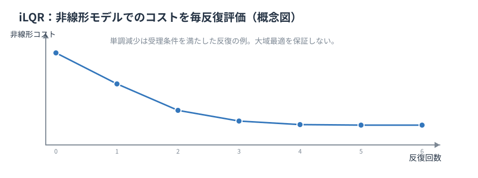

$\varepsilon$ は正規化・精度要求・数値条件に合わせて設定する。実車では最大反復だけでなく**試行ラインサーチ回数・モデル演算回数**も制限し、失敗時の安全な処理を定義する。

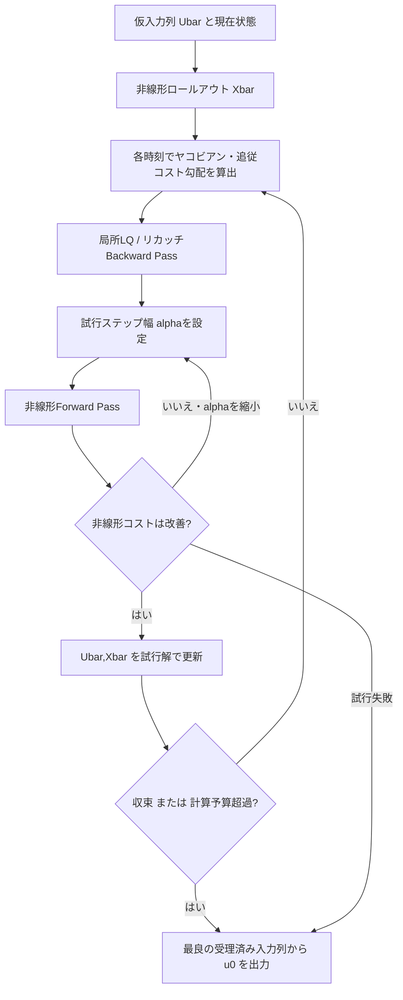

## 6.8 方式②との関係と重要な例外

**方式②＝iLQRの1回目と完全に同義、とは限らない。** 方式②では局所LQ解をそのまま最終候補として出力してもよい。一方、iLQRは最初の候補を**非線形コストで評価し、悪化すればステップを縮める／棄却する**。同じ初期基準でも、初回試行の全ステップが受理される場合に両者の入力が近くなる。

## 6.9 計算負荷と局所解への依存

iLQRの負荷は主に（非線形ロールアウト＋ヤコビアン生成＋リカッチ後退計算＋ラインサーチ試行）×反復回数から生じる。ウォームスタートが良いと反復が少なくなる可能性はあるが、最悪計算時間は別に評価する。

実開発でiLQRを採用する根拠は、方式①②と比べて**同じ非線形評価関数・同じ閉ループ評価条件で実質的な改善があること**、そしてリアルタイム計算予算と失敗時処理が両立できることである。

## 6.10 MATLAB実装に対応する処理

コード：[`matlab/method3_ilqr.m`](matlab/method3_ilqr.m)。各反復で第3章のソルバを呼び、$-\alpha\ell$ と $-K\delta x$ の両方を試行入力に加えて、**非線形**評価関数が減るか判定する。

この学習用サンプルは入力上下限制約を課さない。$\delta=\pm\pi/2$（操舵角のtan特異点）近傍へ入るケースや実際の物理飽和は、実車適用前に別途扱う必要がある。

### 第6章の確認事項

- [ ] iLQRで更新するのは目標軌道ではなく、線形化基準軌道である。
- [ ] Backward Passと非線形Forward Passの役割を区別できる。
- [ ] iLQR反復の終了・最大回数打切り・大域最適性を混同しない。


---

# 第7章　3方式の比較・採用判断・実験計画

## 7.1 3方式を公平に比較する前提

比較時は**同一の非線形状態方程式 $f_k$、同一の初期状態・目標状態／入力系列、同一のコスト (2.2)、同一の予測時間・演算環境**を使う。異なるのは基準軌道・反復回数・ステップ受理方式とする。


| 観点 | ① 目標周り1回 | ② 予測基準周り1回 | ③ iLQR |
|---|---|---|---|
| 線形化基準 | 目標状態・入力 | 前周期解等の非線形ロールアウト | 反復で更新した非線形ロールアウト |
| 名目軌道の準備 | 通常不要 | 必要 | 必要 |
| 各時刻のヤコビアン | 1系列 | 1系列 | 各反復で更新 |
| リカッチ後退計算 | 1回 | 1回 | 原則、反復ごと |
| 非線形評価関数での試行受理 | 必須ではない | 必須ではない | 通常行う |
| 得られる保証 | 固定LTVの一意解※ | 固定LTVの一意解※ | 非線形問題の局所候補 |
| 主な弱点 | 目標から離れた線形化 | 仮入力品質と一回近似 | 収束性と最悪演算時間 |

※ $Q_k,Q_f\succeq0,R_k\succ0$、交差項なしなど、第3章の凸性条件を満たす場合。

## 7.2 評価指標を3層に分ける

**A. 目標のモデル整合性**：

$$\eta_{dyn}=\max_k\|D^{-1}(f_k(x_k^{ref},u_k^{ref})-x_{k+1}^{ref})\|.\tag{7.1}$$

この指標は**目標生成器と制御用モデルの整合**を測るだけであり、線形化位置の優劣を直接示さない。

**B. 線形近似誤差**：同じ候補入力 $U^*$ を、LTVモデルと元の非線形モデルへ与える。

$$\eta_{lin}=\max_k\|D^{-1}(x_k^{NL}(U^*)-x_k^{LTV}(U^*))\|.\tag{7.2}$$

線形化精度を比較する。**候補入力系列が方式ごとに異なる**ことにも注意し、厳密なモデル比較には同一入力系列を両線形化モデルへ適用する実験を併用する。

**C. 非線形の目的関数と閉ループ応答**：

$$J_{NL}(U^*)=J\bigl(X^{NL}(U^*),U^*\bigr).\tag{7.3}$$

同じ非線形モデル・同じコストで比較。さらに閉ループシミュレーションでは横偏差・方位角誤差・舵角／舵角速度・振動・復帰時間を評価する。

**D. 計算資源・故障モード**：平均、最大、99.9パーセンタイルなどの演算時間と、行列分解失敗、ラインサーチ失敗、打切り率を確認する。統計上の最大値は正式なWCET保証と同じではない。

## 7.3 試験シナリオ

| 試験 | 目的 | 着目点 |
|---|---|---|
| S1：小追従偏差、滑らかな目標 | 基準性能 | ①の単純さ、②③の追加利益 |
| S2：大きな初期横偏差・方位差 | 線形化誤差 | ①の誤差と②③の改善 |
| S3：目標曲率急変 | ウォームスタートの劣化 | ②③の初期値感度 |
| S4：低速・大舵角 | 非線形性 | 局所近似とiLQR反復の価値 |
| S5：車速時変・モデル係数時変 | LTV特性 | 各 $k$ のモデル・ヤコビアン整合 |
| S6：入力・アクチュエータ応答にモデル差 | ロバスト性 | 予測性能と実際の追従性能を分離 |
| S7：不整合な目標入力列 | アフィン補正の検証 | $d_k$ と一次項の扱い |

初期状態・重み・参照は同一とし、各ケースの記録形式を固定する。**モデル整合性が良い条件だけで採用判断しない**。

## 7.4 ①→②→③の採用判断

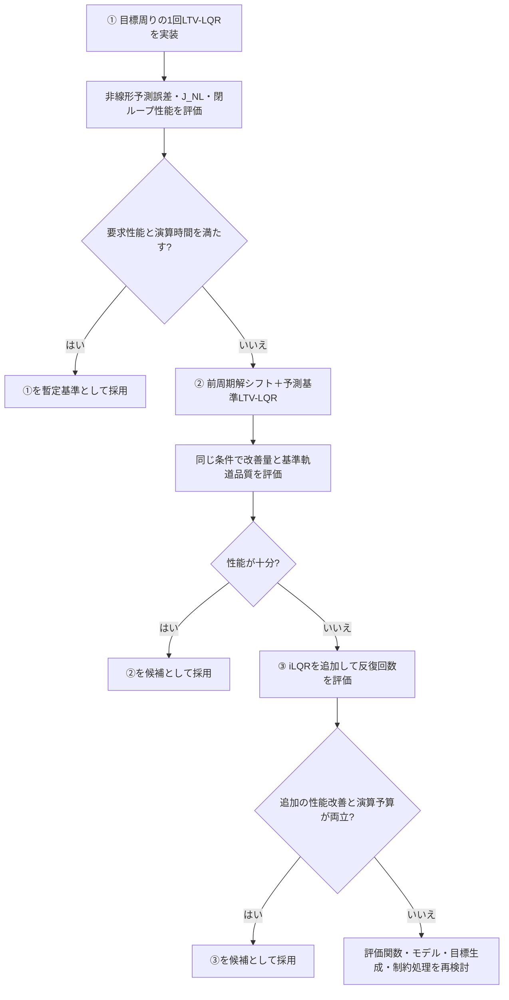

このフローは**検証の進め方**であり、①②の理論上の優劣関係を意味しない。方式②の仮入力が悪い場合には、方式①より悪化し得る。iLQRでラインサーチを行って改善を受理すれば、その反復で使った**同じ初期条件・非線形コスト**に対してはコストを単調に減らすよう設計できるが、大域的な最適性は保証されない。

## 7.5 感度解析と実装判断

結果表には少なくとも、$N$, $T_s$, $Q,R,Q_f$, 初期誤差、参照更新周期、数値積分器、モデルの詳細、線形化方式、反復上限、ラインサーチ試行上限、CPU/ECU条件を必ず残す。パラメータを変える際は、**単一因子を変えて差を見る**条件と、複合ストレス試験を区別する。

特に、非線形コストの差が小さい場合にiLQRの反復演算を追加する意味があるかは、閉ループ指標・演算予算・失敗率と合わせて判断する。

## 7.6 安定性と安全性の限界

- 最適入力の一意性は、安定性や制約順守を意味しない。
- 有限ホライズン・時変・非線形の安定性には、終端設計やLyapunov解析など追加仮定が必要。
- 実車では舵角・操舵速度・トルク・タイヤ摩擦・EPS遅れ等を無視できない。制約なし理論の検証後、**物理限界を反映した別設計**が必要。
- 不収束・演算超過・異常行列・目標欠損などのフォールバックは事前に定義する。

### 第7章の確認事項

- [ ] 3方式の非線形コストを同一条件で比較している。
- [ ] モデル整合性・線形化精度・閉ループ制御性能を別々に評価している。
- [ ] アルゴリズム計算時間の測定と正式な最悪時間保証を混同していない。


---

# 第8章　MATLAB実装・数値検証・C++移植への接続

## 8.1 実装の全体構成

本書には**MATLAB R2019a互換の学習・検証用スクリプト**を添付する。各方式で同じ非線形モデル、同じ評価関数、同じ共通リカッチソルバを使う。コードは簡単な車両運動モデルを対象とするもので、実車ECUへの適用を保証しない。

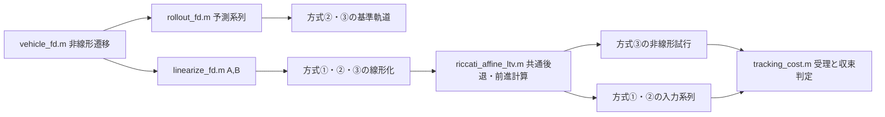

## 8.2 サンプル車両モデル

状態を $x=[y,\psi]^T$、入力を $u=\delta$、ホイールベースを $L$、既知の予測車速を $v_k$ とする。

$$
\boxed{\begin{aligned}
y_{k+1}&=y_k+T_sv_k\sin\psi_k,\\
\psi_{k+1}&=\psi_k+T_s\frac{v_k}{L}\tan\delta_k.
\end{aligned}}\tag{8.1}
$$

これは**説明用の簡易キネマティックモデル**であり、横すべり、タイヤ力、EPS遅れ、車速・舵角制約は含まない。制御で使う入力は前輪舵角と仮定する。実車の状態・入力定義とは区別する。

各基準点 $(\bar x_k,\bar u_k)$ での離散ヤコビアンは

$$
\boxed{
A_k=\begin{bmatrix}1&T_sv_k\cos\bar\psi_k\\0&1\end{bmatrix},\qquad
B_k=\begin{bmatrix}0\\T_sv_k/[L\cos^2\bar\delta_k]\end{bmatrix}.}\tag{8.2}
$$

$(8.1)$ の離散時間写像を直接微分しているため、使用した前進Eulerモデルに対して整合する。$\cos\delta=0$ ではモデルが特異になる。今回の**制約なし**の学習モデルは、大舵角の現実的な安全入力を保証しない。

## 8.3 添付ファイルの構成

```text
ltv_ilqr_guide/
├── README.md
├── 00_完全版.md             # 全章を結合した閲覧用
├── chapters/
│   ├── 01_overview.md
│   ├── 02_model_linearization.md
│   ├── 03_riccati_common.md
│   ├── 04_target_ltv.md
│   ├── 05_nominal_ltv.md
│   ├── 06_ilqr.md
│   ├── 07_comparison.md
│   └── 08_implementation.md
├── appendices/
│   └── A_math_validation.md
├── figures/                  # ベクトル図 SVG
└── matlab/
    ├── demo_three_methods.m
    ├── riccati_affine_ltv.m
    ├── method1_target_ltv.m
    ├── method2_nominal_ltv.m
    ├── method3_ilqr.m
    ├── vehicle_fd.m
    ├── linearize_fd.m
    ├── rollout_fd.m
    ├── tracking_cost.m
    └── test_riccati_vs_condensed.m
```

## 8.4 MATLAB R2019aでの実行手順

1. ZIPを展開する。
2. MATLABの現在のフォルダを `matlab` に移す（または `addpath` する）。
3. `test_riccati_vs_condensed` を実行し、一般形のリカッチ解とCondensed解の数値一致を確認する。
4. `demo_three_methods` を実行する。
5. 状態軌道、舵角系列、iLQR受理コスト履歴を比較する。

```matlab
cd('.../ltv_ilqr_guide/matlab');
test_riccati_vs_condensed;
demo_three_methods;
```

学習用コードでは `quadprog` に依存せず、MATLAB標準の行列演算を使う。`quadprog` を利用できる場合は、Condensed QPの $H,f$ を使って `quadprog(H,f,[],[],[],[],[],[],[])` と比較できる。

## 8.5 数式とMATLABソルバ引数の対応

| 数式 | MATLAB | 次元 |
|---|---|---|
| $A_k$ | `A(:,:,k)` | $n_x\times n_x$ |
| $B_k$ | `B(:,:,k)` | $n_x\times n_u$ |
| $d_k$ | `d(:,k)` | $n_x\times1$ |
| $Q_k,R_k$ | `Q(:,:,k)`, `R(:,:,k)` | $n_x^2$, $n_u^2$ |
| $C_k$ | `C(:,:,k)` | $n_x\times n_u$ |
| $q_k,r_k$ | `q(:,k)`,`r(:,k)` | $n_x, n_u$ |
| 終端 $Q_f,q_f$ | `Qf`,`qf` | $n_x\times n_x$, $n_x$ |
| $z_0$ | `z0` | $n_x$ |
| $K_k,\ell_k^{ff}$ | `sol.K(:,:,k)`, `sol.ell(:,k)` | $n_u\times n_x$, $n_u$ |

**配列インデックスの注意**：数学の $k=0$ はMATLABで `k=1`。終端 $P_N$ は `P(:,:,N+1)` に置く。実装コードの `ell` は**ff補正**であり、ステージコスト関数ではない。

## 8.6 最優先の数値試験：リカッチ vs. Condensed

完全に**同じ固定LTV問題**について、次を検証する。

$$\boxed{\|U_{\rm Riccati}-U_{\rm condensed}\|_\infty<\varepsilon_{num}.}\tag{8.3}$$

$\varepsilon_{num}$ は行列ノルム・条件数・浮動小数点精度に基づいて設定する。例えば倍精度かつ良条件なら $10^{-8}$ 程度を初期的な目標にできるが、一般保証値ではない。

検証では、$d_k\ne0$, $q_k\ne0$, $r_k\ne0$, $q_f\ne0$、可能なら $C_k\ne0$ のケースも含める。

**注意：方式①と方式②の最適入力が一致することは期待しない。** 同じ非線形問題を異なる点で一次近似するため、**異なるLTV問題**になっているからである。一致させるべきは、**各方式が構築した同一のLTV問題をリカッチと直接法で解いた結果**。

## 8.7 非線形ロールアウトの検証

各方式の入力系列 $U^*$ について、

1. 線形化LTVモデルによる $X^{LTV}(U^*)$。
2. 非線形写像 $f_k$ による $X^{NL}(U^*)$。
3. 目標 $X^{ref}$ と $U^{ref}$。

を保存する。非線形のコスト $J_{NL}(U^*)$、各状態ごとの最大偏差、演算時間を記録する。iLQRは受理済み反復の $J_{NL}$ 履歴・ステップ幅・終了理由を記録する。

## 8.8 実車向けへの段階的移行

- **段階1：MATLAB単体**：数式・線形化・直接法一致・反復履歴の検証。
- **段階2：Simulink連携**：状態推定・目標生成と同じ周期・遅れで接続し、閉ループ評価。
- **段階3：C++へ移植**：固定サイズ行列、事前メモリ確保、コレスキー失敗判定、演算回数上限などを実装。
- **段階4：SIL/HIL/ECU**：実行時間、例外的条件、安全側処理、操舵アクチュエータやモデル誤差を評価。

実車側で制約をモデル化する必要が生じた場合には、無制約ソルバの出力を単純飽和するだけでは性能保証が保てないことがある。制約付きQP・NMPCへの拡張は別設計とする。

### 第8章の確認事項

- [ ] 入出力配列の次元・ステップインデックス・$\tfrac12$ の規約が一貫している。
- [ ] 同じ固定LTV問題を二つの方法で解いて数値一致する。
- [ ] 元の非線形問題での評価と、線形化LQ解の一致を混同しない。
- [ ] モデルやソルバの異常時の対応を実車移植の必須項目としている。


---

# 付録A　数式・実装の検証シートと参考資料

## A.1 記号一覧（全章共通）

| 記号 | 意味 |
|---|---|
| $t$ / $k$ | 制御周期 / 周期内の予測時刻 |
| $N$ | 予測区間数。状態点は $N+1$、入力点は $N$ |
| $x_k,u_k$ | 物理状態、物理入力 |
| $x_k^{ref},u_k^{ref}$ | 追従目標の状態・入力 |
| $\bar x_k,\bar u_k$ | 線形化基準の状態・入力 |
| $e_k,w_k$ | 目標偏差 $x-x^{ref},\ u-u^{ref}$ |
| $z_k,v_k$ | 一般ソルバの偏差変数。②③では $x-\bar x,\ u-\bar u$ |
| $f_k$ | 使用する離散時間の非線形モデル |
| $A_k,B_k$ | $f_k$ の線形化ヤコビアン |
| $\bar d_k$ | 基準偏差のモデル不整合：$f_k(\bar x,\bar u)-\bar x^+$ |
| $d_k^{target}$ | 目標点におけるモデル残差：$f_k(x^{ref},u^{ref})-x^{ref,+}$ |
| $d_k^{ref|nom}$ | 一般線形化点を目標偏差座標で書いたときのアフィン項（第2章） |
| $d_k$ | 一般ソルバに渡す偏差モデルのアフィン項（第3章） |
| $q_k,r_k,q_f$ | 一般二次評価関数の一次項係数 |
| $C_k$ | 状態偏差と入力偏差の交差項係数 |
| $P_k,p_k$ | 価値関数の二次・一次係数 |
| $W_k,F_k,g_k$ | リカッチ更新に使う補助行列・ベクトル |
| $K_k,\ell_k^{ff}$ | 最適フィードバックゲイン・FF補正ベクトル |
| $J_{NL}$ | 非線形ロールアウトした状態に対する元の追従評価関数 |

## A.2 座標変換による等価性を確認する

一般の絶対座標の線形近似は

$$x_{k+1}\approx A_kx_k+B_ku_k+c_k,\quad
c_k=f_k(\bar x_k,\bar u_k)-A_k\bar x_k-B_k\bar u_k.$$

目標偏差へ変換すると

$$
\begin{aligned}
e_{k+1}&=x_{k+1}-x_{k+1}^{ref}\\
&=A_ke_k+B_kw_k
+\underbrace{(A_kx_k^{ref}+B_ku_k^{ref}+c_k-x_{k+1}^{ref})}_{d_k^{ref|nom}}.
\end{aligned}
$$

この形と、第2章(2.9) は同じ。一方、基準偏差に変換すると

$$z_{k+1}=A_kz_k+B_kv_k+\bar d_k.$$

目標偏差と基準偏差は $e_k=z_k+\bar x_k-x_k^{ref}$ で結ばれる。どちらの座標で解いても**元の物理入力 $u_k$ に正しく戻せば、同一の線形近似問題の同一解**になる（同じ $A,B,c$ を使うことが条件）。

## A.3 リカッチ再帰の導出の最短確認

$V_{k+1}(z^+)=\tfrac12z^{+T}P_{k+1}z^++p_{k+1}^Tz^++s_{k+1}$ とおく。$z^+=Az+Bv+d$ を代入し、入力 $v$ の二次・一次係数を集めると

$$\tfrac12v^T\underbrace{(R+B^TPB)}_Wv
+v^T\left[\underbrace{(C^T+B^TPA)}_Fz
+\underbrace{\{r+B^T(Pd+p)\}}_g\right]+\mathrm{const}.$$

$\partial/\partial v$ をゼロと置くと $Wv+Fz+g=0$。$W\succ0$ より唯一の最小点 $v^*=-W^{-1}Fz-W^{-1}g$。これを価値関数に代入し、$z$ の二次・一次係数を比較すると

$$P_k=Q+A^TPA-F^TW^{-1}F,$$
$$p_k=q+A^T(Pd+p)-F^TW^{-1}g.$$

ここで右辺の $P,p$ はすべて**時刻 $k+1$ の値**である。小添字の取り違えを避けるため、実装では `Pn = P(:,:,k+1)` とする。

## A.4 単位テスト：数値一致の検証

添付の `matlab/test_riccati_vs_condensed.m` は、ランダムだが固定seedのLTV問題を構築し、$d,q,r,q_f,C$ をゼロ以外にする。状態を消去した密Hessian $H$ と一次項 $f$ を独立に構築して

$$U_{direct}=-H\backslash f$$

を計算し、リカッチ再帰の $U_{riccati}$ と比べる。**この比較は元の非線形問題についてではなく、同一の線形アフィン・二次問題について行う**。

さらに推奨する追加試験：

1. $d=q=r=q_f=C=0$ の簡単な手計算と一致すること。
2. $Q_f=0$、$Q$ が半正定値、$R$ が正定値でも成功すること。
3. $R$ を極端に小さくして条件数が大きくなるケースを検査すること。
4. $C$ を増やして全体が非凸となる場合、正定値チェックに失敗し得ることを検査すること。
5. 状態の異なる単位に合わせたスケーリングを行った結果を確認すること。
6. 方式①・②の**それぞれ**が構築した線形問題を、直接法と比較すること。

## A.5 クロスチェック表（章間の整合条件）

| 不変条件 | 第2章 | 第3章 | 第4章 | 第5章 | 第6章 |
|---|---|---|---|---|---|
| 最適化の追従目標は $X^{ref},U^{ref}$ | 定義 | コストに反映 | 一致 | 一致 | 一致 |
| 目標周りなら $d_k=f(ref)-ref^+$ | (2.4) | 一般 $d$ | 使用 | 直接は使わない | 直接は使わない |
| 非線形モデル整合の基準偏差なら $\bar d=0$ | (2.7) | $d=0$ として扱う | 必須ではない | 成立 | 各反復で成立 |
| 目標と基準が異なればコスト一次項 | (2.10) | $q,r,q_f$ | 0 | 使用 | 各反復で使用 |
| 同一LQ問題の一意解（凸性条件付き） | — | 導出 | 1回 | 1回 | 各局所問題で1回 |
| 元の非線形問題への保証 | 剰余を定義 | 保証なし | 保証なし | 保証なし | 局所解を探索 |

## A.6 よくある誤解の訂正

**誤解1：「目標がモデル不整合なら目標周りでは線形化できない」**：線形化は可能。$d_k$ を残す必要がある。ただし線形化の精度・到達可能性は別問題。

**誤解2：「$d_k=0$ なら線形化誤差はゼロ」**：基準点でのオフセットがゼロなだけ。基準点から離れた非線形剰余は残る。

**誤解3：「予測基準上の線形化は必ず高精度」**：仮入力が不適切、または線形最適入力が仮入力から大きく離れれば誤差が大きくなり得る。

**誤解4：「Riccatiは反復最適化なので収束判定が必要」**：固定LTV問題の後退計算は時間インデックスに沿う有限の計算。反復最適化の収束判定は①②に存在せず、iLQR等で必要。

**誤解5：「iLQRの最初の1回は方式②の出力と常に同じ」**：局所LQの候補は一致し得るが、iLQRは非線形試行評価とステップ幅調整によって出力を変更し得る。

**誤解6：「DAREを使えばすべてのLTVゲインが固定になる」**：LTI・一定重み等で成立する性質を、一般のLTVには拡張できない。

## A.7 一次資料・発展学習（確認用リンク）

1. Stanford EE363, *Linear Quadratic Regulator: Discrete-Time Finite Horizon*（有限ホライズンLQR、動的計画法、時変・追従、非線形拡張）。https://ee363.stanford.edu/lectures/015_dlqr.pdf
2. MIT, Russ Tedrake, *Underactuated Robotics – Linear Quadratic Regulators*（有限ホライズン、軌道追従、離散リカッチ、最小二乗と制約との関係）。https://underactuated.mit.edu/lqr.html
3. MIT, *Underactuated Robotics – Trajectory Optimization*（iLQR、DDP、予測基準軌道に沿った線形化）。https://underactuated.mit.edu/trajopt.html
4. Drake, `FiniteHorizonLinearQuadraticRegulatorOptions`（線形化基準軌道 $x_0,u_0$ と目標軌道 $x_d,u_d$ を明確に分離）。https://drake.mit.edu/doxygen_cxx/structdrake_1_1systems_1_1controllers_1_1_finite_horizon_linear_quadratic_regulator_options.html
5. Drake, `FiniteHorizonLinearQuadraticRegulatorResult`（二次＋一次の価値関数とFF項を伴う制御則）。https://drake.mit.edu/doxygen_cxx/structdrake_1_1systems_1_1controllers_1_1_finite_horizon_linear_quadratic_regulator_result.html
6. acados Documentation（RTI、SQP、ウォームスタート、実時間非線形最適制御の実装設計）。https://docs.acados.org/

**参考資料の位置づけ**：本書の一般アフィン・離散時間リカッチ再帰は上記の理論と整合する形で独立に導出した。各節の記号や $\tfrac12$ 規約が文献と同一とは限らない。図は本書用に制作した概念図であり、論文図版の転載ではない。
